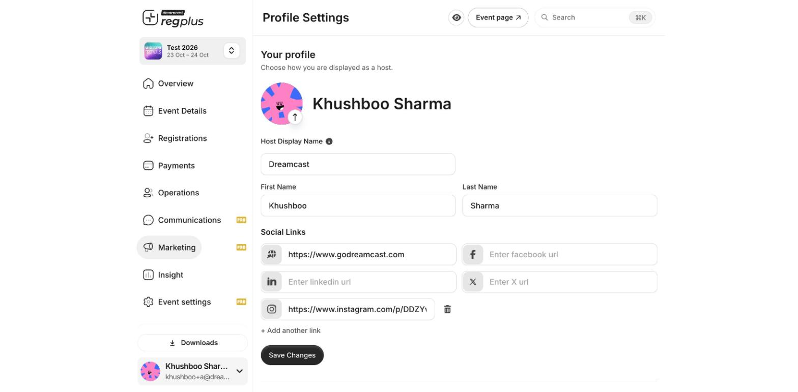

**In short:** Your profile controls two things — how you appear to guests on your event pages, and how you sign in. Open it from your name at the **bottom-left** of the dashboard → **Profile Settings**.

## Your profile

This is how you're shown to guests as the host. Set it once and every event inherits it.

<Frame caption="Your profile — host display name, name and social links.">
  
</Frame>

| Field | What it does |
| --- | --- |
| **Host Display Name** | The name guests see as the organiser — often your company or team name rather than a person. |
| **First & Last Name** | Your own name on the account. |
| **Profile photo** | Your host avatar — click to upload or change it. |
| **Social links** | Website, Facebook, LinkedIn, X, Instagram and YouTube, shown on your event pages. |

Click **Save Changes** when you're done.

<Tip>
  Use a **Host Display Name** that's your brand, not your personal name — it's what appears on every event page and in confirmations, so it should look official to guests.
</Tip>

## Email & phone

Manage the email address and phone number you use to sign in and to receive notifications. Update either, then click **Update Details**.

<Note>
  Keeping both a verified email **and** WhatsApp number on your account means you can sign in with either, and you won't accidentally create a second account.
</Note>

## Password

Click **Change Password** to set or update your account password. Enter your current password and a new one.

A valid password is at least **8 characters** and includes an **uppercase** letter, a **lowercase** letter, a **number** and a **special character**. Forgotten it? Use **Forgot your password?** to reset by email.

## FAQs

<AccordionGroup>
  <Accordion title="Guests see my personal name, not my brand.">
    Set a **Host Display Name** in Your profile — that's the name shown on event pages, instead of your first and last name.
  </Accordion>

  <Accordion title="Can I sign in with a different email later?">
    Yes — update your email in **Email & phone**. Keep your old contact linked too so you don't split your account.
  </Accordion>

  <Accordion title="I forgot my password.">
    Use **Forgot your password?** on the sign-in screen to reset it by email, or keep using a one-time code instead of a password.
  </Accordion>
</AccordionGroup>

## Related articles

- [Account, organisation & Pro Mode](/regplus/how-to-account-org)
- [A quick tour of your dashboard](/regplus/quick-tour)
