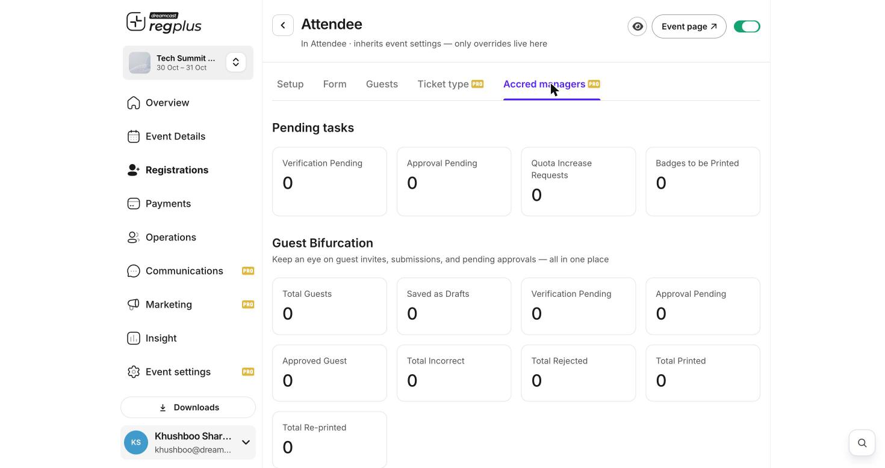
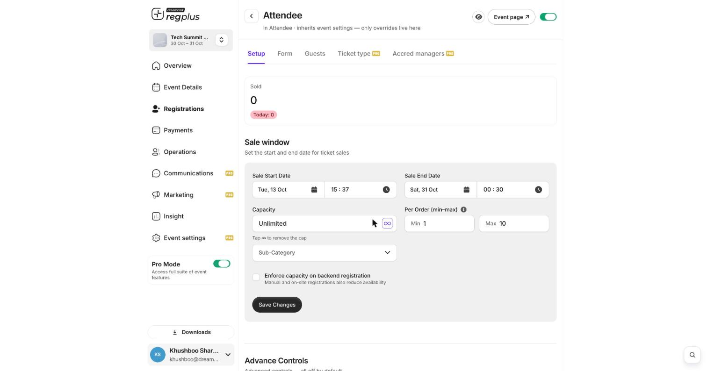

**In short:** You decide who gets a place and how many. Review each sign-up before it's confirmed, set a capacity, or let guests complete their registration later.

## Approve each registration

For events that need vetting — press, VIPs, restricted access — use an approval flow so each sign-up waits for your yes before it's confirmed. Registrations land in **Approval Pending**, and you approve or reject them. The per-ticket **Accred managers** tab gives you the whole pipeline in one place.

<Frame caption="The accreditation dashboard — pending tasks and status breakdown.">
  
</Frame>

| Count | What it means |
| --- | --- |
| **Verification Pending** | Details still need checking. |
| **Approval Pending** | Waiting for your yes/no. |
| **Approved Guest** | Confirmed and ready. |
| **Total Rejected** | Declined registrations. |
| **Badges to be Printed** | Approved guests whose badge isn't printed yet. |

See [Advanced ticket & accreditation](/regplus/how-to-ticket-advanced) for the full flow.

## Set a capacity

Give a ticket option a limit so it stops taking sign-ups once it's full — guests then see it as sold out.

<Frame caption="Capacity and per-order limits on a ticket option.">
  
</Frame>

- Set **Capacity** to a number (or leave it **Unlimited**).
- Turn on **Enforce capacity on backend registration** so manual and walk-in registrations also count against the cap.
- Use **Per Order (min–max)** to limit how many one person can book.

## Let guests finish later

With **partial registration**, a guest can enter their details now and complete the rest later without losing their place — they show as **Partial Registered** until they finish, and can be nudged with the _Resume Cart_ email.

<Note>
  If you use approval, guests aren't confirmed until you approve them. Tell them to expect a wait so they don't sign up twice.
</Note>

## FAQs

<AccordionGroup>
  <Accordion title="Where do I approve or reject guests?">
    From the **Guests** list (open a pending guest's row) or the per-ticket **Accred managers** tab, which shows everything awaiting a decision.
  </Accordion>

  <Accordion title="My ticket shows available even though it's full.">
    Set a **Capacity** on the option, and turn on **Enforce capacity on backend registration** so on-site sign-ups also reduce it.
  </Accordion>

  <Accordion title="Can guests come back to an unfinished registration?">
    Yes — partial registrations are kept, and the _Resume Cart_ reminder sends them a link to finish.
  </Accordion>
</AccordionGroup>

## What's next?

<CardGroup cols={2}>
  <Card title="Confirmations & reminders" icon="bell" href="/regplus/confirmations-reminders">
    Keep guests informed automatically.
  </Card>

  <Card title="Manage registrants" icon="users" href="/regplus/manage-registrants">
    Edit or cancel a registration.
  </Card>
</CardGroup>
