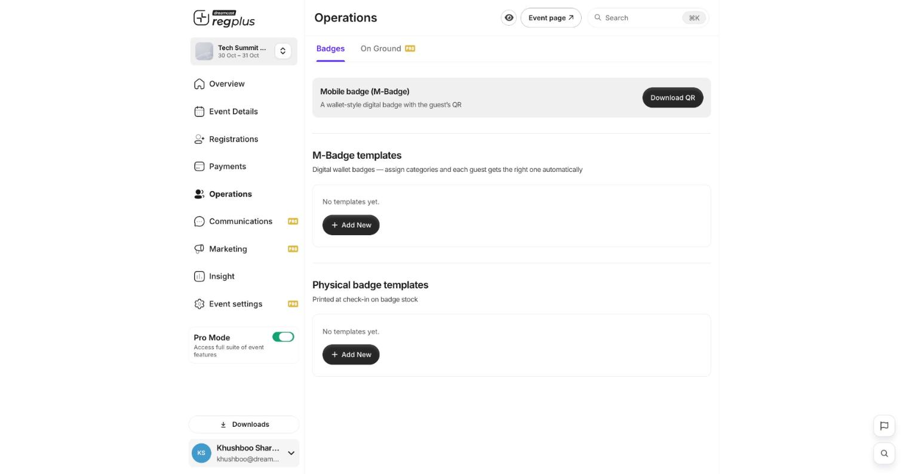
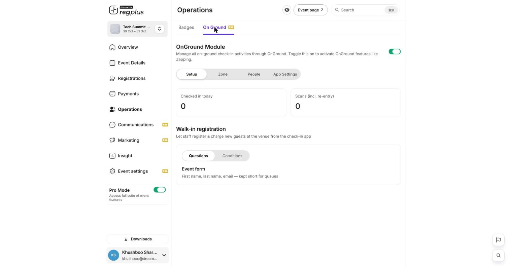

**In short:** Guests get a badge with a QR code. On event day your team checks them in by scanning that code, or by searching their name in the check-in app.

## Set up badges

Under **Operations → Badges**, set up the badge each guest carries. There are two kinds:

<Frame caption="The Badges screen — mobile and printed badge templates.">
  
</Frame>

| Badge | What it is |
| --- | --- |
| **M-Badge (mobile)** | A wallet-style digital badge with the guest's QR — nothing to print. |
| **Physical badge** | Printed on badge stock at check-in. |

Build each from a template in the badge designer, assign it to the ticket types it covers, and each guest automatically gets the right one. Full detail in [Design badges](/regplus/how-to-badges).

## Check guests in on event day

Turn on **OnGround** under **Operations → On Ground**. From here you watch live check-in and scan counts, set up entry zones, add the staff who'll run the door, and allow walk-in registration at the venue.

<Frame caption="The OnGround module — live counts and walk-in registration.">
  
</Frame>

1. **Open the check-in app** — your team signs in to the regplus check-in app on their phones at the venue.
2. **Scan the QR** — scan the guest's badge; they're marked present straight away.
3. **Or search by name** — no QR? Search the guest's name and check them in by hand.

Your checked-in count updates live on the **Overview** and the **OnGround** dashboard. The full setup — access zones, volunteer roles and app settings — is in [Set up on-ground check-in](/regplus/how-to-onground-checkin).

<Note>
  Test a scan before doors open. Make sure the team's phones have the app and can sign in at the venue.
</Note>

## FAQs

<AccordionGroup>
  <Accordion title="Do guests need to print anything?">
    No — the **M-Badge** lives on their phone with a scannable QR. Printed badges are optional, for events that want physical badges.
  </Accordion>

  <Accordion title="A guest can't find their badge.">
    If self-service download is on, point them to the **M-Badge** link on the event page. Otherwise resend it, or check them in by name.
  </Accordion>

  <Accordion title="A guest was turned away at a gate.">
    Their ticket type isn't allowed in that zone. Adjust **Zone permissions** under On Ground — see [Set up on-ground check-in](/regplus/how-to-onground-checkin).
  </Accordion>
</AccordionGroup>

## What's next?

<CardGroup cols={2}>
  <Card title="Design badges (detailed)" icon="id-badge" href="/regplus/how-to-badges">
    Build mobile and printed badge templates.
  </Card>

  <Card title="Set up on-ground check-in" icon="qrcode" href="/regplus/how-to-onground-checkin">
    Zones, scanning staff and app settings.
  </Card>
</CardGroup>
