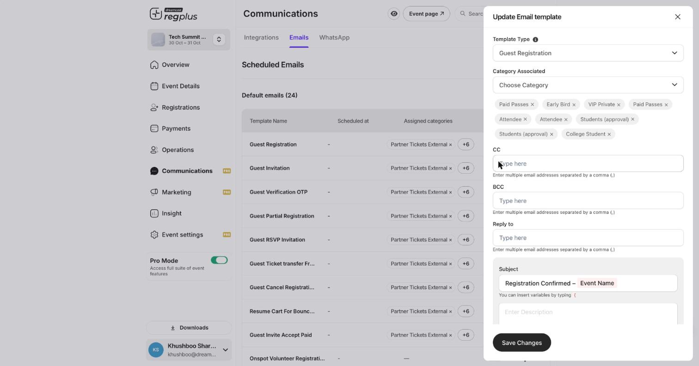
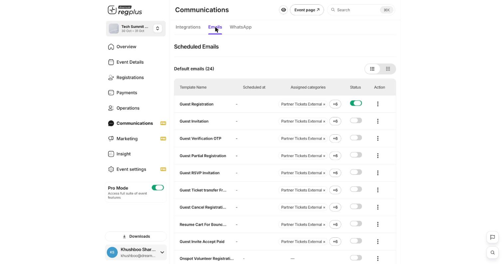

**In short:** These are the automatic messages guests get — a **confirmation** when they sign up, and **reminders** before the event. You control both from **Communications**.

## The confirmation message

When someone registers, regplus sends them the **Guest Registration** email — their confirmation, with their ticket or registration details and a QR code. Open it from **Communications → Emails** to change the wording, add your own note, or control which ticket types it goes to.

<Frame caption="Editing a message template — subject, body and variables.">
  
</Frame>

| Field | What it does |
| --- | --- |
| **Subject** | The email subject line (for example `Registration Confirmed – {Event Name}`). |
| **Category Associated** | Which ticket types receive this message. |
| **CC / BCC / Reply to** | Extra recipients and where replies go. |
| **Body** | The message content — type a curly brace `{` to insert guest and event details. |

## Reminders before the event

Turn on the reminder templates so guests get a nudge before event day, with the date, time and venue. A reminder lifts turnout — more of the people who registered actually show up.

<Frame caption="The template library holds confirmations, reminders and more.">
  
</Frame>

<Note>
  Keep your event **date and venue** up to date in **Event Details** — reminders and confirmations pull from those, so wrong details go out to every guest.
</Note>

## FAQs

<AccordionGroup>
  <Accordion title="Can I add my own note to the confirmation?">
    Yes — open the **Guest Registration** template and edit the body. Send yourself a **Test Email** to check it.
  </Accordion>

  <Accordion title="Guests aren't getting reminders.">
    Check the reminder template's **Status** is on and assigned to the right ticket types, and that the event date is set correctly.
  </Accordion>

  <Accordion title="Can confirmations go out over WhatsApp too?">
    Yes — switch on the WhatsApp integration and sync templates. See [Set up emails & WhatsApp](/regplus/how-to-emails-whatsapp).
  </Accordion>
</AccordionGroup>

## What's next?

<CardGroup cols={2}>
  <Card title="Emails & WhatsApp" icon="comments" href="/regplus/emails-whatsapp">
    Send a one-off update to guests.
  </Card>

  <Card title="Badges & check-in" icon="qrcode" href="/regplus/badges-check-in">
    Get ready for event day.
  </Card>
</CardGroup>
