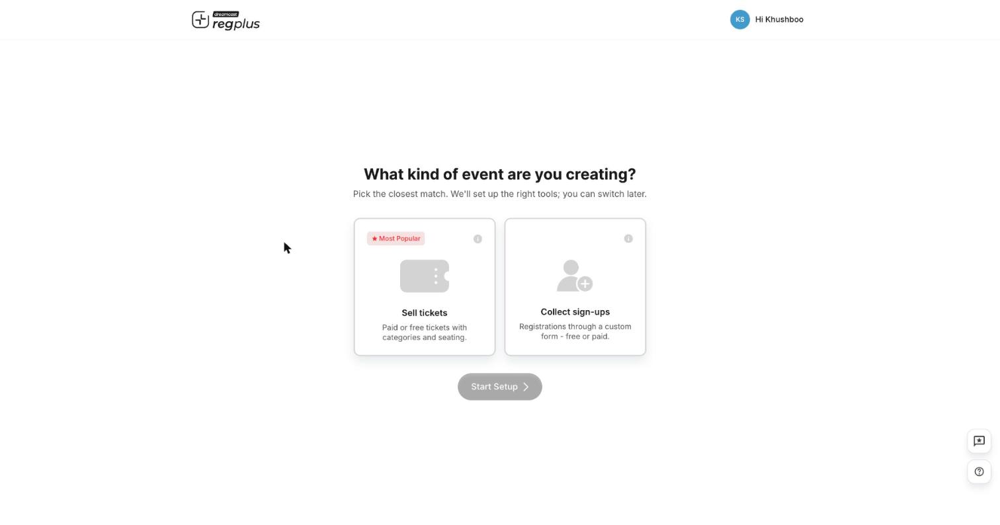
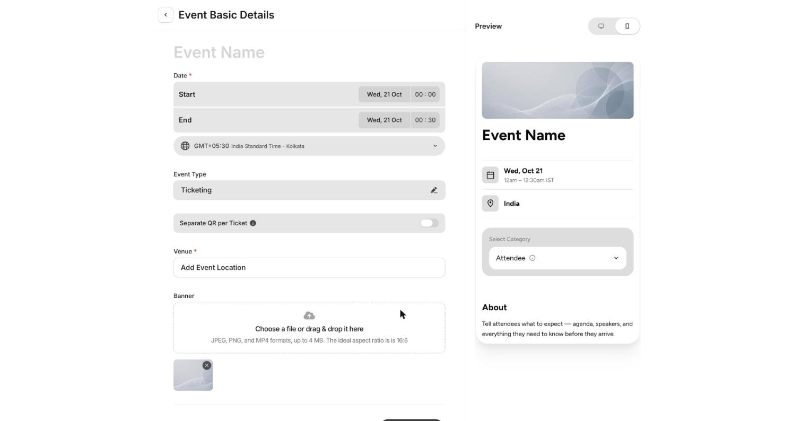
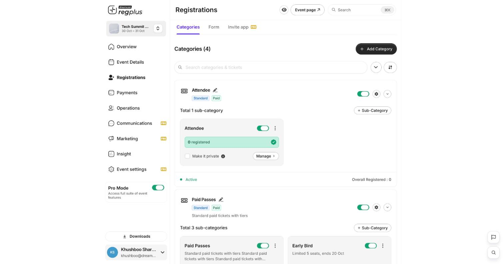
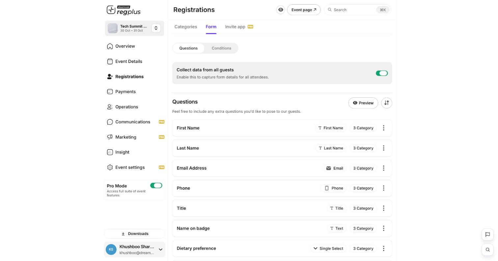

**In short:** Create an event, choose how people join, add what they sign up for, and share your event page. You can be live in a few minutes.

<Info>
  **Before you start:** you need a regplus account — see [Create your account](/regplus/overview).
</Info>

## 1. Start a new event

Click **Create event**, then pick the type that fits what you're running:

<Frame caption="Choose the event type when you start.">
  
</Frame>

| Type | Use it when… |
| --- | --- |
| **Ticketing** | You're selling passes — paid or free — with ticket types, pricing, add-ons and seating. |
| **Registrations** | You're collecting RSVPs or sign-ups through a form, usually free or invite-led. |

## 2. Add the basics

Enter the event **name**, **date** and **venue**, then click **Create**. This opens your event's **Overview** — its home base.

<Frame caption="The basic details for a new event.">
  
</Frame>

| Field | What to enter |
| --- | --- |
| **Event name** | What guests and confirmations will show. |
| **Event Type** | Ticketing or Registrations (you chose this in step 1). |
| **Date & time** | Start and end — the basis for reminders and day-of counts. |
| **Venue** | The location shown on the event page. |

## 3. Add a ticket type

Open **Registrations** from the left menu. Click **\+ Add Category** to add a ticket type (for example _Delegate_), then **\+ Sub-Category** for the option inside it. Keep it free, or set a price for paid events.

<Frame caption="Registrations — your ticket types live here.">
  
</Frame>

For the full set of options — pricing, sale windows, capacity, private tickets and day admission — see [Ticket types & pricing](/regplus/ticket-types).

## 4. Check your registration form

Open the **Form** tab. Your form already asks for name, email and phone. Add any other questions you need.

<Frame caption="The registration form starts with the essentials.">
  
</Frame>

Keep it short — every extra question is one more thing between a guest and a completed sign-up. See [Build your registration form](/regplus/registration-form) for field types and conditional questions.

## 5. Go live and share

Click **Event page** to see exactly what your guests see. Share that link and you're open for registrations.

<Frame caption="Your live event page — exactly what guests see.">
  
</Frame>

## What happens next

Every person who signs up appears in your **Guests** list, and your Overview shows live counts for registrations and revenue.

<Note>
  For paid events, always open your event page and check the amount at checkout matches the price you set **before** you share the link.
</Note>

## FAQs

<AccordionGroup>
  <Accordion title="Can I change the event type after creating it?">
    It's best to choose correctly at creation — switching between Ticketing and Registrations once there's data is disruptive. See [RSVP & sign-up events](/regplus/how-to-rsvp-events).
  </Accordion>

  <Accordion title="Do I have to set a price straight away?">
    No. Keep tickets free for now and turn on **Paid** with a price whenever you're ready.
  </Accordion>

  <Accordion title="How do I make the event page look more like my brand?">
    Add a banner, content sections and choose a layout in **Event Details**. See [Set up your event page](/regplus/how-to-event-page).
  </Accordion>
</AccordionGroup>

## What's next?

<CardGroup cols={2}>
  <Card title="Build your registration form" icon="list-check" href="/regplus/registration-form">
    Ask only what you need, with questions that adapt to each guest.
  </Card>

  <Card title="Ticket types & pricing" icon="ticket" href="/regplus/ticket-types">
    Set up ticket types, options and prices.
  </Card>
</CardGroup>
