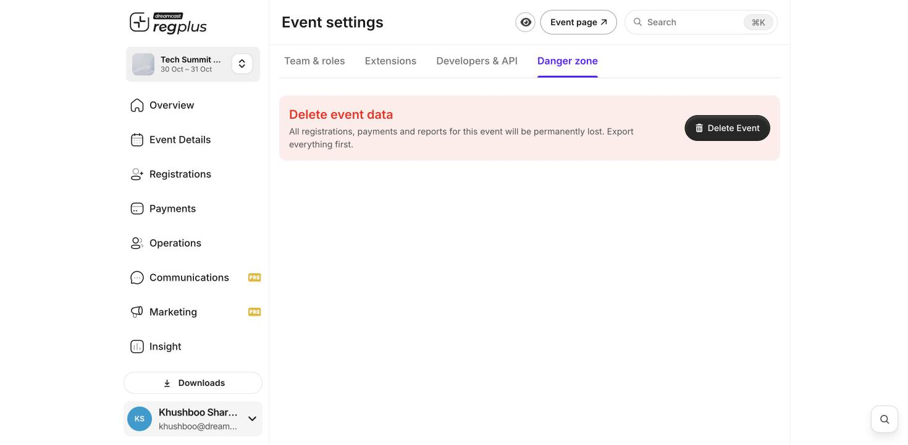

**In short:** The Danger zone lets you permanently delete an event. This cannot be undone, so export anything you need first.

<Warning>
  Deleting an event **permanently removes all its registrations, payments and reports**. There is no way to get them back.
</Warning>

<Info>
  **Where to find it:** Open **Event settings → Danger zone**.
</Info>

## Before you delete

Export everything you might need later — your registrant list, payment records and reports. See [Export your data](/regplus/exports).

## Delete the event

Click **Delete Event**. You'll be asked to confirm before anything is removed.

<Frame caption="The Danger zone — the Delete Event action.">
  
</Frame>

<Note>
  Only the event owner can delete an event. If you just want to **stop taking registrations**, close your ticket types instead of deleting — that keeps all your data.
</Note>

## FAQs

<AccordionGroup>
  <Accordion title="Can I undo a deletion?">
    No. Deletion is permanent and removes all registrations, payments and reports. Always export first.
  </Accordion>

  <Accordion title="I just want to pause registrations, not delete.">
    Don't use the Danger zone. Switch off or close your ticket types, or turn on **Disable Landing Page** — your data stays intact.
  </Accordion>
</AccordionGroup>

## What's next?

<CardGroup cols={2}>
  <Card title="Export your data" icon="file-export" href="/regplus/exports">
    Download everything before you delete.
  </Card>

  <Card title="Event settings & team (detailed)" icon="gear" href="/regplus/how-to-event-settings">
    The full event-settings walkthrough.
  </Card>
</CardGroup>
