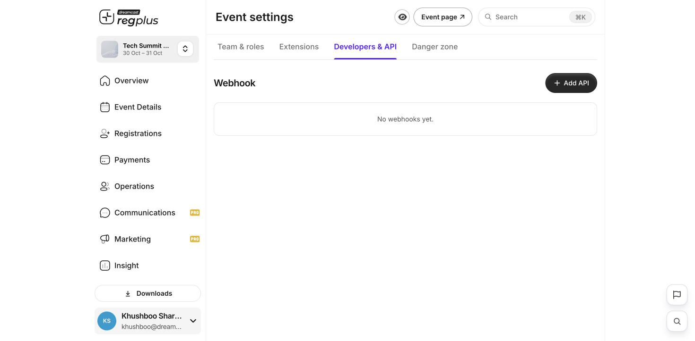

**In short:** If you have your own systems (a CRM, a database, an internal tool), you can have regplus send them event updates automatically with a **webhook**.

<Note>
  This is a technical feature. If you're not a developer, share this page with your tech team.
</Note>

<Info>
  **Where to find it:** Open **Event settings → Developers & API**.
</Info>

## Add a webhook

Click **Add API**, enter the web address (URL) that should receive the data, and choose which events should trigger it — for example a new registration or a payment.

<Frame caption="The Developers & API tab — add a webhook endpoint.">
  
</Frame>

| Field | What to enter |
| --- | --- |
| **URL** | The endpoint on your system that should receive the data. |
| **Events** | Which event triggers a message — e.g. a new registration or a completed payment. |

Once saved, regplus posts a message to your URL each time one of those events happens, so your systems stay in sync without anyone copying data by hand.

<Tip>
  Prefer a no-code option? Connect thousands of apps through **Zapier** under [Extensions](/regplus/extensions) instead.
</Tip>

## FAQs

<AccordionGroup>
  <Accordion title="What's the difference between a webhook and Zapier?">
    A **webhook** posts data directly to your own endpoint (for developers). **Zapier** connects to other apps without code. Use whichever suits your team.
  </Accordion>

  <Accordion title="My endpoint isn't receiving data.">
    Check the URL is correct and publicly reachable, and that the right events are selected to trigger it.
  </Accordion>
</AccordionGroup>

## What's next?

<CardGroup cols={2}>
  <Card title="Connect apps & extensions" icon="puzzle-piece" href="/regplus/extensions">
    No-code integrations like Zapier and Wallet passes.
  </Card>

  <Card title="Delete your event" icon="triangle-exclamation" href="/regplus/danger-zone">
    The other Event settings tab.
  </Card>
</CardGroup>
