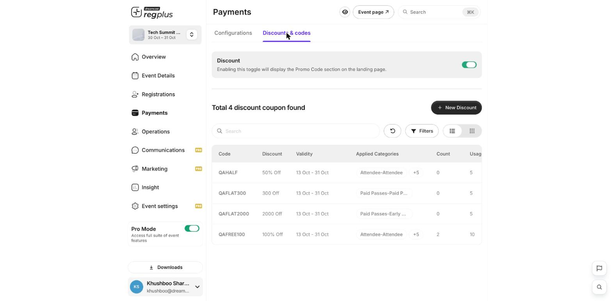
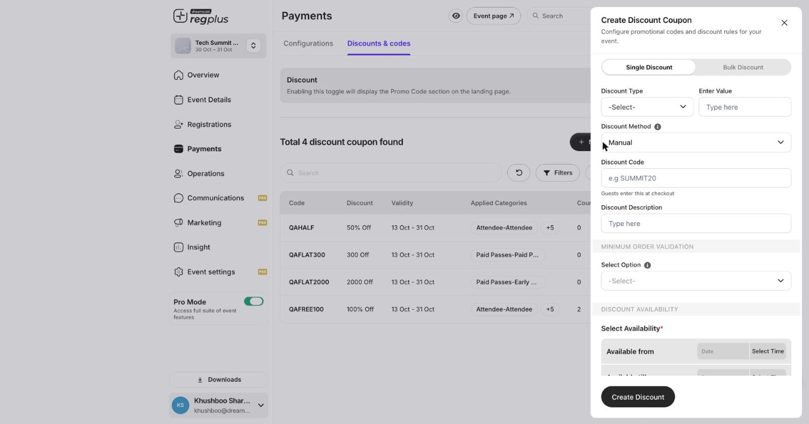

**In short:** A discount code gives guests money off at checkout. You choose the code, the amount, which tickets it works on, and how long it lasts.

<Info>
  **Where to find it:** Open **Payments** from the left menu and go to **Discounts & codes**.
</Info>

## See your codes

The Discounts list shows every code, what it takes off, where it applies and how many times it's been used.

<Frame caption="The discounts list — every code at a glance.">
  
</Frame>

## Create a code

Click **New Discount** and fill in the details.

<Frame caption="Creating a discount — code, amount, scope, dates and limit.">
  
</Frame>

| Field | What to set |
| --- | --- |
| **Code** | What guests type at checkout (for example `EARLY20`). Keep it short and memorable. |
| **Type & amount** | **Percentage** (e.g. 20%) or a **flat** amount off. |
| **Applies to** | Which ticket types the code works on — all, or a chosen few. |
| **Available from / till** | The window the code is valid. |
| **Usage limit** | The maximum number of times the code can be used, so it can't spread further than intended. |

Click **Create Discount**. The code is live immediately — guests enter it at checkout and the price drops.

<Note>
  A discount never takes the total below zero. Always set a **usage limit** so a code shared publicly can't be used an unlimited number of times.
</Note>

## FAQs

<AccordionGroup>
  <Accordion title="Can one code work on only some ticket types?">
    Yes — set **Applies to** on the discount to the specific ticket types you want.
  </Accordion>

  <Accordion title="How do I make a code expire?">
    Set an **Available till** date. After it, the code stops working automatically.
  </Accordion>

  <Accordion title="A guest says the code isn't working.">
    Check it hasn't passed its date range, hasn't hit its usage limit, and that their ticket type is in the code's scope.
  </Accordion>

  <Accordion title="Can I limit a code to one use per person?">
    Set a tight **usage limit**, and share the code privately rather than posting it publicly, to keep it from being reused widely.
  </Accordion>
</AccordionGroup>

## What's next?

<CardGroup cols={2}>
  <Card title="Create discount codes (detailed)" icon="tag" href="/regplus/how-to-create-discounts">
    The full step-by-step with every option.
  </Card>

  <Card title="Publish & share" icon="share-nodes" href="/regplus/publish-share">
    Take your event live.
  </Card>
</CardGroup>
