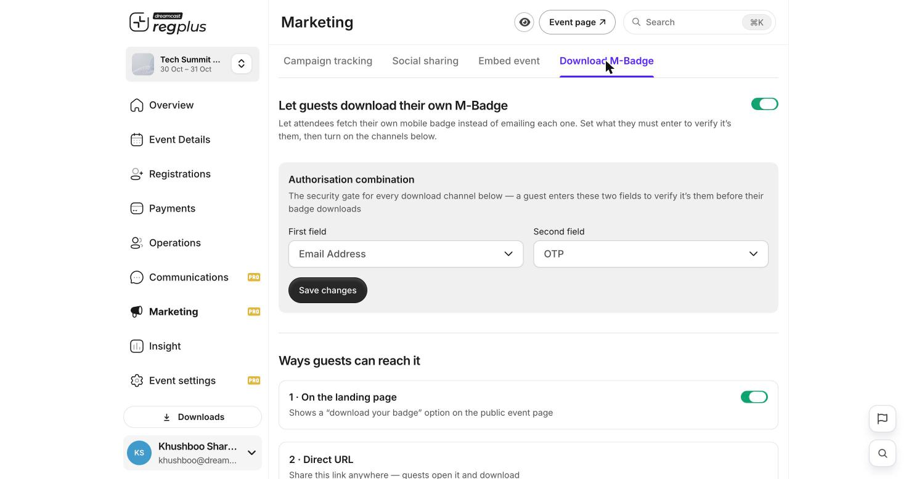

**In short:** Instead of emailing every badge, let guests fetch their own mobile badge (M-Badge). They prove who they are with two details, then download it.

<Info>
  **Where to find it:** Open **Marketing → Download M-Badge** and switch it on.
</Info>

<Frame caption="Download M-Badge — the identity check and sharing channels.">
  
</Frame>

## Set the identity check

Under **Authorisation combination**, choose the **two details** a guest must enter to prove it's them before their badge downloads — for example **Email Address** and **OTP**. This stops anyone pulling another guest's badge.

## Choose how guests reach it

Turn on any of these ways for guests to get to their badge:

| Channel | What it does |
| --- | --- |
| **On the landing page** | Shows a _download your badge_ option on your public event page. |
| **Direct URL** | A link you can share anywhere; guests open it and download. |
| **QR code** | A code guests scan to reach the download page. |

Click **Save changes** when you're done.

<Note>
  Only guests who pass the identity check can download a badge, so it's safe to share the link or QR code publicly. Always keep an **Authorisation combination** set.
</Note>

## FAQs

<AccordionGroup>
  <Accordion title="A guest's badge link asks for a code they don't have.">
    That's the **Authorisation combination** (for example Email + OTP). Make sure they use the same email they registered with.
  </Accordion>

  <Accordion title="Can guests add the badge to their phone wallet?">
    Yes, if **Wallet passes** is enabled in Extensions — the M-Badge can be added to Apple or Google Wallet.
  </Accordion>
</AccordionGroup>

## What's next?

<CardGroup cols={2}>
  <Card title="Badges & check-in" icon="qrcode" href="/regplus/badges-check-in">
    Set up badges and check guests in.
  </Card>

  <Card title="For attendees: register & get your badge" icon="ticket" href="/regplus/how-to-attendee-journey">
    The guest's side of the journey.
  </Card>
</CardGroup>
