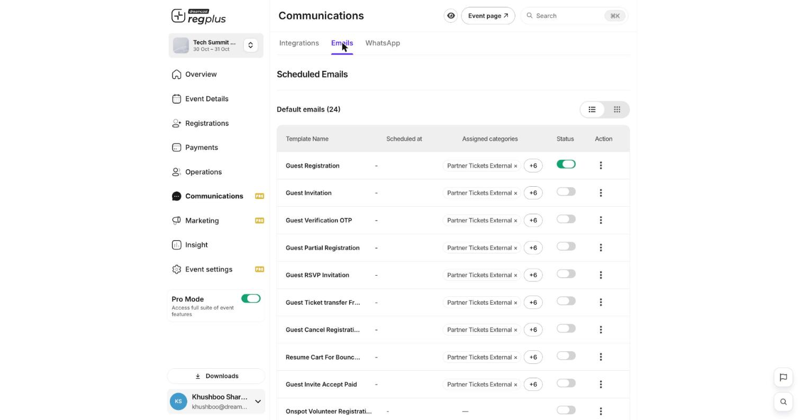
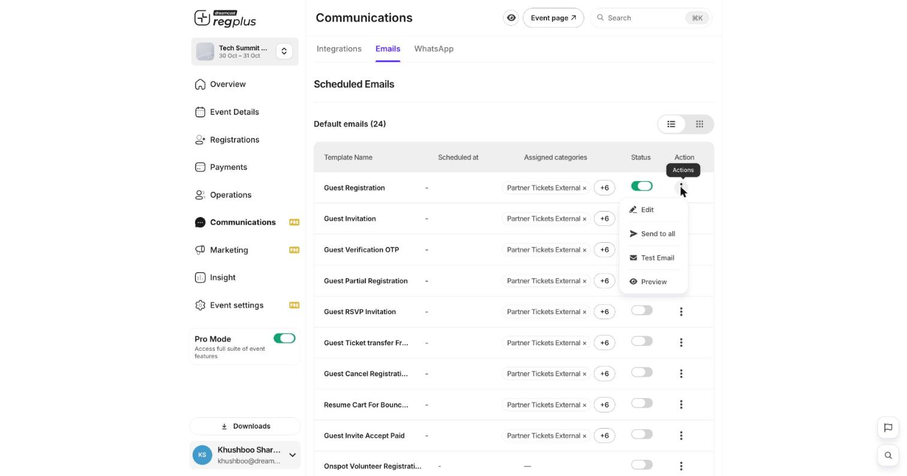
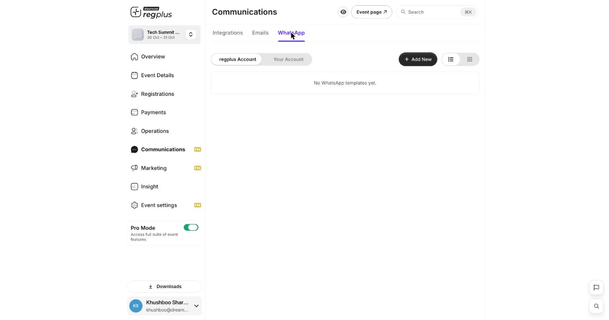

**In short:** regplus keeps guests informed by **email** and **WhatsApp**. You control exactly what every message says — and can send a one-off update to everyone — from the **Communications** section.

<Info>
  **Where to find it:** Open **Communications** from the left menu. The **Emails** and **WhatsApp** tabs hold the templates; the **Integrations** tab controls how they send. This is a Pro feature.
</Info>

## Two kinds of message

| Kind | Example |
| --- | --- |
| **Automatic** | A confirmation when someone registers, an OTP, a reminder — sent on their own. |
| **One-off** | A venue change or announcement you send yourself to everyone. |

## The template library

The **Emails** tab lists 24 ready-made templates — one for each thing that can happen to a registration. Each has an on/off switch and the ticket types it applies to.

<Frame caption="The Emails tab — every transactional template.">
  
</Frame>

Templates you'll use most include **Guest Registration** (the confirmation), **Guest Verification OTP**, **Guest RSVP Invitation**, **Guest Partial Registration** and **Resume Cart**.

## Work with a message

Open a template's **⋮** menu for four actions:

<Frame caption="The per-template actions.">
  
</Frame>

| Action | What it does |
| --- | --- |
| **Edit** | Change the subject, body, recipients and ticket types. Use the curly-brace variables to drop in a guest's name or the event name. |
| **Send to all** | Send this message now to everyone it applies to. |
| **Test Email** | Send yourself a test copy first — always do this before Send to all. |
| **Preview** | See how it looks without sending. |

## Send over WhatsApp

The **WhatsApp** tab works the same way, over WhatsApp.

<Frame caption="WhatsApp templates — platform or your own number.">
  
</Frame>

Use the **regplus Account** (pre-approved templates, no setup) or connect **Your Account** (your own WhatsApp Business number). Switch it on under **Integrations**.

<Note>
  These messages reach real guests. Send yourself a **Test Email** first and check the details before you Send to all.
</Note>

## FAQs

<AccordionGroup>
  <Accordion title="A confirmation isn't going out.">
    Check the template's **Status** is on, and the guest's ticket type is in its **Assigned categories**.
  </Accordion>

  <Accordion title="Can I change the wording of the confirmation?">
    Yes — open the **Guest Registration** template's **Edit** action and change the subject and body.
  </Accordion>

  <Accordion title="How do I send everyone a venue update?">
    Edit (or create) a message and use **Send to all**, choosing who it goes to.
  </Accordion>
</AccordionGroup>

## What's next?

<CardGroup cols={2}>
  <Card title="Set up emails & WhatsApp (detailed)" icon="envelope" href="/regplus/how-to-emails-whatsapp">
    The full walkthrough of templates and variables.
  </Card>

  <Card title="Confirmations & reminders" icon="bell" href="/regplus/confirmations-reminders">
    Set the automatic messages guests get.
  </Card>
</CardGroup>
