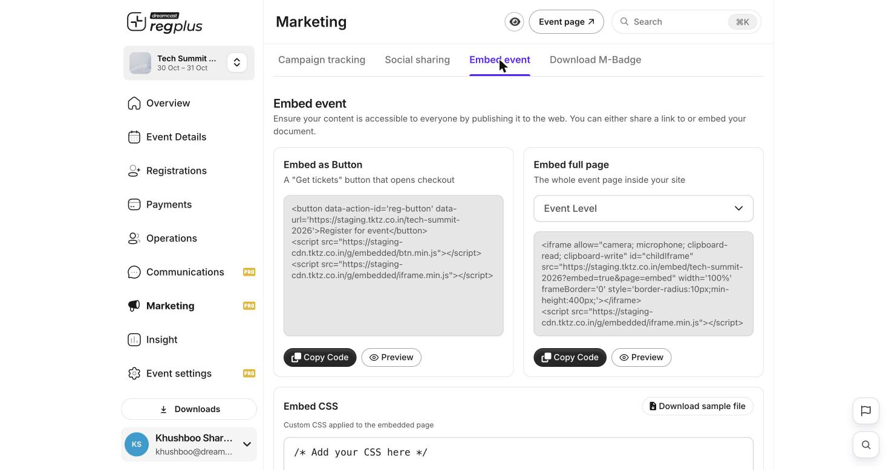

**In short:** Copy a small piece of code from regplus and paste it into your website so people can register without leaving your site.

<Info>
  **Where to find it:** Open **Marketing → Embed event**.
</Info>

## Choose how to embed

You have two options — copy the code for the one you want and paste it into your website's HTML.

<Frame caption="The Embed event tab — button, full-page and custom CSS.">
  
</Frame>

| Option | What it gives you |
| --- | --- |
| **Embed as Button** | A **Get tickets** button that opens checkout in an overlay. Click **Copy Code** and paste it where the button should appear. |
| **Embed full page** | Your whole event page inside your site. Pick what to show in the dropdown (for example **Event Level**), then **Copy Code**. |
| **Embed CSS** | Custom styling so the embed matches your site — **Download sample file** to start from an example. |

Each block has **Copy Code** and **Preview**.

<Note>
  Not comfortable editing your website's code? Send this page to whoever manages your site — pasting the snippet is all it takes.
</Note>

## FAQs

<AccordionGroup>
  <Accordion title="Which embed should I use?">
    Use the **button** if you just want a 'Get tickets' call-to-action on an existing page; use the **full-page** embed to host the whole event inside your site.
  </Accordion>

  <Accordion title="The embed doesn't match my site's style.">
    Add your own rules under **Embed CSS** — download the sample file and adjust it to your brand.
  </Accordion>
</AccordionGroup>

## What's next?

<CardGroup cols={2}>
  <Card title="Add a LinkedIn share card" icon="linkedin" href="/regplus/social-sharing">
    Let guests share that they're attending.
  </Card>

  <Card title="Publish & share" icon="share-nodes" href="/regplus/publish-share">
    Take your event live.
  </Card>
</CardGroup>
