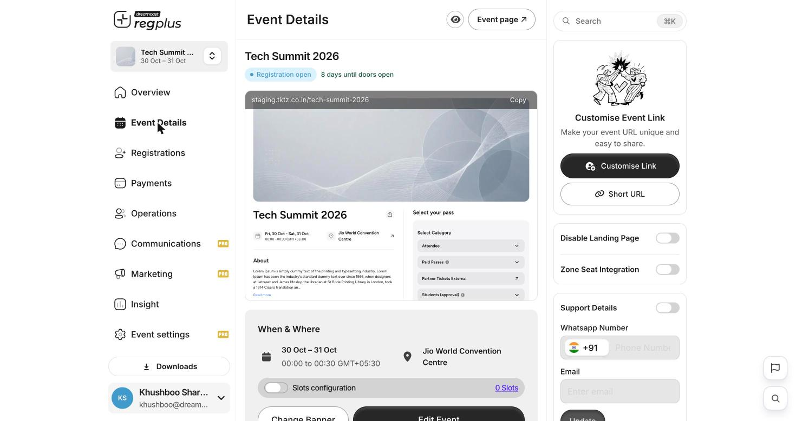
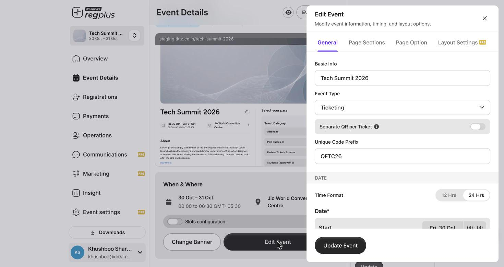

**In short:** Your event details — name, date, venue and the whole public page — can be changed at any time. Guests, confirmations and reminders all use them.

<Info>
  **Where to find it:** Open **Event Details** from the left menu. The screen shows a live preview of your public page, with the controls around it.
</Info>

## The Event Details screen

<Frame caption="Event Details — a live preview with the URL, support and banner controls.">
  
</Frame>

Around the live preview you'll find:

| Control | What it does |
| --- | --- |
| **Event URL + Copy** | Your public link, with **Customise Link** and **Short URL**. |
| **Disable Landing Page** | Turn the public page off for invite-only events. |
| **Support Details** | Show a WhatsApp number and email on the page so guests can reach you. |
| **Change Banner** | Upload the hero image. |
| **Slots configuration** | Split the event into bookable time slots. |
| **Edit Event** | Open the full editor (below). |

## Edit the event

Click **Edit Event** to change the core details.

<Frame caption="The Edit Event editor — name, type, code prefix and dates.">
  
</Frame>

| Field | What it does |
| --- | --- |
| **Event name** | Shown everywhere, including confirmations. |
| **Event Type** | Ticketing or Registrations. |
| **Unique Code Prefix** | A short prefix on every ticket code, so codes are easy to recognise. |
| **Date & time** | Start and end — the basis for reminders and day-of counts. |

The editor also has **Page Sections** (the About and other content blocks), **Page Option** (the booking button wording) and **Layout Settings** (web-first vs mobile-first). The full tour is in [Set up your event page](/regplus/how-to-event-page).

<Note>
  Confirmations and reminders use these details. If you change the **date or venue** after guests have registered, send them an update too. See [Emails & WhatsApp](/regplus/emails-whatsapp).
</Note>

## FAQs

<AccordionGroup>
  <Accordion title="Can I change the date after people have registered?">
    Yes, but tell your guests — reminders and confirmations use the new date. Send an update email so no one misses the change.
  </Accordion>

  <Accordion title="How do I add an agenda or speakers to the page?">
    Use **Edit Event → Page Sections → Add New** to add content blocks and drag them into order.
  </Accordion>

  <Accordion title="How do guests contact me?">
    Turn on **Support Details**, add a WhatsApp number and email, and click **Update** — they appear on the public page.
  </Accordion>
</AccordionGroup>

## What's next?

<CardGroup cols={2}>
  <Card title="Set up your event page (detailed)" icon="window" href="/regplus/how-to-event-page">
    The full walkthrough of the public page.
  </Card>

  <Card title="Confirmations & reminders" icon="bell" href="/regplus/confirmations-reminders">
    Keep guests up to date.
  </Card>
</CardGroup>
