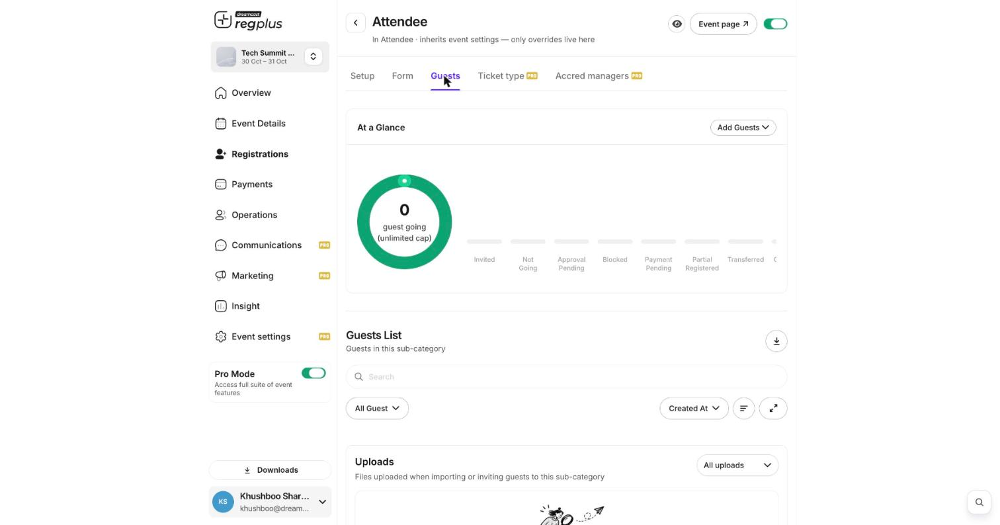

**In short:** You can download your guest list and reports as a file to share with your team or open in a spreadsheet. Exports collect in the **Downloads** centre.

## Export a guest list

Open a ticket type's **Guests** tab and use the **download** icon to export everyone in it, with their details and status.

<Frame caption="The download icon on a guest list.">
  
</Frame>

## Export a report

Open **Insight**, choose a report, and use **Download Option** (on the Financial report's Sales Summary, for example) to save the figures. Each report can be exported for the date range you've filtered to.

## Find your downloads

Every file you export collects under **Downloads** at the bottom of the left menu. Open it for recent files, or **View All Downloads** for the full history — handy if an export takes a moment to generate.

<Note>
  An export holds guests' personal details. Share it only with people who need it, and keep the file safe.
</Note>

## FAQs

<AccordionGroup>
  <Accordion title="Where did my exported file go?">
    Open **Downloads** at the bottom of the left menu. Exports collect there; use **View All Downloads** for older ones.
  </Accordion>

  <Accordion title="Can I export everyone across all ticket types at once?">
    Use the **Insight** reports for an event-wide export; the Guests tab export is per ticket type.
  </Accordion>

  <Accordion title="Can I schedule an export instead of downloading each time?">
    Yes — use **Schedule Report** to have a report emailed automatically. See [Schedule reports by email](/regplus/insight-schedule-report).
  </Accordion>
</AccordionGroup>

## What's next?

<CardGroup cols={2}>
  <Card title="Insights & reports" icon="chart-line" href="/regplus/insights-reports">
    Read your numbers inside regplus.
  </Card>

  <Card title="Schedule reports by email" icon="clock" href="/regplus/insight-schedule-report">
    Have reports delivered automatically.
  </Card>
</CardGroup>
