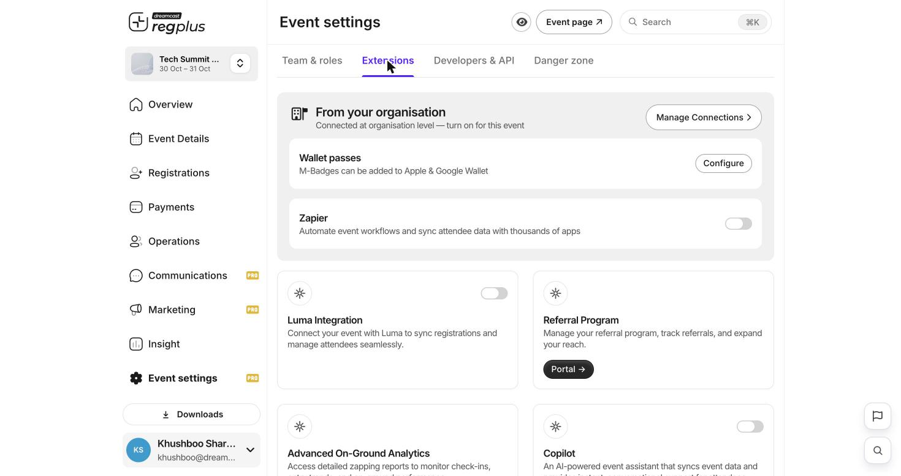

**In short:** Extensions are extra tools you can switch on for your event — from adding badges to Apple & Google Wallet to connecting other apps.

<Info>
  **Where to find it:** Open **Event settings → Extensions**.
</Info>

<Frame caption="Extensions — organisation connections on top, individual extensions below.">
  
</Frame>

## From your organisation

These are set up once at the organisation level, then switched on per event. Use **Manage Connections** to see everything connected for your organisation.

| Extension | What it does |
| --- | --- |
| **Wallet passes** | Let guests add their M-Badge to Apple & Google Wallet — **Configure** to set it up. |
| **Zapier** | Automate your workflow and sync attendee data with thousands of other apps. |

## More tools

Switch on any of the app cards to add them to your event:

| Tool | What it does |
| --- | --- |
| **Luma Integration** | Sync registrations and attendees with Luma. |
| **Referral Program** | Track referrals and grow your reach. |
| **Advanced On-Ground Analytics** | Detailed check-in and entry reports. |

<Note>
  Some tools open in a separate **Portal** to finish setup — just follow the link on the card.
</Note>

## FAQs

<AccordionGroup>
  <Accordion title="I turned on an extension but nothing happened.">
    Some are connected at the **organisation** level first. Use **Manage Connections** to check the connection exists, then switch it on for this event.
  </Accordion>

  <Accordion title="Can I add badges to Apple/Google Wallet?">
    Yes — turn on **Wallet passes** and use **Configure**. Guests can then add their M-Badge to their phone's wallet.
  </Accordion>

  <Accordion title="How do I connect an app that isn't listed?">
    Use **Zapier** to connect thousands of apps without code, or a **webhook** — see [Webhooks & API](/regplus/developers-api).
  </Accordion>
</AccordionGroup>

## What's next?

<CardGroup cols={2}>
  <Card title="Webhooks & API" icon="code" href="/regplus/developers-api">
    Send event data to your own systems.
  </Card>

  <Card title="Event settings & team (detailed)" icon="gear" href="/regplus/how-to-event-settings">
    The full event-settings walkthrough.
  </Card>
</CardGroup>
