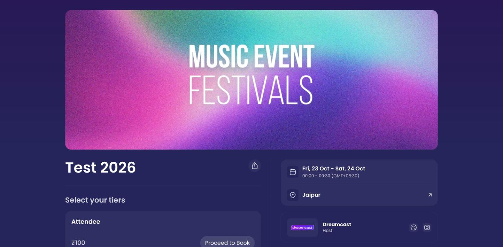
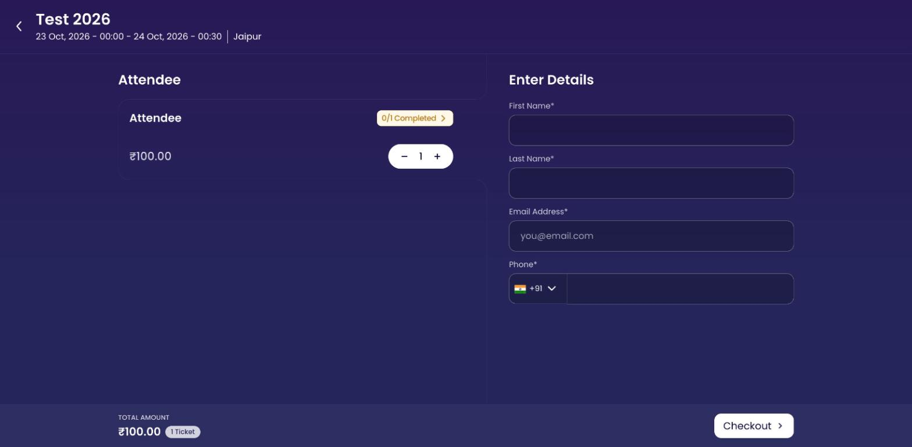
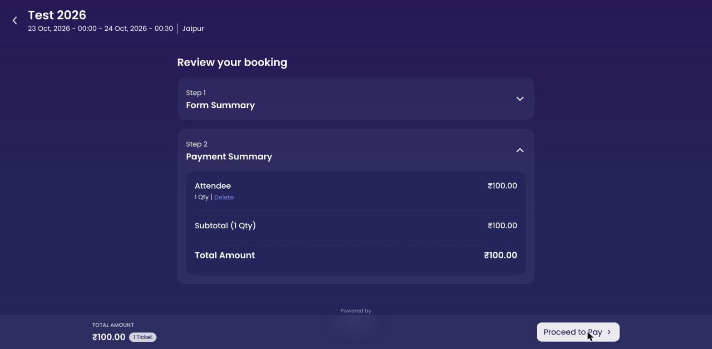
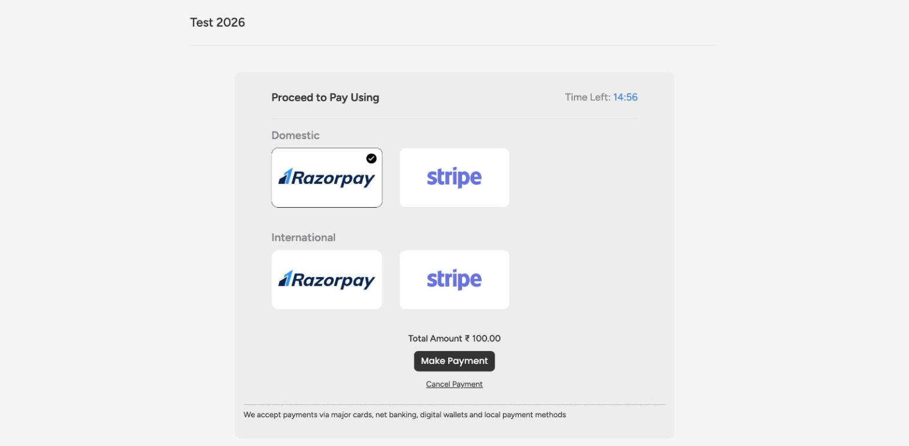
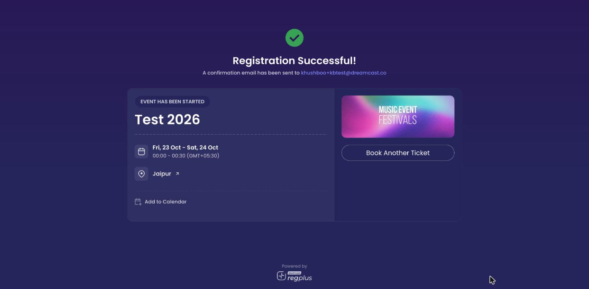

**In short:** This is what your guests experience, start to finish — they open your event page, choose a tier, enter their details, pay (if it's a paid event), and get a ticket by email and WhatsApp. Knowing the flow helps you set your event up so it's smooth for them.

<Info>
  Everything on this page is the **attendee's** view of your public event link (for example `reg.dreamcast.co/your-event`). To change any of it, see [Design the attendee journey](/regplus/how-to-design-journey).
</Info>

## 1. They open your event page

Your guest arrives on the event landing page from your invite link, a social post, or your discovery page. It shows your banner, the event name, date and venue, the host details, and the tiers they can book.

<Frame caption="The event landing page — the first thing your guests see.">
  
</Frame>

They can also share the page or add the event to their calendar from here. You control the banner, link, host block and support details in [Event details](/regplus/event-details).

## 2. They choose a tier

Under **Select your tiers**, the guest picks a ticket type and clicks **Proceed to Book**. Free and paid tiers can sit side by side, and (if you've turned it on) each shows a free or paid tag so guests know what to expect.

## 3. They enter their details

Next they choose how many tickets they want and fill in the details for each one. The form always asks for name, email and phone, plus any custom questions you've added.

<Frame caption="Entering attendee details — one set per ticket, with a running total.">
  
</Frame>

Each ticket shows a **0/1 Completed** marker until its details are filled, and the **total amount** updates as they go. When everything's complete they click **Checkout**. Shape this form in [Build your registration form](/regplus/how-to-registration-form).

## 4. They check out and pay

For a **paid** event, the guest lands on the payment step and picks a method under your **Domestic** and **International** sections, with any payment note you've written shown below. For a **free** event, there's no payment step — the booking is confirmed straight away. If you set up discount codes, guests enter them here. See [Payments](/regplus/payments) and [Discount codes](/regplus/discounts).

<Frame caption="Reviewing the booking before paying.">
  
</Frame>

<Frame caption="Choosing a payment method — domestic and international options, with your payment note below.">
  
</Frame>

## 5. They get their confirmation

Once booked, the guest gets a confirmation by **email** and **WhatsApp** with their ticket — including a **QR code** (the mobile M-Badge) they'll show at the door. They can add the event to their calendar too. You control these messages in [Emails & WhatsApp](/regplus/emails-whatsapp) and the ticket design in [Badges](/regplus/how-to-badges).

<Frame caption="The confirmation screen — with add-to-calendar and the confirmation email on its way.">
  
</Frame>

## 6. They arrive and check in

On event day, your team scans the guest's QR code with the on-ground app to check them in — and, if you print badges, their badge comes out at that moment. See [Check in guests](/regplus/how-to-check-in-guests).

## The journey at a glance

<Steps>
  <Step title="Open the event page">Banner, details and tiers.</Step>
  <Step title="Choose a tier">Free or paid, then Proceed to Book.</Step>
  <Step title="Enter details">Quantity and the form, per ticket.</Step>
  <Step title="Checkout & pay">Pay for paid events; free events skip this.</Step>
  <Step title="Get the ticket">Email and WhatsApp with a QR code.</Step>
  <Step title="Check in">QR scanned on the day.</Step>
</Steps>

## FAQs

<AccordionGroup>
  <Accordion title="Do guests have to create an account to book?">
    No — guests book by entering their details. They don't need a host account.
  </Accordion>

  <Accordion title="Can one person book several tickets?">
    Yes — they set the quantity and fill in the details for each attendee, within any limit you've set.
  </Accordion>

  <Accordion title="What does a guest get after booking?">
    A confirmation by email and WhatsApp with their ticket and a QR code to show at check-in.
  </Accordion>
</AccordionGroup>

## What's next?

<CardGroup cols={2}>
  <Card title="Design the attendee journey" icon="sliders" href="/regplus/how-to-design-journey">
    Use backend settings to shape what guests experience.
  </Card>

  <Card title="Set up your event page" icon="browser" href="/regplus/how-to-event-page">
    Control the page guests land on.
  </Card>
</CardGroup>
