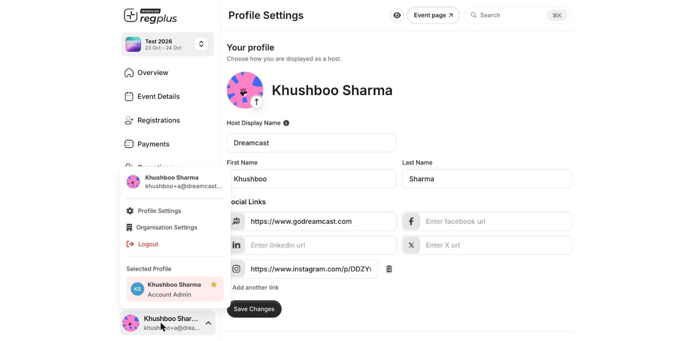
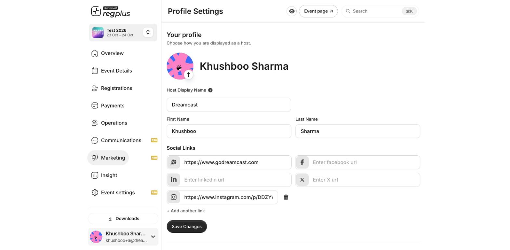
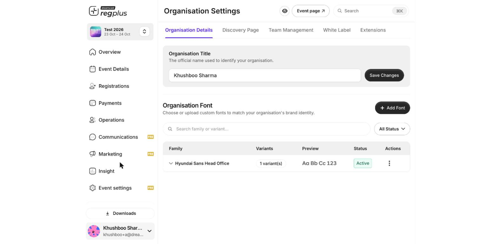

**In short:** Your **profile** controls how you appear to attendees as a host. Your **organisation** holds the name, fonts, branding, team and discovery page shared across all your events. Both open from the account menu at the bottom-left of the dashboard.

<Info>
  **Where to find it:** Click your name at the **bottom-left**, then choose **Profile Settings** or **Organisation Settings**.
</Info>

<Frame caption="The account menu — profile, organisation, switch profile and logout.">
  
</Frame>

## Your profile

Open **Profile Settings** to choose how you're shown as a host on your event pages.

<Frame caption="Profile Settings — how you appear as a host.">
  
</Frame>

| Field | What it does |
| --- | --- |
| **Profile photo** | The avatar shown for you as a host. Click the arrow on the image to upload. |
| **Host Display Name** | The name attendees see as the event host (for example your brand name). |
| **First name** and **Last name** | Your own name on the account. |
| **Social links** | Website, Facebook, LinkedIn, X and Instagram links shown on your event page. Use **+ Add another link** for more. |

Click **Save Changes** to apply.

## Your organisation

Open **Organisation Settings** for the settings shared across every event in your organisation.

<Frame caption="Organisation Settings — details, discovery page, team, white label and extensions.">
  
</Frame>

| Tab | What it's for |
| --- | --- |
| **Organisation Details** | Your **Organisation Title** (the official name) and **Organisation Fonts** — upload custom fonts to match your brand. |
| **Discovery Page** | Your organisation's public page that lists all your live events in one place. |
| **Team Management** | Invite colleagues to your organisation and manage who's on the team. See [Team access & roles](/regplus/team-access). |
| **White Label** | Apply your own branding across your events. |
| **Extensions** | Turn on add-ons available to your organisation. See [Extensions](/regplus/extensions). |

## Switch profile or organisation

If your login has access to more than one organisation — or you hold an event-specific role — you don't need to sign out to move between them. Open the account menu and pick another entry under **Selected Profile**. See [Sign up & sign in](/regplus/how-to-sign-in).

## Sign out

Open the account menu and click **Logout**. Always sign out on a shared or public computer.

## FAQs

<AccordionGroup>
  <Accordion title="What's the difference between my name and my Host Display Name?">
    Your first and last name identify your account. The **Host Display Name** is what attendees see as the event host — usually your brand or organisation name.
  </Accordion>

  <Accordion title="Where do my social links show up?">
    On your public event page, in the host block alongside your name and photo.
  </Accordion>

  <Accordion title="How do I add a teammate to my organisation?">
    Use **Organisation Settings → Team Management** to invite them, or set event-specific roles under [Event settings & team](/regplus/how-to-event-settings).
  </Accordion>
</AccordionGroup>

## What's next?

<CardGroup cols={2}>
  <Card title="Team access & roles" icon="user-group" href="/regplus/team-access">
    Let colleagues help run your events.
  </Card>

  <Card title="Find your way around the dashboard" icon="gauge" href="/regplus/how-to-dashboard">
    Get oriented in the event dashboard.
  </Card>
</CardGroup>
