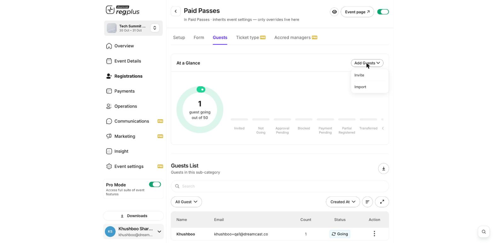

**In short:** You don't have to wait for people to register online. You can add guests yourself from a ticket type's **Guests** tab — useful for VIPs, partners, or people who signed up offline.

## Add a guest

<Steps>
  <Step title="Open the ticket type">
    Go to **Registrations → Categories**, find the ticket type you want to add the guest under, and click **Manage**.
  </Step>
  <Step title="Go to the Guests tab">
    Open the **Guests** tab, then click **Add Guests**.

    <Frame>
      
    </Frame>
  </Step>
  <Step title="Invite or import">
    Choose **Invite** to add one guest by entering their details, or **Import** to upload a file and add many guests at once.
  </Step>
</Steps>

<Tip>
  Guests you add this way show up alongside your online registrations, and are counted as invited guests so you can tell them apart in your reports.
</Tip>

## What's next?

<CardGroup cols={2}>
  <Card title="Manage registrants" icon="users" href="/regplus/manage-registrants">
    Find and edit guests you've added.
  </Card>

  <Card title="Export your guest list" icon="file-export" href="/regplus/how-to-export-guests">
    Download your full list.
  </Card>
</CardGroup>
