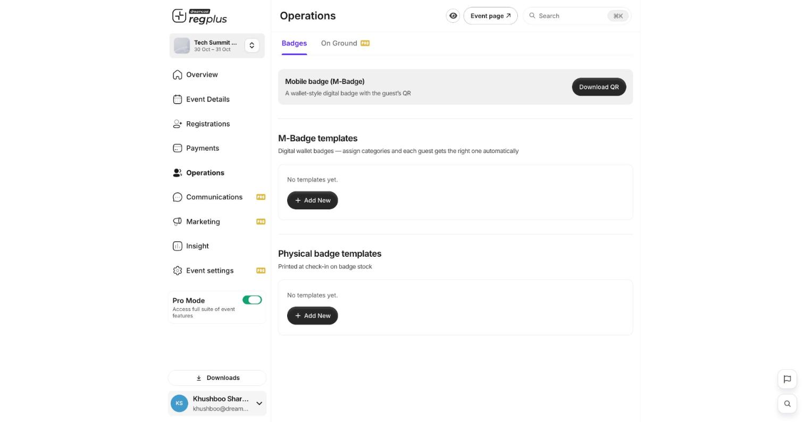
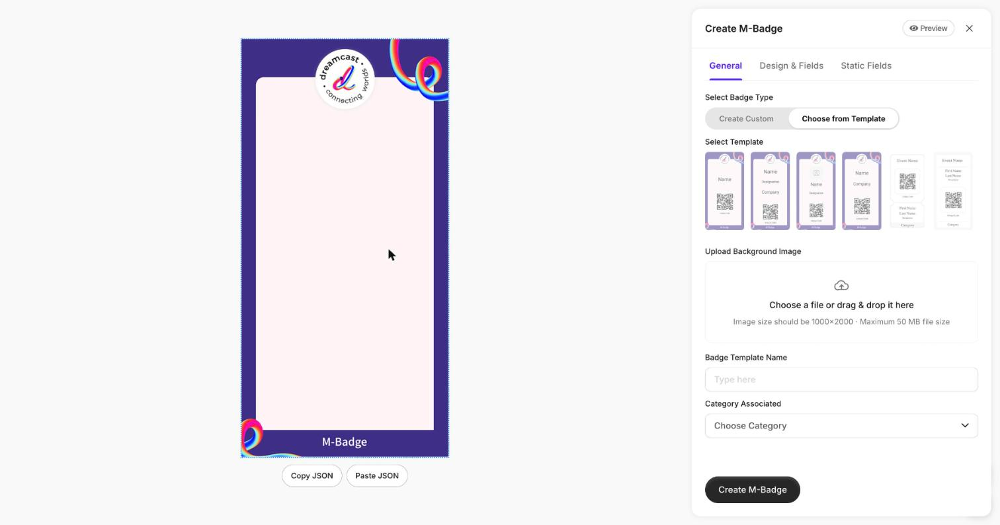

**In short:** Badges carry a guest's details and a QR code for entry. regplus has two kinds — **M-Badge** (a mobile, wallet-style badge) and **physical badges** printed at check-in. You build both under **Operations → Badges**.

## The Badges screen

<Frame>
  
</Frame>

- **Mobile badge (M-Badge)** — a wallet-style digital badge with the guest's QR. Use **Download QR** to grab it.
- **M-Badge templates** — digital wallet badges; assign them to ticket types so each guest gets the right one automatically.
- **Physical badge templates** — printed on badge stock at check-in.

Click **Add New** under either section to open the designer.

## Step 1 — Create a template

<Frame>
  
</Frame>

The designer shows a **live preview** on the left and settings on the right, across three tabs — **General**, **Design & Fields** and **Static Fields**.

| General setting | What it does |
| --- | --- |
| **Select Badge Type** | **Create Custom** to design from scratch, or **Choose from Template** to start from a ready-made layout |
| **Select Template** | Pick a layout from the gallery (name only, name + company, QR-forward, and so on) |
| **Upload Background Image** | Your badge artwork — **1000×2000**, up to 50 MB |
| **Badge Template Name** | A name to recognise this template |
| **Category Associated** | The ticket type(s) this template applies to |

## Step 2 — Add fields and static text

- **Design & Fields** — choose which guest details appear (name, company, designation, QR, category) and position them on the badge.
- **Static Fields** — add fixed text or graphics that are the same on every badge (your event name, a sponsor line).

Use **Preview** to check the result, then click **Create M-Badge** (or **Create** for a physical template).

## Step 3 — Link templates to ticket types

Set the **Category Associated** so each ticket type pulls the right badge automatically — for example a different colour or label for _Delegate_, _Speaker_ and _Crew_.

<Tip>
  Design your badges before the event so they're ready to print the moment check-in starts. Check-in and print counts show in **Insight → Attendee Dynamics**.
</Tip>

## FAQ

<AccordionGroup>
  <Accordion title="What's the difference between M-Badge and physical badges?">
    **M-Badge** is digital — guests keep it on their phone / in their wallet and show the QR. **Physical badges** are printed on badge stock at the check-in desk.
  </Accordion>

  <Accordion title="Can each ticket type have its own badge?">
    Yes — set **Category Associated** on each template, and guests automatically get the badge for their ticket type.
  </Accordion>

  <Accordion title="What image size should the background be?">
    **1000×2000** pixels (portrait), up to 50 MB. Keep important details away from the edges so nothing is lost when printed.
  </Accordion>
</AccordionGroup>

## What's next?

<CardGroup cols={2}>
  <Card title="Check in guests on event day" icon="qrcode" href="/regplus/how-to-check-in-guests">
    Scan badges at the door.
  </Card>

  <Card title="Let guests download their badge" icon="id-badge" href="/regplus/download-m-badge">
    Self-service M-Badge download.
  </Card>
</CardGroup>
