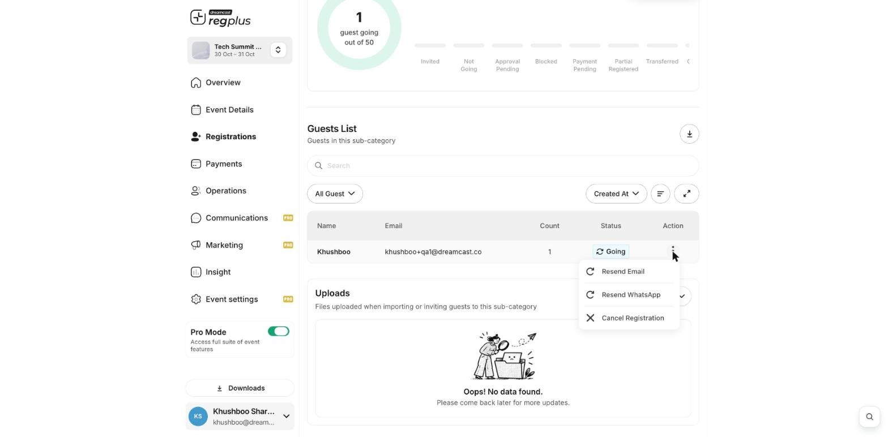

**In short:** If a guest needs to be on a different ticket type, the reliable way is to cancel their current registration and add them again under the new ticket type.

## Move a guest

<Steps>
  <Step title="Cancel the current registration">
    Go to **Registrations → Categories**, click **Manage** on the guest's current ticket type, open the **Guests** tab, and from the guest's **⋮** menu choose **Cancel Registration**.

    <Frame>
      
    </Frame>
  </Step>
  <Step title="Add them to the new ticket type">
    Open the ticket type you want to move them to, go to its **Guests** tab, click **Add Guests → Invite**, and enter the guest's details. See [Add a guest manually](/regplus/how-to-add-guest-manually).
  </Step>
</Steps>

<Warning>
  If the original ticket was paid, cancelling here does not refund the guest — handle any refund through your payment provider. See [Issue a refund](/regplus/how-to-issue-refund).
</Warning>

<Note>
  Ticket changes and transfers are tracked in **Insight → Attendee Dynamics**, under **Category Changed** and **Ticket Transferred**.
</Note>

## What's next?

<CardGroup cols={2}>
  <Card title="Add a guest manually" icon="user-plus" href="/regplus/how-to-add-guest-manually">
    Add them to the new ticket type.
  </Card>

  <Card title="Manage registrants" icon="users" href="/regplus/manage-registrants">
    Find and manage guests.
  </Card>
</CardGroup>
