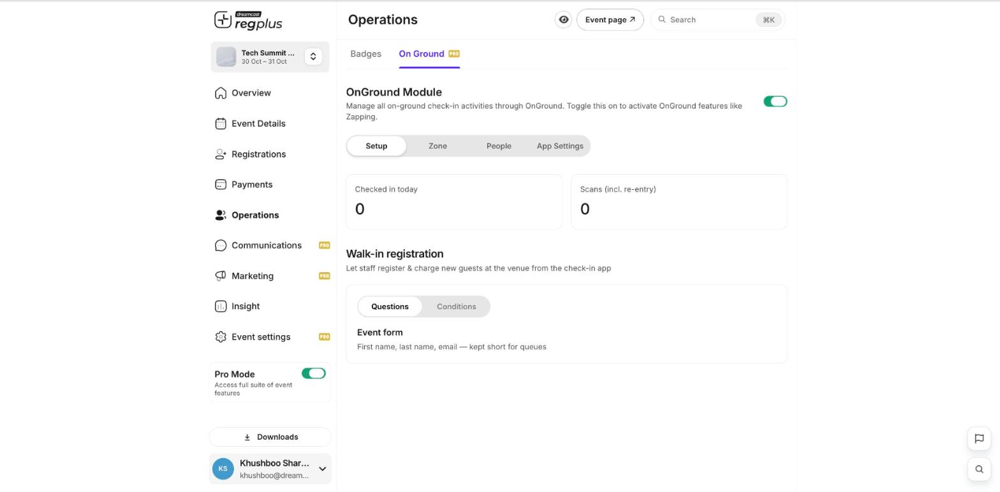

**In short:** On event day you check guests in from the **Operations → On Ground** area. Each check-in marks the guest as arrived, and staff can even register walk-ins on the spot.

<Frame>
  
</Frame>

## Turn on On Ground

Go to **Operations → On Ground** and switch the **OnGround Module** on. This activates on-ground check-in, zones and the walk-in registration form.

## Check a guest in

<Steps>
  <Step title="Open the check-in app">
    Use the On Ground check-in app on your phone or tablet at the door.
  </Step>
  <Step title="Find the guest">
    Scan the QR code on the guest's ticket or M-Badge, or search for them by name, email or phone.
  </Step>
  <Step title="Check them in">
    Confirm the guest to mark them as checked in. Your **Checked in today** and **Scans** counts update live.
  </Step>
</Steps>

## Register walk-ins

Turn on **Walk-in registration** so staff can register and charge new guests right at the venue from the check-in app — handy for people who didn't sign up in advance.

<Tip>
  Set up your badge templates under **Operations → Badges** before the event so badges are ready to print at check-in. Check-in and badge numbers also show in **Insight → Attendee Dynamics**.
</Tip>

## What's next?

<CardGroup cols={2}>
  <Card title="See attendee dynamics" icon="people-arrows" href="/regplus/insight-attendee-dynamics">
    Track check-ins and badge prints live.
  </Card>

  <Card title="Manage registrants" icon="users" href="/regplus/manage-registrants">
    Find and manage individual guests.
  </Card>
</CardGroup>
