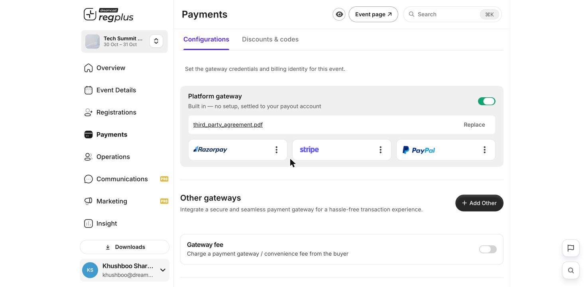
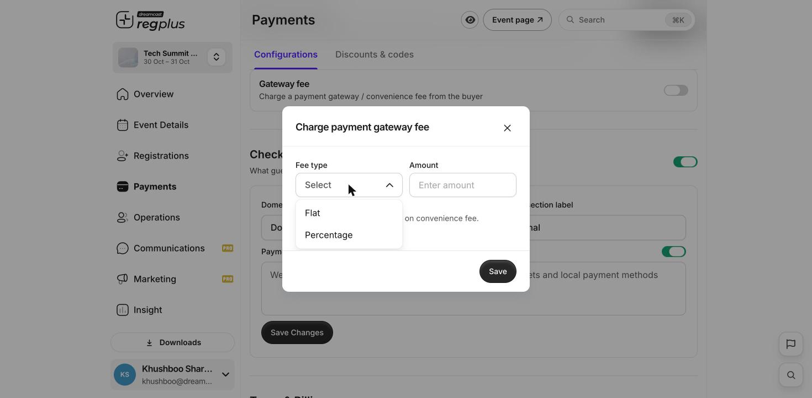
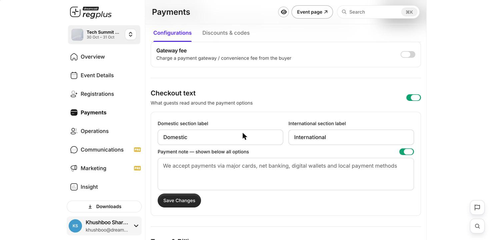
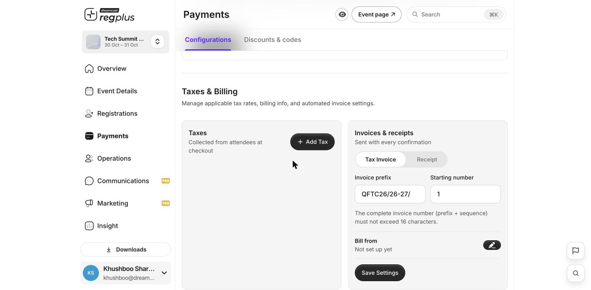
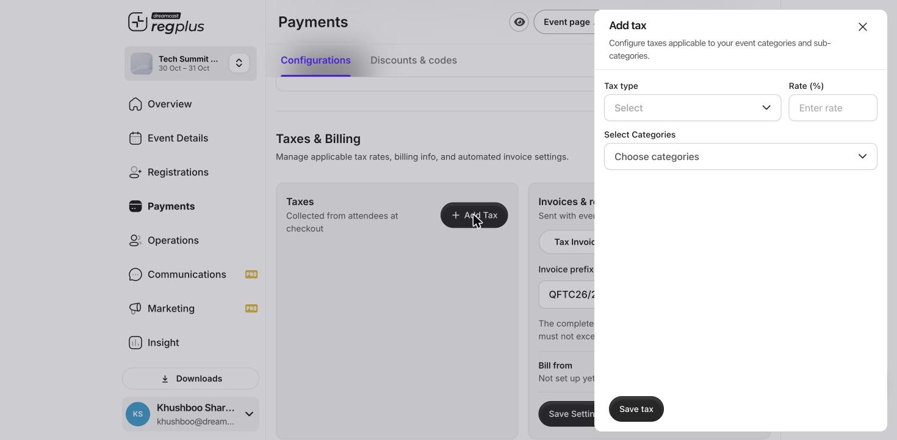

**In short:** Everything about how guests pay lives in **Payments → Configurations** — which gateway runs checkout, whether you add a convenience fee, the text guests read, and how taxes and invoices work. Set these up once before you open bookings.

<Info>
  **Where to find it:** Open **Payments** from the left menu and stay on the **Configurations** tab. Click **Save Changes** or **Save Settings** in each section after you edit it.
</Info>

## Choose your gateway

<Frame caption="The Payments Configurations screen — platform gateway plus your own providers.">
  
</Frame>

**Platform gateway** is built in and on by default — no setup, settled straight to your payout account. It already offers **Razorpay**, **Stripe** and **PayPal** as methods; use the **⋮** on each card to edit where it's accepted or turn one off.

When you first switch the platform gateway on, regplus shows a **Third-party agreement** step. Click to download the **Pure Agent cum Professional Services Agreement**, fill it in, and upload the signed copy here. The file you've uploaded appears on the gateway card, with a **Replace** link if you need to change it later.

**Other gateways** lets you connect your **own** provider so money lands directly in your account. Click **Add Other**, pick a provider from the list (Razorpay, Stripe, PayPal, HDFC SmartGateway and more), and fill in its credentials. Step-by-step guides:

<CardGroup cols={3}>
  <Card title="Set up Razorpay" icon="credit-card" href="/regplus/how-to-setup-razorpay">
  </Card>

  <Card title="Set up Stripe" icon="stripe-s" href="/regplus/how-to-setup-stripe">
  </Card>

  <Card title="Set up PayPal" icon="paypal" href="/regplus/how-to-setup-paypal">
  </Card>
</CardGroup>

## Add a gateway fee (optional)

Turn on **Gateway fee** to pass the payment / convenience fee on to the buyer at checkout, rather than absorbing it in your ticket price. A short form opens:

<Frame caption="Charge a flat or percentage gateway fee from the buyer.">
  
</Frame>

| Field | What to enter |
| --- | --- |
| **Fee type** | **Flat** adds a fixed amount to every order; **Percentage** adds a share of the order total |
| **Amount** | The flat value, or the percentage, to charge |

The fee shown to the buyer already includes any tax charged on the convenience fee. Click **Save** to apply, or leave the toggle off to keep your price all-in.

## Write the checkout text

Turn on **Checkout text** to control the words guests read around the payment options.

<Frame caption="Labels and note shown around the payment options at checkout.">
  
</Frame>

| Field | What it does |
| --- | --- |
| **Domestic section label** | Heading over domestic payment methods (default _Domestic_) |
| **International section label** | Heading over international methods (default _International_) |
| **Payment note** | A line shown below all options — e.g. _"We accept payments via major cards, net banking, digital wallets and local payment methods."_ Use its own toggle to show or hide it |

Click **Save Changes** when you're done.

## Set up taxes and invoices

Scroll to **Taxes & Billing** to collect tax and control the invoices guests receive.

<Frame caption="Taxes, invoice numbering and your billing identity.">
  
</Frame>

### Add a tax

Click **Add Tax** to collect a tax from attendees at checkout.

<Frame caption="Add a tax rate and choose which ticket types it applies to.">
  
</Frame>

| Field | What to enter |
| --- | --- |
| **Tax type** | The kind of tax — GST, VAT or another |
| **Rate (%)** | The percentage to charge |
| **Select Categories** | The ticket types the tax applies to |

Click **Save tax**. Add as many taxes as you need — each one can apply to different ticket types.

### Invoices & receipts

Choose whether guests get a **Tax Invoice** or a **Receipt** with every confirmation, then set how the numbers are built:

- **Invoice prefix** and **Starting number** — the complete number (prefix + sequence) must stay within **16 characters**.
- **Bill from** — click the pencil to open **Billing identity** and enter your business details. Enter your **GSTIN** and regplus validates it against the GST portal and fills in your company name and address for you.

Click **Save Settings** to apply. For the full walkthrough — including the difference between a tax invoice and a receipt — see [Tax invoices & receipts](/regplus/how-to-tax-invoice).

<Tip>
  Set your **Bill from** details and a sensible **Invoice prefix** before you open bookings, so every guest's invoice is numbered correctly from the first sale.
</Tip>

## What's next?

<CardGroup cols={2}>
  <Card title="Tax invoices & receipts" icon="receipt" href="/regplus/how-to-tax-invoice">
    Set up compliant invoices and receipts for attendees.
  </Card>

  <Card title="Read your financial report" icon="indian-rupee-sign" href="/regplus/insight-financial">
    Track orders and revenue.
  </Card>
</CardGroup>
