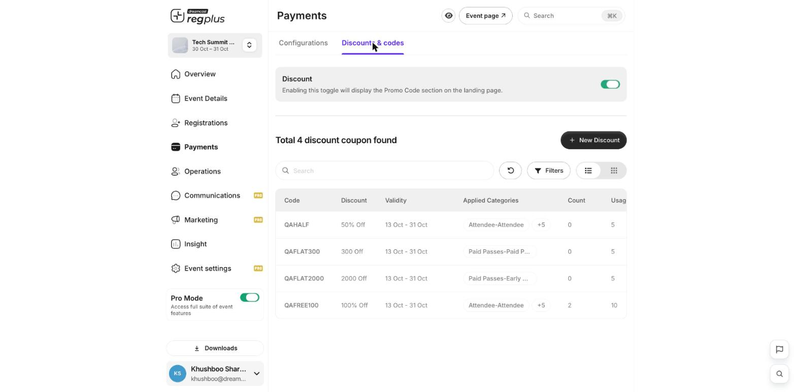
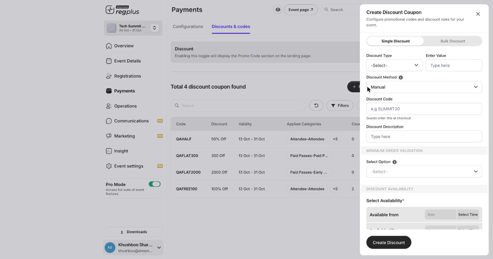

**In short:** Discount codes let guests take money off at checkout. Create them under **Payments → Discounts & codes**, as a single code or in bulk.

## Turn on discounts

Open **Payments → Discounts & codes** and switch **Discount** on. This shows the **Promo Code** box on your event's landing page so guests can enter a code at checkout.

<Frame>
  
</Frame>

The table lists every code with its **discount**, **validity**, the **ticket types** it applies to, how many times it's been **used**, and its **usage limit**.

## Create a single code

<Steps>
  <Step title="New Discount">
    Click **New Discount** and stay on the **Single Discount** tab.

    <Frame>
      
    </Frame>
  </Step>
  <Step title="Set the discount">
    Choose a **Discount Type** — a **percentage** (e.g. 50% off) or a **flat** amount (e.g. ₹300 off) — and enter the **value**.
  </Step>
  <Step title="Name the code">
    Enter the **Discount Code** guests will type at checkout (e.g. _SUMMIT20_) and an optional **description** for your own reference.
  </Step>
  <Step title="Add limits and rules">
    Optionally set a **minimum order** rule, a **usage limit**, a **validity window** (start and end dates), and which **ticket types** the code applies to.
  </Step>
  <Step title="Create">
    Click **Create Discount**. The code is live immediately within its validity window.
  </Step>
</Steps>

## Field reference

| Field | What it does |
| --- | --- |
| **Discount Type** | Percentage or flat amount off |
| **Enter Value** | The size of the discount (e.g. 50 or 300) |
| **Discount Method** | How it's applied — e.g. **Manual** (guest types the code) |
| **Discount Code** | What guests enter at checkout |
| **Discount Description** | A private note to help you recognise the code |
| **Minimum order validation** | Require a minimum cart value before the code works |
| **Discount Availability** | The ticket types and/or dates the code is valid for |

## Create codes in bulk

Switch to the **Bulk Discount** tab to generate many unique codes at once — handy for sponsor allocations or one-use invites, where each guest gets their own code.

<Tip>
  Use a short validity window and a usage limit on high-value codes (like 100% off) so they can't be shared and over-used. You can watch usage climb in the **Count** column.
</Tip>

## What's next?

<CardGroup cols={2}>
  <Card title="Configure payments & taxes" icon="sliders" href="/regplus/how-to-configure-payments">
    Fees, checkout text and invoices.
  </Card>

  <Card title="Set up ticket types & pricing" icon="ticket" href="/regplus/ticket-types">
    What the codes apply to.
  </Card>
</CardGroup>
