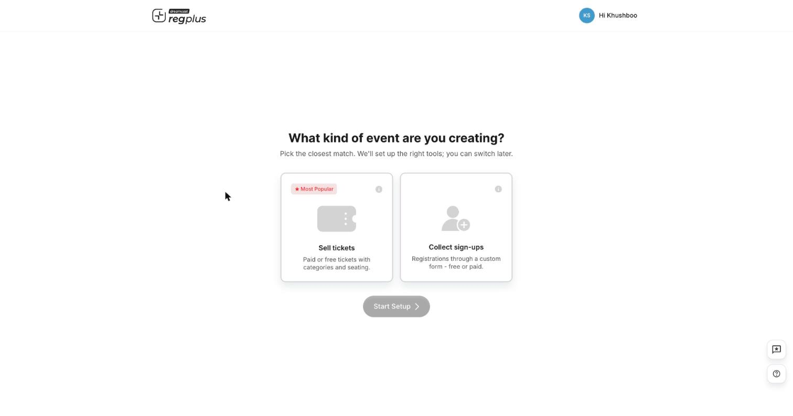
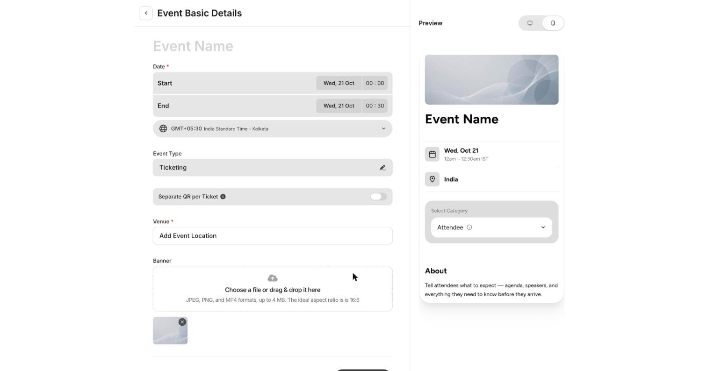

**In short:** Creating an event takes two quick decisions — what kind of event it is, and its basic details. regplus then sets up the right tools and drops you into the dashboard to finish the rest.

## Step 1 — Start a new event

Click the **event switcher** at the top of the sidebar and choose **Create New Event** (or **View All Events → Create**).

## Step 2 — Choose the event type

<Frame>
  
</Frame>

| Type | Choose it when |
| --- | --- |
| **Sell tickets** _(most popular)_ | You're selling paid or free tickets with ticket types (categories) — conferences, shows, workshops. |
| **Collect sign-ups** | You just need registrations through a custom form — free or paid — like RSVPs or webinars. |

<Note>
  This only sets your starting tools. You can switch later, so pick the closest match and move on.
</Note>

Select a type and click **Start Setup**.

## Step 3 — Fill in the basic details

<Frame>
  
</Frame>

The form on the left updates the **live preview** on the right as you type.

| Field | What to enter |
| --- | --- |
| **Event Name** | Your event's public title |
| **Date — Start / End** | The start and end date **and time** |
| **Timezone** | The event's timezone (e.g. GMT+05:30 India Standard Time) |
| **Event Type** | Ticketing or sign-up — set from Step 2, editable here |
| **Separate QR per Ticket** | Turn on to give every ticket in an order its own QR (useful for group bookings where each person scans in separately) |
| **Venue** | The event location (required) |
| **Banner** | Your cover image or video — JPEG, PNG or MP4, up to 4 MB, ideal ratio **16:6** |

Save to create the event. You'll land on the **Overview** with a setup checklist for the rest.

## What to set up next

After the event exists, work through these in order:

<CardGroup cols={2}>
  <Card title="Build your ticket types" icon="ticket" href="/regplus/how-to-ticket-types">
    Categories, tiers, pricing and sale windows.
  </Card>

  <Card title="Build your registration form" icon="list-check" href="/regplus/how-to-registration-form">
    Decide what details you collect.
  </Card>

  <Card title="Configure payments & taxes" icon="sliders" href="/regplus/how-to-configure-payments">
    Gateway, fees and invoices.
  </Card>

  <Card title="Design and print badges" icon="id-badge" href="/regplus/how-to-badges">
    Mobile and physical badges.
  </Card>
</CardGroup>

## FAQ

<AccordionGroup>
  <Accordion title="Can I change the event type after creating it?">
    Yes. The type only decides which tools are switched on at the start; you can adjust later from the event's settings.
  </Accordion>

  <Accordion title="What's the best banner size?">
    Use a **16:6** image or video under 4 MB. A wide, text-light banner looks best because text and buttons sit over and around it on the event page.
  </Accordion>

  <Accordion title="When should I turn on Separate QR per Ticket?">
    When one person books several tickets for different people and each attendee needs to scan in on their own. Leave it off if the buyer checks in the whole group together.
  </Accordion>
</AccordionGroup>
