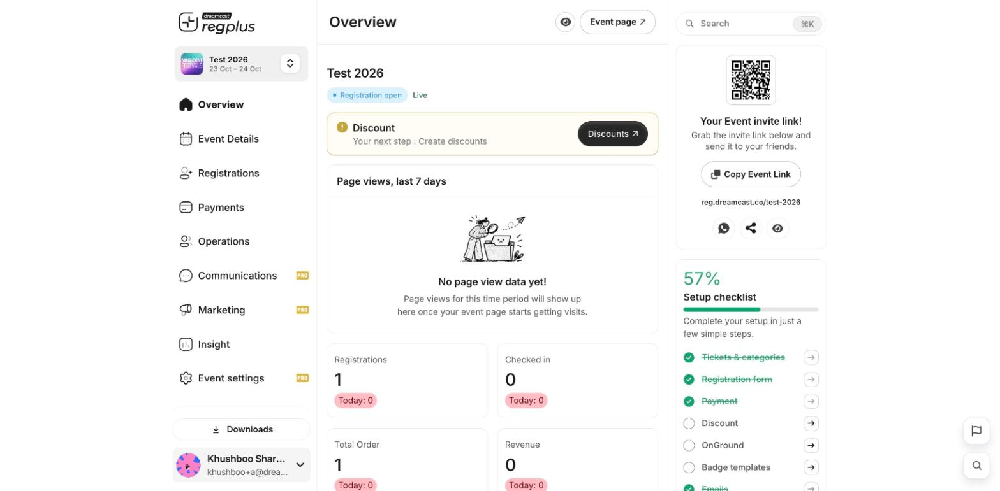

**In short:** Every event opens in the same dashboard. The **left menu** holds the modules for running the event, the **top-left switcher** moves between events, and the **right panel** shows your invite link and setup checklist.

<Frame caption="The event dashboard — modules on the left, your event at a glance in the centre and right.">
  
</Frame>

## Switch between events

The card at the **top-left** shows the event you're working on. Click it to switch to another event, or go back to the full [event list](/regplus/overview) to open a different one or create a new event.

## The left menu

Each item opens a module for running your event:

| Module | What it's for |
| --- | --- |
| **Overview** | Headline numbers and your setup checklist. |
| **Event Details** | Banner, dates, venue, event link and host details. See [Event details](/regplus/event-details). |
| **Registrations** | Ticket types, the registration form and the invite app. See [Ticket types](/regplus/ticket-types). |
| **Payments** | Gateways, fees, taxes and discounts. See [Payments](/regplus/payments). |
| **Operations** | Badges and on-ground check-in. See [Badges & check-in](/regplus/badges-check-in). |
| **Communications** | Emails and WhatsApp to attendees. See [Emails & WhatsApp](/regplus/emails-whatsapp). |
| **Marketing** | Tracking links, pixels, sharing and embeds. See [Promote your event](/regplus/tracking-links). |
| **Insight** | Reports on money, people, traffic and attendance. See [Insights & reports](/regplus/insights-reports). |
| **Event settings** | Team roles, extensions, API and the danger zone. See [Roles & permissions](/regplus/roles-permissions). |

<Note>
  Some modules carry a **PRO** badge. Turn on **Pro Mode** at the bottom of the left menu to use them — see [Plans & billing](/regplus/plans-billing) and [Advanced mode](/regplus/advanced-mode).
</Note>

## Search anything

Use the **Search** box at the top (or press `Cmd/Ctrl + K`) to jump straight to a setting, page or attendee without clicking through the menus.

## The right panel

On the Overview, the right panel gives you:

- **Your event invite link** — a QR code and a **Copy Event Link** button to share your event.
- **Setup checklist** — the steps left to get your event ready; each links straight to where you finish it.

## Downloads and your account

- **Downloads** (bottom of the menu) collects the exports you've generated. See [Export your data](/regplus/exports).
- **Your name** (bottom-left) opens the account menu — profile, organisation, switch profile and logout. See [Account & organisation](/regplus/how-to-account-org).

## FAQs

<AccordionGroup>
  <Accordion title="A module has a PRO badge and I can't open it.">
    Turn on **Pro Mode** at the bottom of the left menu. If it's still unavailable, it may depend on your plan — see [Plans & billing](/regplus/plans-billing).
  </Accordion>

  <Accordion title="How do I get back to all my events?">
    Click the event card at the top-left and choose another event, or return to the [event list](/regplus/overview).
  </Accordion>

  <Accordion title="What's the fastest way to find a setting?">
    Press `Cmd/Ctrl + K` and search for it by name.
  </Accordion>
</AccordionGroup>

## What's next?

<CardGroup cols={2}>
  <Card title="Create your first event" icon="calendar-plus" href="/regplus/how-to-create-event">
    Build and publish an event end to end.
  </Card>

  <Card title="Account & organisation" icon="id-card" href="/regplus/how-to-account-org">
    Set your profile, organisation and branding.
  </Card>
</CardGroup>
