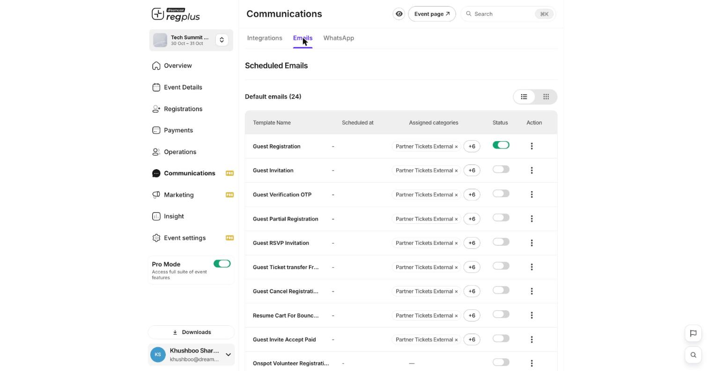
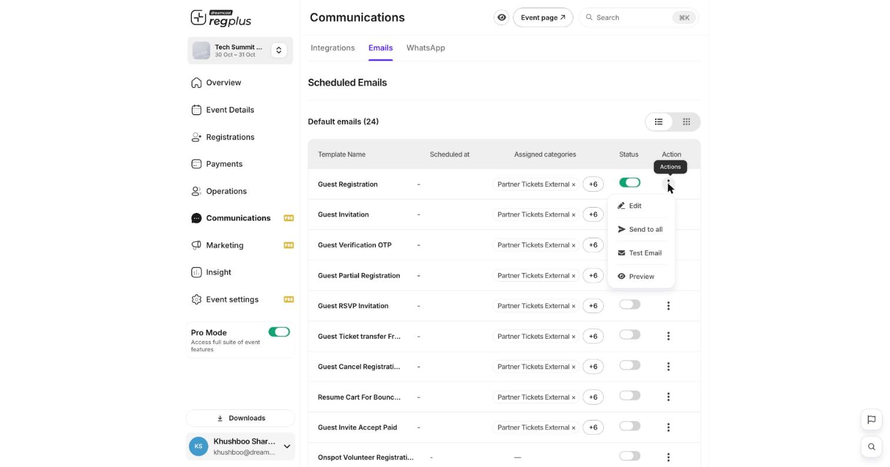
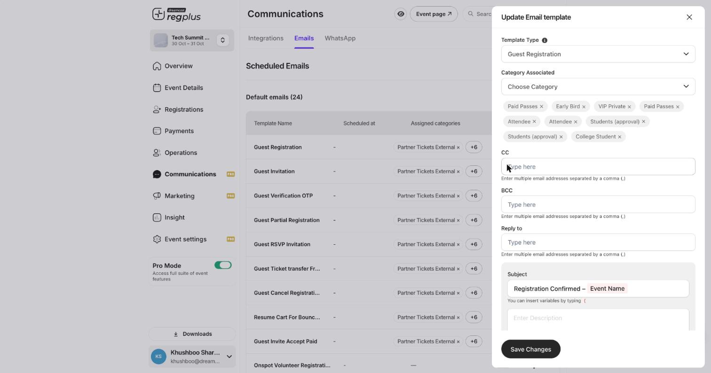
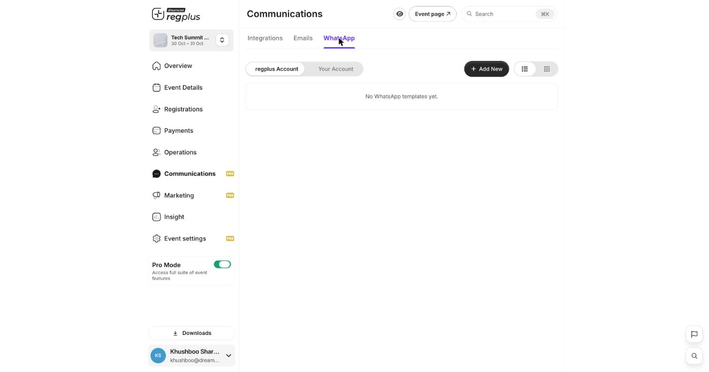

## In short

regplus sends your guests the right message at the right moment — a registration confirmation, an OTP, a reminder, a cancellation notice — from a set of ready-made templates. You decide which ones are switched on, which ticket types they go to, and exactly what they say. This guide covers both channels: **email** and **WhatsApp**.

<Info>
**Where to find it:** Open **Communications** from the left menu. The **Emails** and **WhatsApp** tabs hold the templates; the **Integrations** tab controls which server and provider they send through. This is a Pro feature.
</Info>

## The default email templates

The **Emails** tab lists 24 ready-made templates — one for each thing that can happen to a registration. Each row shows the template name, when it is scheduled, which ticket types it is assigned to, and an on/off switch.

<Frame caption="The Emails tab — every transactional template, with a per-template on/off switch.">
  
</Frame>

Some of the templates you will use most:

| Template | When it sends |
| --- | --- |
| **Guest Registration** | A guest completes their registration — their confirmation. |
| **Guest Invitation** | You invite a guest to register. |
| **Guest Verification OTP** | A one-time code to verify the guest's email or phone. |
| **Guest Partial Registration** | A guest started but did not finish — a nudge to come back. |
| **Guest RSVP Invitation** | An RSVP-style invite to confirm attendance. |
| **Guest Ticket Transfer** | A ticket is moved to another person. |
| **Guest Cancel Registration** | A registration is cancelled. |
| **Resume Cart** | A reminder to finish an abandoned paid registration. |

<Tip>
The **Status** switch on each row turns a template on or off. The **Assigned categories** column shows which ticket types it applies to — so you can, for example, send a different confirmation to VIPs than to general attendees.
</Tip>

## Work with a template

The **Action** menu (the three dots at the end of each row) gives you four choices.

<Frame caption="The per-template action menu.">
  
</Frame>

| Action | What it does |
| --- | --- |
| **Edit** | Open the template to change its subject, body, recipients and assigned ticket types. |
| **Send to all** | Send this email now to everyone it applies to. |
| **Test Email** | Send yourself a test copy first — always do this before Send to all. |
| **Preview** | See how the email will look without sending. |

### Edit a template

Choosing **Edit** opens the template editor.

<Frame caption="The email template editor — recipients, subject and body, with variables.">
  
</Frame>

| Field | What it does |
| --- | --- |
| **Template Type** | Which event this template responds to (for example *Guest Registration*). |
| **Category Associated** | The ticket types this template is sent to. Add or remove ticket-type chips here. |
| **CC / BCC** | Extra addresses to copy on every send — enter multiple separated by commas. |
| **Reply to** | Where replies from guests should land. |
| **Subject** | The email subject line. |
| **Description** | The body of the email. |

<Note>
To drop in a guest's details — their name, the event name, their ticket — type a curly brace `{` in the subject or body and pick a variable from the list. For example, the default registration subject is `Registration Confirmed – {Event Name}`. Variables fill in automatically for each guest.
</Note>

Click **Save Changes** when you are done.

## Choose how emails are sent

The **Integrations** tab decides the plumbing behind every email:

- **Use platform email server** — the quick option, no setup. regplus sends on your behalf.
- Turn it off to send from **your own** email server, so emails come from your domain.
- **Sender identity** — set the **Sender Name** and **Sender Email** your guests see in their inbox.

## Send over WhatsApp

The **WhatsApp** tab works the same way as emails, but over WhatsApp. You choose which account the messages send from:

<Frame caption="WhatsApp templates — send from the regplus account or connect your own.">
  
</Frame>

| Option | What it means |
| --- | --- |
| **regplus Account** | Use the platform's pre-approved WhatsApp templates — no setup needed. |
| **Your Account** | Connect your own WhatsApp Business provider so messages come from your number. |

To switch WhatsApp on, go to the **Integrations** tab, turn on **Default WhatsApp integration**, and use **Sync Template** to pull in the pre-approved templates. To use your own number instead, use **Add Provider** under *Your WhatsApp providers*.

## FAQs & troubleshooting

<AccordionGroup>
  <Accordion title="A confirmation email is not going out. Why?">
    Check two things: the template's **Status** switch is on, and the guest's ticket type is listed under **Assigned categories**. If either is missing, the email will not send to that guest.
  </Accordion>
  <Accordion title="Can I change the wording of a confirmation?">
    Yes. Open the template's **Edit** action and change the Subject and Description. Use the curly-brace variables to insert guest or event details, and send yourself a **Test Email** before saving.
  </Accordion>
  <Accordion title="How do I make emails come from my own domain?">
    On the **Integrations** tab, turn off **Use platform email server** and configure your own email server, then set your **Sender identity**.
  </Accordion>
  <Accordion title="Do I need my own WhatsApp number to send WhatsApp messages?">
    No. The **regplus Account** option uses pre-approved templates with no setup. Connect **Your Account** only if you want messages to come from your own WhatsApp Business number.
  </Accordion>
</AccordionGroup>

## What's next?

<CardGroup cols={2}>
  <Card title="Read your Insight reports" icon="chart-line" href="/regplus/how-to-insight-reports">
    See how your sends and registrations are performing.
  </Card>
  <Card title="Manage your guest list" icon="users" href="/regplus/how-to-manage-guests">
    Check who has registered and chase pending guests.
  </Card>
</CardGroup>
