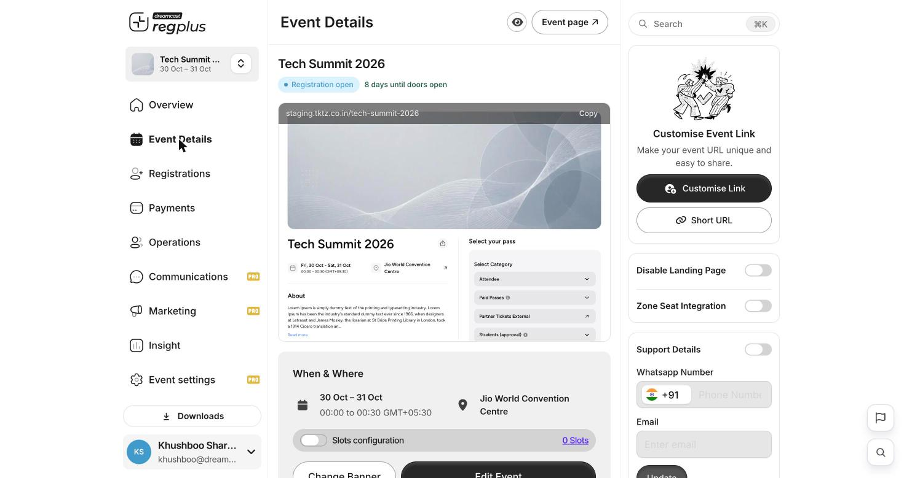
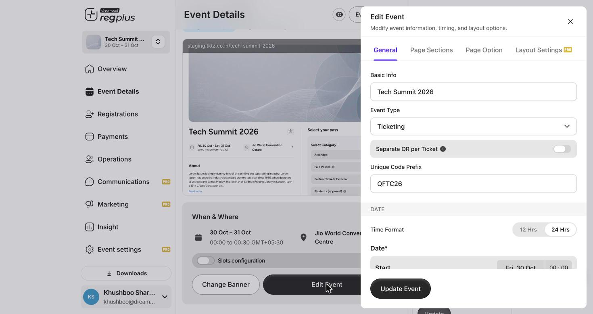
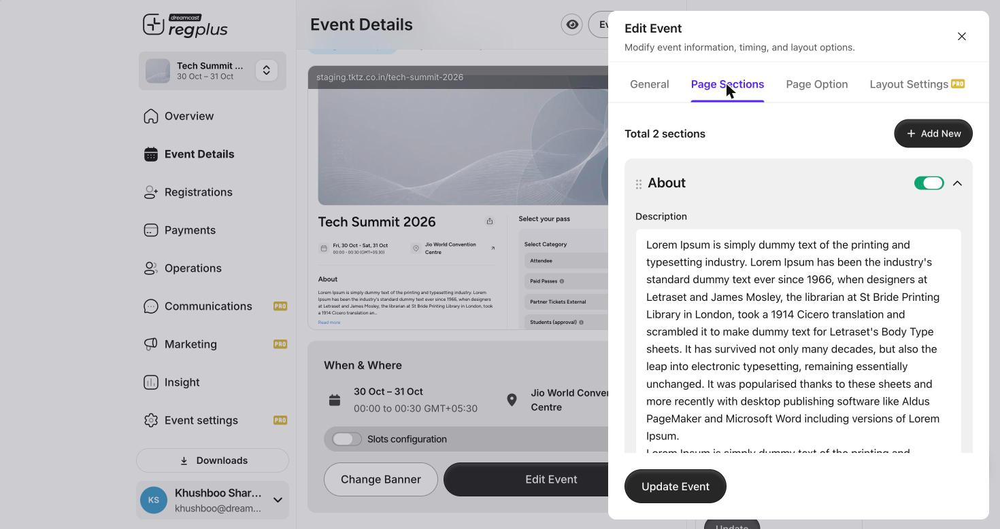
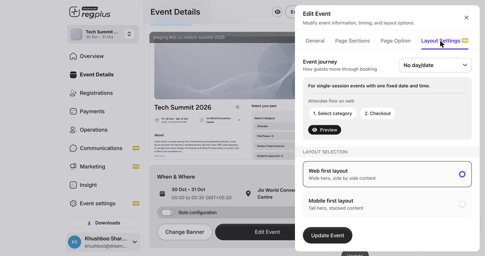

## In short

**Event Details** is where you design the page guests actually see — the banner, the title and dates, the “About” story, the support contacts, the booking button and the overall layout. Everything here is shown on your public event page, with a live preview so you can see changes as you make them.

<Info>
**Where to find it:** Open **Event Details** from the left menu.
</Info>

## The Event Details screen

<Frame caption="Event Details — a live preview of the public page, with the URL, support and banner controls around it.">
  
</Frame>

The big preview in the middle is your live public page. Around it are the controls:

| Control | What it does |
| --- | --- |
| **Event URL + Copy** | Your public link (for example `staging.tktz.co.in/your-event`). **Copy** grabs it to share. |
| **Customise Link** | Set a clean, memorable URL slug instead of the default. |
| **Short URL** | Generate a shortened link for places with tight character limits. |
| **Disable Landing Page** | Turn the public page off — use this when you only take registrations by invite or embed. |
| **Zone Seat Integration** | Connect seat/zone selection, for events that use seating. |
| **Support Details** | Show a WhatsApp number and email on the page so guests can reach you. Enter them and click **Update**. |
| **Change Banner** | Upload the hero image at the top of the page. |
| **Edit Event** | Open the full editor (covered below). |

The **When & Where** block shows your dates and venue, and a **Slots configuration** toggle for events that run in time slots.

## Edit Event

**Edit Event** opens a four-tab editor: **General**, **Page Sections**, **Page Option** and **Layout Settings**.

### General — the basics

<Frame caption="The General tab — name, type, code prefix and dates.">
  
</Frame>

| Field | What it does |
| --- | --- |
| **Basic Info** | The event name shown everywhere. |
| **Event Type** | **Ticketing** or **Registration** — how this event works. |
| **Separate QR per Ticket** | Give each ticket its own QR code instead of one per order. |
| **Unique Code Prefix** | A short prefix on every ticket code (for example `QFTC26`), so codes are easy to recognise. |
| **Time Format** | Show times in **12 Hrs** or **24 Hrs**. |
| **Date** | The event's start and end date and time. |

### Page Sections — the page content

<Frame caption="Page Sections — add, reorder and toggle the content blocks on your page.">
  
</Frame>

Each section is a content block on your public page — for example **About**, with a rich-text description. You can:

- **Add New** to create more sections.
- **Drag** a section (the handle on the left) to reorder it.
- Use each section's **toggle** to show or hide it without deleting it.

### Page Option — the booking button

The **Page Option** tab controls the call-to-action wording:

- **Button text** — the main booking button label (for example *Proceed to Book*).
- **“Book another ticket” after checkout** — turn on to invite guests to book again, and set its wording.

### Layout Settings — how the page is arranged

<Frame caption="Layout Settings — the attendee journey and the page layout.">
  
</Frame>

This Pro tab shapes how guests move through booking and how the page looks:

| Setting | What it does |
| --- | --- |
| **Event journey** | How guests move through booking — for example a single-session flow (*Select category → Checkout*) for an event with one fixed date and time. |
| **Web first layout** | Wide hero with side-by-side content — best for desktop-heavy audiences. |
| **Mobile first layout** | Tall hero with stacked content — best when most guests are on phones. |

Use **Preview** to see the chosen journey, then **Update Event** to save.

## FAQs & troubleshooting

<AccordionGroup>
  <Accordion title="How do I get a clean, shareable link?">
    Use **Customise Link** to set a memorable slug, and **Short URL** when you need something tiny for ads or print.
  </Accordion>
  <Accordion title="I only take registrations by invite — can I hide the public page?">
    Yes. Turn on **Disable Landing Page**. Guests then come in only through invites or embeds.
  </Accordion>
  <Accordion title="How do I add an agenda, speakers or FAQ to the page?">
    Open **Edit Event → Page Sections** and use **Add New** to create a section, then drag it into the order you want.
  </Accordion>
  <Accordion title="Most of my guests are on mobile. Which layout should I pick?">
    Choose **Mobile first layout** under Layout Settings — a tall hero with stacked content reads better on phones.
  </Accordion>
  <Accordion title="How do guests reach me with questions?">
    Turn on **Support Details**, add a WhatsApp number and email, and click **Update**. They appear on the public page.
  </Accordion>
</AccordionGroup>

## What's next?

<CardGroup cols={2}>
  <Card title="Build ticket types" icon="ticket" href="/regplus/how-to-ticket-types">
    Set up the passes guests choose from on this page.
  </Card>
  <Card title="Promote & track your event" icon="bullhorn" href="/regplus/how-to-marketing">
    Share the page with tracked links and embeds.
  </Card>
</CardGroup>
