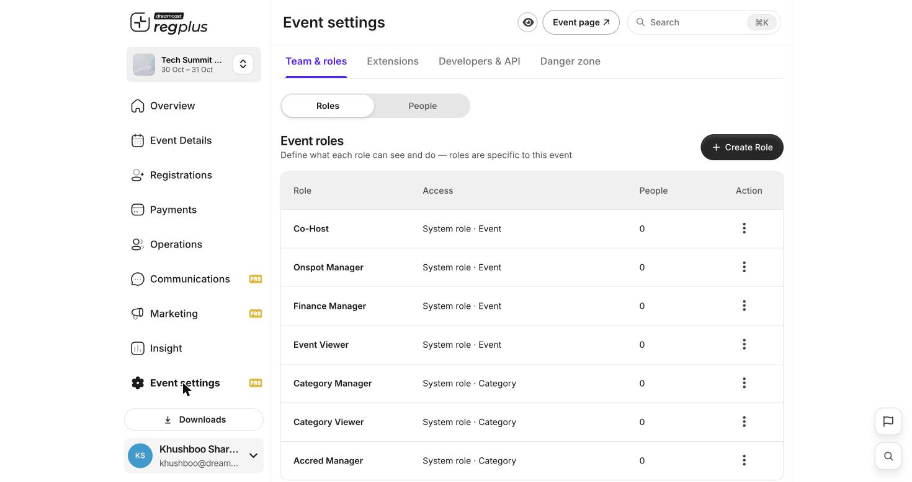
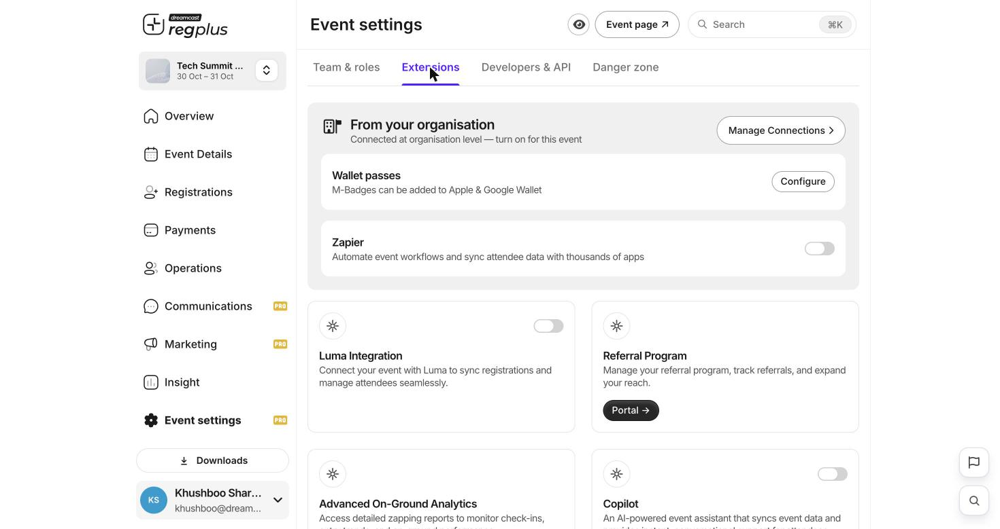

## In short

**Event settings** is the admin corner of your event: who on your team can do what, which extensions are switched on, developer webhooks, and the delete button. This guide walks through all four tabs.

<Info>
**Where to find it:** Open **Event settings** from the left menu. This is a Pro feature. The four tabs are **Team & roles**, **Extensions**, **Developers & API** and **Danger zone**.
</Info>

## Team & roles

This tab has two halves — **Roles** (what each role can do) and **People** (who is on the team).

<Frame caption="Event roles — ready-made roles, each scoped to the whole event or a single ticket type.">
  
</Frame>

### Roles

Roles are specific to this event. Each one has an **Access** scope — either the whole event, or a single ticket type (shown as *Category*). The ready-made system roles:

| Role | Scope | Good for |
| --- | --- | --- |
| **Co-Host** | Whole event | A trusted partner who helps run everything. |
| **Onspot Manager** | Whole event | Whoever runs check-in and on-ground on the day. |
| **Finance Manager** | Whole event | Someone who needs payments and settlement, not everything else. |
| **Event Viewer** | Whole event | Read-only access for a stakeholder. |
| **Category Manager** | One ticket type | A sponsor or partner who manages just their ticket type. |
| **Category Viewer** | One ticket type | Read-only access to one ticket type. |
| **Accred Manager** | One ticket type | Accreditation for a specific ticket type. |

Use **Create Role** if you need a custom set of permissions beyond these.

### People

Switch to **People** and use **Invite Member** to add someone by email and assign them one of the roles above. They get access scoped to exactly that role — nothing more.

<Tip>
Give people the narrowest role that still lets them do their job. A sponsor managing one ticket type should be a **Category Manager**, not a Co-Host.
</Tip>

## Extensions

Extensions connect your event to other tools. Some are connected once at the **organisation** level and then switched on per event; others are turned on right here.

<Frame caption="Extensions — organisation connections on top, individual extensions below.">
  
</Frame>

| Extension | What it does |
| --- | --- |
| **Wallet passes** | Lets M-Badges be added to Apple & Google Wallet. Use **Configure** to set it up. |
| **Zapier** | Automates workflows and syncs attendee data with thousands of other apps. |
| **Luma Integration** | Syncs registrations and attendees with Luma. |
| **Referral Program** | Runs and tracks a referral programme to grow reach. |
| **Advanced On-Ground Analytics** | Deeper zapping/check-in reporting for the on-ground app. |

<Note>
Connections marked *“From your organisation”* are set up once at the organisation level — use **Manage Connections** — and then you just switch them on for each event that needs them.
</Note>

## Developers & API

The **Developers & API** tab is where you wire regplus into your own systems with **webhooks**. Click **Add API** to register an endpoint, and regplus will post event data (such as new registrations) to it as things happen — useful for syncing into a CRM or a data warehouse. If you have no webhooks yet, the list is simply empty.

## Danger zone

The **Danger zone** holds one irreversible action: **Delete Event**. It permanently removes every registration, payment and report for the event.

<Warning>
Deleting an event cannot be undone. **Export your registrations, payments and reports first** (from the Insight reports and each ticket type's Guests list), then delete only if you are certain.
</Warning>

## FAQs & troubleshooting

<AccordionGroup>
  <Accordion title="I want a sponsor to manage only their own ticket type.">
    Invite them as a **Category Manager** scoped to that ticket type. They will see and manage only that category, not the rest of the event.
  </Accordion>
  <Accordion title="How do I let a colleague see reports but not change anything?">
    Invite them as an **Event Viewer** — read-only access to the whole event.
  </Accordion>
  <Accordion title="Can I add my event's badges to Apple or Google Wallet?">
    Yes — turn on **Wallet passes** under Extensions and use **Configure**. Guests can then add their M-Badge to their phone's wallet.
  </Accordion>
  <Accordion title="I turned on an extension but nothing happened.">
    Some extensions are connected at the organisation level first. Use **Manage Connections** to check the connection exists, then switch it on for this event.
  </Accordion>
  <Accordion title="Is deleting an event reversible?">
    No. Everything — registrations, payments and reports — is permanently lost. Always export first.
  </Accordion>
</AccordionGroup>

## What's next?

<CardGroup cols={2}>
  <Card title="Set up on-ground check-in" icon="qrcode" href="/regplus/how-to-onground-checkin">
    Give your Onspot Manager the check-in tools they need.
  </Card>
  <Card title="Read your Insight reports" icon="chart-line" href="/regplus/how-to-insight-reports">
    Export everything before you ever touch the Danger zone.
  </Card>
</CardGroup>
