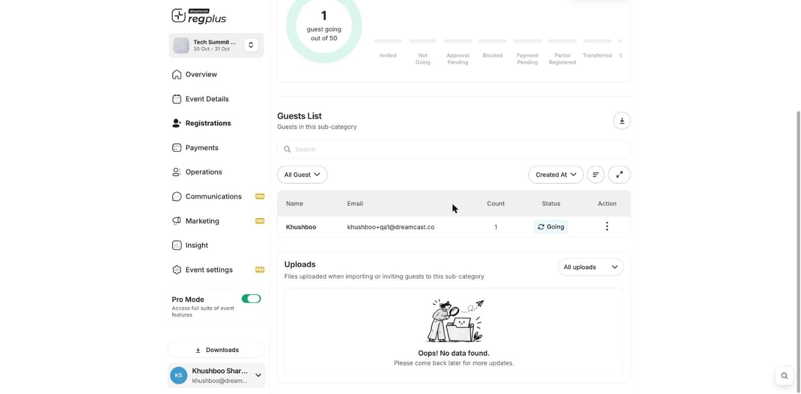

**In short:** You can download your guest list as a file, ready to open in a spreadsheet. Export it straight from a ticket type's guest list, and find all your exports under **Downloads**.

## Export a guest list

<Steps>
  <Step title="Open the guest list">
    Go to **Registrations → Categories**, click **Manage** on a ticket type, and open the **Guests** tab.
  </Step>
  <Step title="Download it">
    Click the **download** icon on the **Guests List** to export those guests.

    <Frame>
      
    </Frame>
  </Step>
  <Step title="Find your file under Downloads">
    Your export is prepared and collected under **Downloads** in the left menu — click **View All Downloads** to grab the file.
  </Step>
</Steps>

<Tip>
  You can also export your insight reports from **Insight** (look for the download option on each report), and have reports emailed to you on a schedule. See [Schedule reports by email](/regplus/insight-schedule-report).
</Tip>

## What's next?

<CardGroup cols={2}>
  <Card title="Exports" icon="download" href="/regplus/exports">
    More on what you can export.
  </Card>

  <Card title="Read your financial report" icon="indian-rupee-sign" href="/regplus/insight-financial">
    See your sales and revenue.
  </Card>
</CardGroup>
