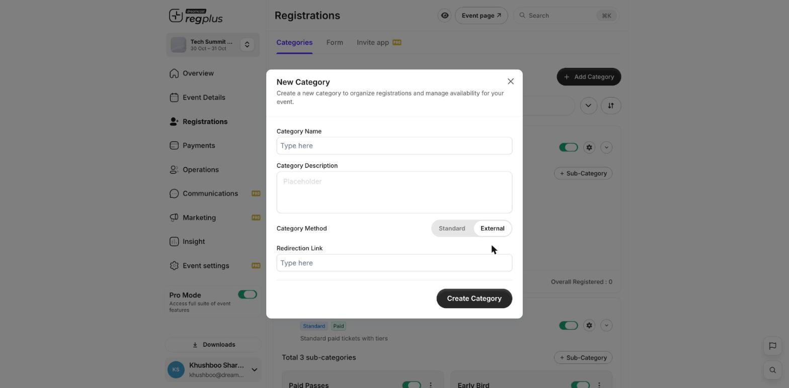

**In short:** You can add a ticket type that sends guests to another website instead of booking on regplus. Use it when a partner or a different platform handles that ticket.

## Add an external ticket type

<Steps>
  <Step title="Add a category">
    Go to **Registrations** and click **\+ Add Category**.
  </Step>
  <Step title="Choose the external method">
    Set the category method to **External**, then paste the web address guests should go to in the **Redirection Link** field.

    <Info icon="image">
      
    </Info>
  </Step>
  <Step title="Save">
    Click **Create Category**. On your event page, that option now opens the external site instead of the regplus checkout.
  </Step>
</Steps>

<Note>
  regplus can't see sign-ups that happen on the other website, so those guests won't appear in your registrant list or counts. Check the other platform for those numbers.
</Note>

## What's next?

<CardGroup cols={2}>
  <Card title="Ticket types & pricing" icon="ticket" href="/regplus/ticket-types">
    Set up your other ticket types.
  </Card>

  <Card title="Tracking links (UTM)" icon="link" href="/regplus/tracking-links">
    See where your sign-ups come from.
  </Card>
</CardGroup>
