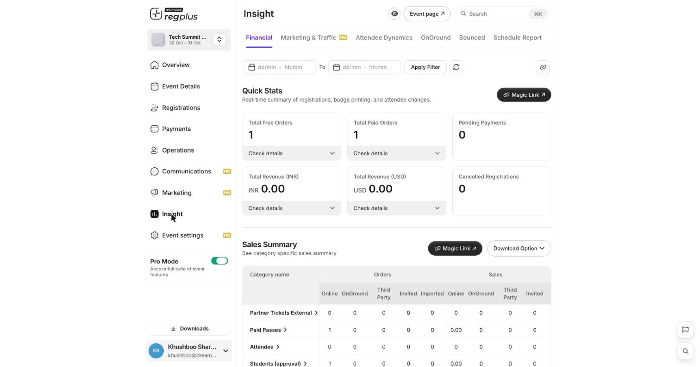
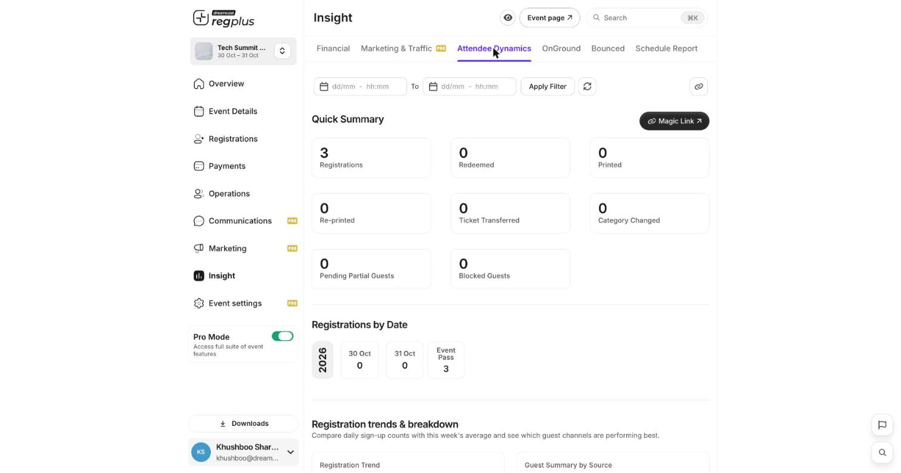
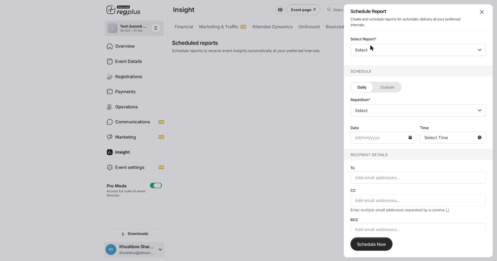

## In short

**Insight** is where you see how your event is doing — money in, who registered, who checked in, where your traffic came from, and which emails bounced. Every report can be filtered by date, shared as a live link, and set to arrive in your inbox on a schedule.

<Info>
**Where to find it:** Open **Insight** from the left menu. This is a Pro feature. Each report sits on its own tab across the top: **Financial**, **Marketing & Traffic**, **Attendee Dynamics**, **OnGround**, **Bounced**, and **Schedule Report**.
</Info>

<Tip>
Every report has a **date filter** at the top (From / To, then **Apply Filter**) and a **Magic Link** button. A Magic Link is a shareable, live view of that report — send it to a colleague or client and they always see the latest numbers, without a dashboard login.
</Tip>

## Financial

The money view — orders, revenue and what is still outstanding.

<Frame caption="The Financial report: quick stats on top, a category-by-category sales summary below.">
  
</Frame>

**Quick Stats** give you the headline numbers at a glance:

| Stat | What it means |
| --- | --- |
| **Total Free Orders** | Orders placed on free ticket types. |
| **Total Paid Orders** | Orders placed on paid ticket types. |
| **Pending Payments** | Orders where payment has not completed. |
| **Total Revenue (INR / USD)** | Money collected, split by currency. |
| **Cancelled Registrations** | Registrations that were cancelled. |

**Sales Summary** breaks orders and sales down by ticket type and by **channel** — Online, OnGround, Third Party, Invited and Imported — so you can see where your registrations are actually coming from. Use **Download Option** to export it.

## Attendee Dynamics

The people view — who registered and what happened to their tickets.

<Frame caption="Attendee Dynamics: a summary of registrations and ticket activity, plus trends.">
  
</Frame>

**Quick Summary** counts the key attendee actions:

| Stat | What it means |
| --- | --- |
| **Registrations** | Total people registered. |
| **Redeemed** | How many have been checked in / redeemed. |
| **Printed / Re-printed** | Badges printed, and badges printed again. |
| **Ticket Transferred** | Tickets moved to another person. |
| **Category Changed** | Guests moved between ticket types. |
| **Pending Partial Guests** | People who started but did not finish registering. |
| **Blocked Guests** | Guests you have blocked. |

Below that, **Registrations by Date** and **Registration trends & breakdown** show daily sign-up counts and a **Guest Summary by Source**, so you can see which channels are performing best over time.

## The other reports

| Tab | What it shows |
| --- | --- |
| **Marketing & Traffic** | Where your event-page visitors came from and how your promotion is converting — useful with UTM links from the Marketing module. |
| **OnGround** | Check-in and scan activity on event day — how many have been scanned in, and when. |
| **Bounced** | Emails that failed to deliver, so you can fix bad addresses. |

## Schedule a report to your inbox

Instead of opening Insight every day, have the numbers delivered automatically.

<Frame caption="The Schedule Report form — pick a report, a cadence and who receives it.">
  
</Frame>

On the **Schedule Report** tab, click **Schedule New** and fill in:

| Field | What to enter |
| --- | --- |
| **Select Report** | Which report to send (Financial, Attendee Dynamics, and so on). |
| **Daily / Custom** | Choose a daily cadence, or set your own with **Custom**. |
| **Repetition** | How often it repeats. |
| **Date / Time** | When the first report goes out. |
| **To / CC / BCC** | Who receives it — enter multiple email addresses separated by commas. |

Click **Schedule Now**. The report will arrive in those inboxes on the cadence you set.

## FAQs & troubleshooting

<AccordionGroup>
  <Accordion title="My numbers look wrong — am I seeing the whole event?">
    Check the **date filter** at the top of the report. If a From/To range is applied, you are only seeing that window. Clear or widen it to see everything.
  </Accordion>
  <Accordion title="How do I share a report without giving someone dashboard access?">
    Use the **Magic Link** button on the report. It gives a live, read-only view that updates on its own — no login required.
  </Accordion>
  <Accordion title="What is the difference between the sales channels?">
    **Online** is self-service registrations on your event page, **OnGround** is walk-ins registered at the venue, **Third Party** is external/partner sources, **Invited** came through invites, and **Imported** were uploaded by you.
  </Accordion>
  <Accordion title="Can I get a report automatically every morning?">
    Yes — use **Schedule Report**, pick the report, set a daily cadence and a time, and add the recipients.
  </Accordion>
</AccordionGroup>

## What's next?

<CardGroup cols={2}>
  <Card title="Set up emails & WhatsApp" icon="envelope" href="/regplus/how-to-emails-whatsapp">
    Turn insights into action with reminders and nudges.
  </Card>
  <Card title="Manage your guest list" icon="users" href="/regplus/how-to-manage-guests">
    Act on pending and partial registrations.
  </Card>
</CardGroup>
