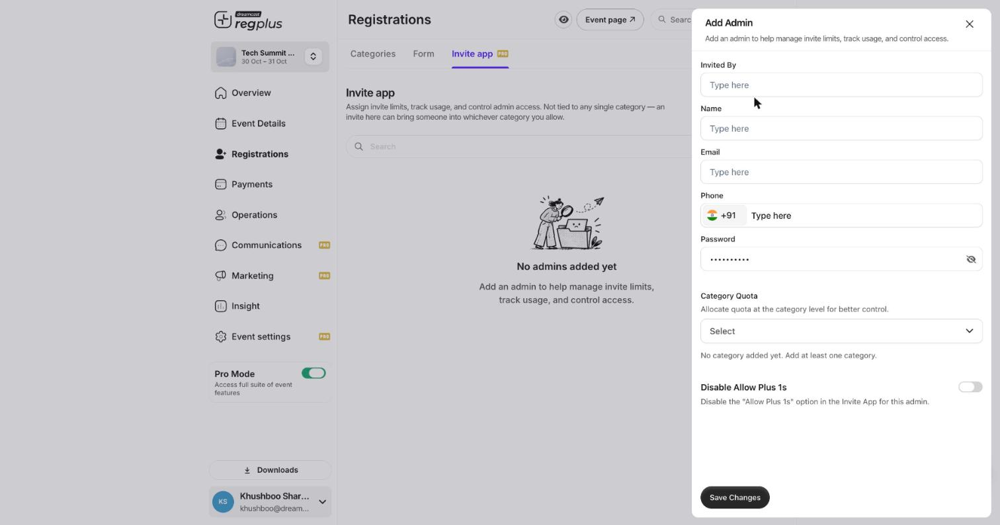

## In short

The **Invite app** lets you hand out invitations through other people — a sponsor, a sales lead, a community manager — while you stay in control of how many seats each of them can give away. You add them as *invite admins*, set a quota, and they invite guests from their own phone without ever touching your event settings.

<Info>
**Where to find it:** Open **Registrations** from the left menu and go to the **Invite app** tab. This is a Pro feature.
</Info>

<Note>
An invite admin is **not** tied to a single ticket type. The invites they send can bring a guest into whichever ticket types you allow through their quota — so one trusted person can invite across your whole event.
</Note>

## Add an invite admin

On the **Invite app** tab, click **Add New**. The **Add Admin** panel opens.

<Frame caption="The Add Admin panel — who the admin is, their login, and how many invites they get.">
  
</Frame>

### Field reference

| Field | What to enter |
| --- | --- |
| **Invited By** | Who this admin reports to or was added by — helpful for tracking which team or partner brought them on. |
| **Name** | The admin's full name. |
| **Email** | Their email — this is also their login for the Invite app. |
| **Phone** | Their mobile number, with country code. |
| **Password** | A login password for the Invite app. A password is pre-filled; you can set your own and share it with them. |
| **Category Quota** | The heart of the feature — choose which ticket types this admin can invite into, and how many seats they get in each. Add at least one ticket type first, then set a number against it. |
| **Disable Allow Plus 1s** | Turn on to stop this admin's guests from bringing additional people (+1s). Leave off to allow them. |

<Warning>
The **Category Quota** dropdown shows *"No category added yet"* until your event has ticket types set up. Build your ticket types first, then come back and assign quotas.
</Warning>

Click **Save Changes**. The admin now appears in the Invite app list, where you can track how many of their invites have been used.

## How admins use it

Once added, the admin signs in to the Invite app with the email and password you set. They can invite guests up to their quota — and when the quota runs out, they cannot invite any more until you raise it. Every invite they send flows back into the matching ticket type's **Guests** list, so you see everything in one place.

## Track usage

Back on the **Invite app** tab, each admin row shows their invite usage against their quota. This is how you keep an eye on a growing guest list without handing anyone access to your event's real settings.

## FAQs & troubleshooting

<AccordionGroup>
  <Accordion title="Can one admin invite into more than one ticket type?">
    Yes. In **Category Quota**, add each ticket type you want them to cover and give each its own number. Their invites can then land in any of those.
  </Accordion>
  <Accordion title="What happens when an admin uses up their quota?">
    They can no longer send invites until you increase their quota. Edit the admin and raise the number against the ticket type.
  </Accordion>
  <Accordion title="How is this different from inviting guests directly?">
    Inviting from a ticket type's **Guests** tab is you sending invites yourself. The Invite app lets *other people* send invites on your behalf, each with a capped quota and their own login — without access to your event settings.
  </Accordion>
  <Accordion title="Can I stop an admin's guests from bringing +1s?">
    Yes — turn on **Disable Allow Plus 1s** when you add or edit the admin.
  </Accordion>
</AccordionGroup>

## What's next?

<CardGroup cols={2}>
  <Card title="Manage your guest list" icon="users" href="/regplus/how-to-manage-guests">
    See every invited and registered guest, and their status.
  </Card>
  <Card title="Set up on-ground check-in" icon="qrcode" href="/regplus/how-to-onground-checkin">
    Scan guests in at the door on event day.
  </Card>
</CardGroup>
