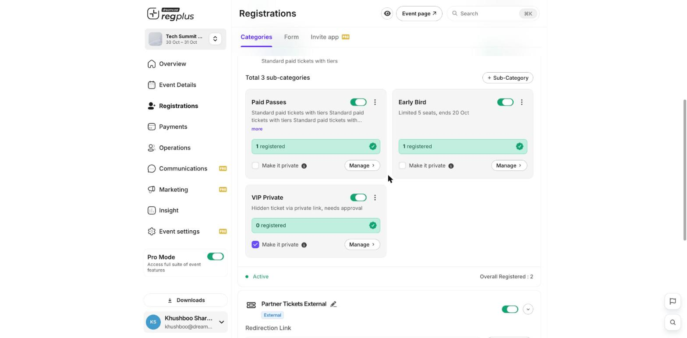

**In short:** Not every event should be open to the public. regplus lets you keep tickets hidden behind a private link, so only the people you share it with can register.

## Make a ticket type private

The main way to run invite-only is to mark a ticket type as private. It then disappears from your public event page and only opens to people who have its private link.

<Steps>
  <Step title="Open your ticket types">
    Go to **Registrations → Categories**.
  </Step>
  <Step title="Turn on Make it private">
    Tick **Make it private** on the ticket type you want to hide. It becomes a hidden ticket, reachable only by its private link (you can also require approval).

    <Frame>
      
    </Frame>
  </Step>
  <Step title="Share the private link">
    Share that ticket's private link only with the people you want to invite. Anyone without it won't see the ticket.
  </Step>
</Steps>

## Hide the whole event

If you don't want a public landing page at all, open **Event Details** and turn on **Disable Landing Page**. People can then only reach your event through the links you share.

<Tip>
  Use a private ticket for a soft launch — open registration to a small group first, then add public tickets when you're ready.
</Tip>

## What's next?

<CardGroup cols={2}>
  <Card title="Set up ticket types & pricing" icon="ticket" href="/regplus/ticket-types">
    Make a single ticket type private.
  </Card>

  <Card title="Publish & share" icon="share-nodes" href="/regplus/publish-share">
    Share your event link.
  </Card>
</CardGroup>
