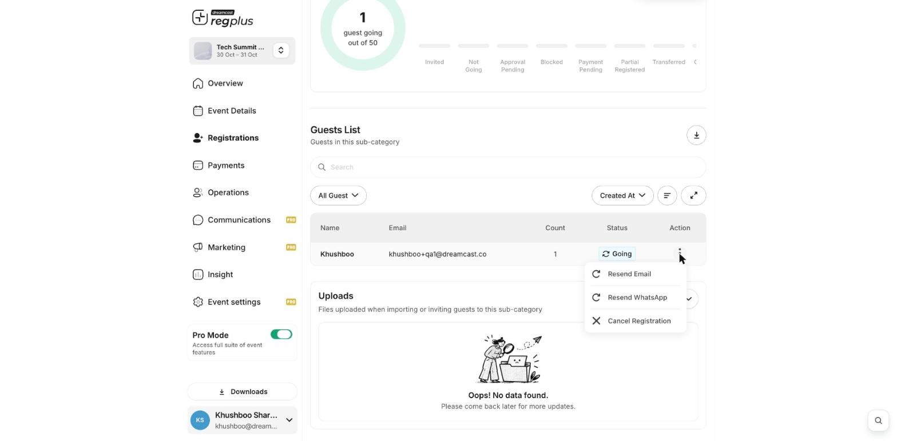

**In short:** Cancelling a guest in regplus does **not** send their money back on its own. You refund them through your payment provider, then cancel the registration so your counts and tickets update.

## Refund a guest

<Steps>
  <Step title="Refund through your payment provider">
    Open your payment gateway (for example Razorpay, Stripe or PayPal) and refund the guest's payment there.
  </Step>
  <Step title="Cancel the registration in regplus">
    Go to **Registrations → Categories**, click **Manage** on the guest's ticket type, open the **Guests** tab, and from the guest's **⋮** menu choose **Cancel Registration**. This frees their place and voids their ticket.

    <Frame>
      
    </Frame>
  </Step>
</Steps>

<Warning>
  Cancelling in regplus alone does not move any money. Always do the refund in your payment provider too, or the guest won't get their money back.
</Warning>

## What's next?

<CardGroup cols={2}>
  <Card title="Manage registrants" icon="users" href="/regplus/manage-registrants">
    Find and cancel a guest.
  </Card>

  <Card title="Payments, taxes & fees" icon="credit-card" href="/regplus/payments">
    How payments are set up.
  </Card>
</CardGroup>
