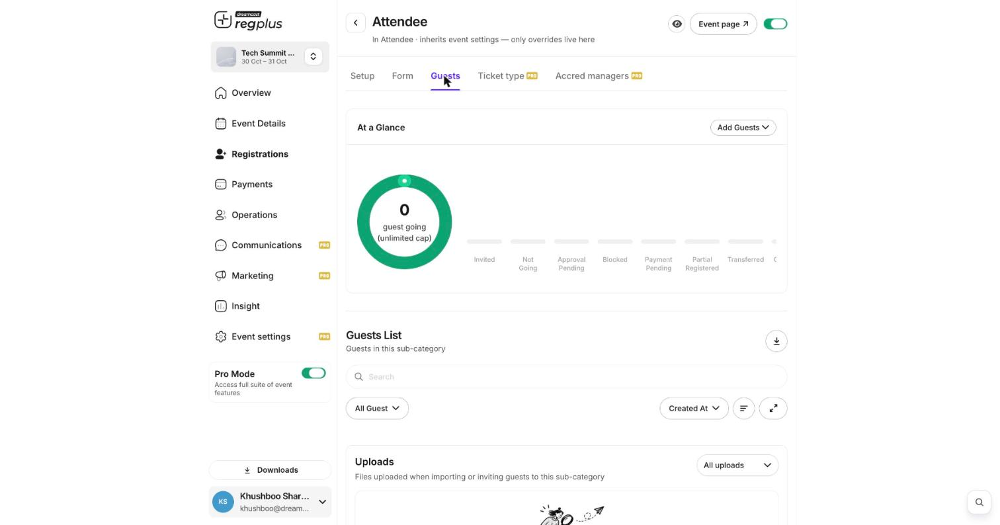
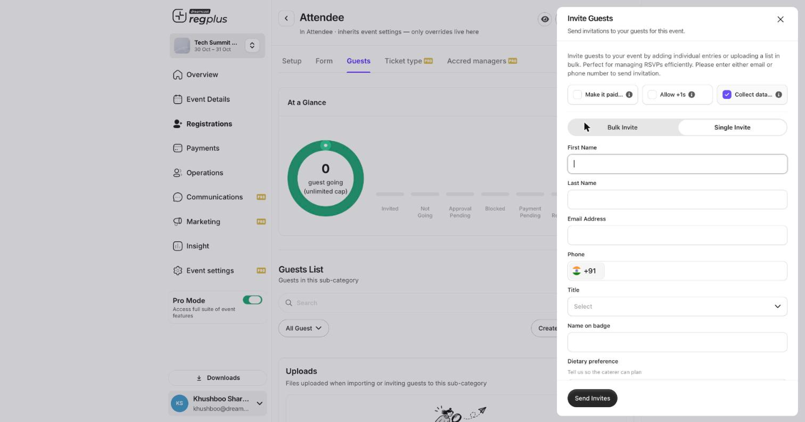

## In short

Every ticket type has its own **Guests** list — the single place to see who has registered, add people yourself, chase pending payments or approvals, and export the list for your team. This guide walks through the whole screen, field by field.

<Info>
**Where to find it:** Open **Registrations** from the left menu, find the ticket type you want on the **Categories** tab, and click **Manage**. On the ticket type screen, open the **Guests** tab.
</Info>

## Read the guest list at a glance

The top of the **Guests** tab shows a donut with the headline count (for example *0 guest going*) and the ticket's capacity. Next to it is a row of status chips so you can see, in one glance, where everyone stands.

<Frame caption="The Guests tab: a status summary at the top, the full list below, and Add Guests on the right.">
  
</Frame>

### What each status means

| Status | What it tells you |
| --- | --- |
| **Invited** | You sent an invite, but the guest has not completed registration yet. |
| **Not Going** | The guest declined the invite. |
| **Approval Pending** | The registration needs your approval before the guest is confirmed. |
| **Blocked** | You have blocked this guest — they cannot check in or re-register. |
| **Payment Pending** | A paid registration where the payment has not gone through yet. |
| **Partial Registered** | The guest started but did not finish the form or payment. |
| **Transferred** | The ticket was moved to another person. |

<Tip>
If registrations are sitting in **Approval Pending**, open the guest's row and approve or reject from there. Approved guests move to the confirmed count and receive their confirmation; rejected ones are not charged.
</Tip>

## Add guests yourself

You will not always wait for people to register on the public page — you may want to invite a VIP list, or add walk-ups and sponsors. Use **Add Guests** (top right of the summary) and pick one of two options:

<CardGroup cols={2}>
  <Card title="Invite" icon="paper-plane">
    Send an invitation to one person or a whole list. Good for guest lists, VIPs and RSVPs.
  </Card>
  <Card title="Import" icon="file-arrow-up">
    Upload a spreadsheet of people to bring them in all at once.
  </Card>
</CardGroup>

### Invite one or many

Choosing **Invite** opens the **Invite Guests** panel. Three toggles across the top control the invite, and a **Single Invite / Bulk Invite** switch lets you add one person or paste a list.

<Frame caption="The Invite Guests panel — toggles on top, then the single-invite form.">
  
</Frame>

| Field or toggle | What it does |
| --- | --- |
| **Make it paid** | Turn on to send a paid invite — the guest pays when they accept. Leave off for a free, complimentary invite. |
| **Allow +1s** | Lets the invited guest bring additional people along with their registration. |
| **Collect data** | When on, the guest fills in your registration form when they accept. Turn off for a name-and-email-only invite that skips the form. |
| **Single Invite / Bulk Invite** | Switch between adding one guest by hand and pasting or uploading a list of many. |
| **First Name, Last Name** | The guest's name. |
| **Email Address** | Where the invite is sent. Enter at least an email or a phone number. |
| **Phone** | Mobile number (with country code) — used for WhatsApp or SMS invites. |
| **Title** | An optional honorific or label for the guest. |
| **Name on badge** | What should print on the guest's badge, if it differs from their name. |

Any custom questions from your registration form appear below these fields when **Collect data** is on. Click **Send Invites** to fire the invitations.

### Import a list

Choosing **Import** lets you upload a file of guests and bring them in together — useful when a partner or sponsor hands you a delegate list. Every file you import (or invite from) is kept under the **Uploads** section at the bottom of the Guests tab, so you always have a record of what was brought in.

## Search, filter and export

The **Guests List** below the summary is your working view of everyone in this ticket type.

- **Search** by name, email or phone to jump to one person.
- Use the **All Guest** dropdown to filter by status (for example, show only *Payment Pending*).
- Use **Created At** to change the sort order.
- Click the **download** icon to export the current list to a file for your team or your badge printer.

<Warning>
The Guests list is specific to **one ticket type**. If you run several ticket types, repeat these steps for each, or export each list separately. For an event-wide view of everyone, use the **Insight** reports.
</Warning>

## FAQs & troubleshooting

<AccordionGroup>
  <Accordion title="A guest is stuck on Payment Pending — what do I do?">
    Their payment did not complete. Ask them to finish paying from the link in their email, or, if they paid another way, confirm the registration manually from their row. You can also cancel it to free up the seat.
  </Accordion>
  <Accordion title="Can I invite someone without making them fill the form?">
    Yes. In the Invite Guests panel, turn **Collect data** off. The guest is added with just the name and contact details you enter, and skips the registration form.
  </Accordion>
  <Accordion title="What is the difference between Invite and Import?">
    **Invite** sends each person an invitation they accept to register. **Import** adds the people straight into the list from a file. Use Invite when you want guests to confirm; use Import when you already have a confirmed list.
  </Accordion>
  <Accordion title="How do I stop someone from attending?">
    Open their row and block them. A blocked guest keeps their record but cannot check in or register again.
  </Accordion>
</AccordionGroup>

## What's next?

<CardGroup cols={2}>
  <Card title="Set up the Invite app" icon="user-plus" href="/regplus/how-to-invite-app">
    Give team members their own invite quotas to grow the guest list.
  </Card>
  <Card title="Set up on-ground check-in" icon="qrcode" href="/regplus/how-to-onground-checkin">
    Scan guests in at the door with the On-Ground app.
  </Card>
</CardGroup>
