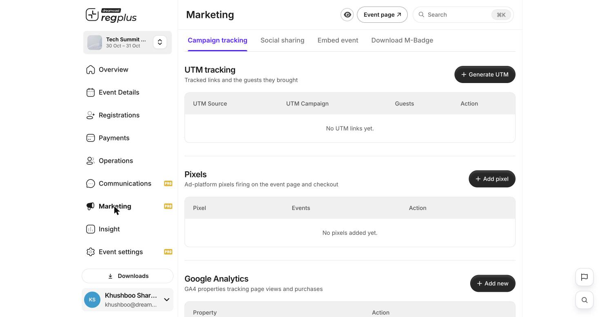
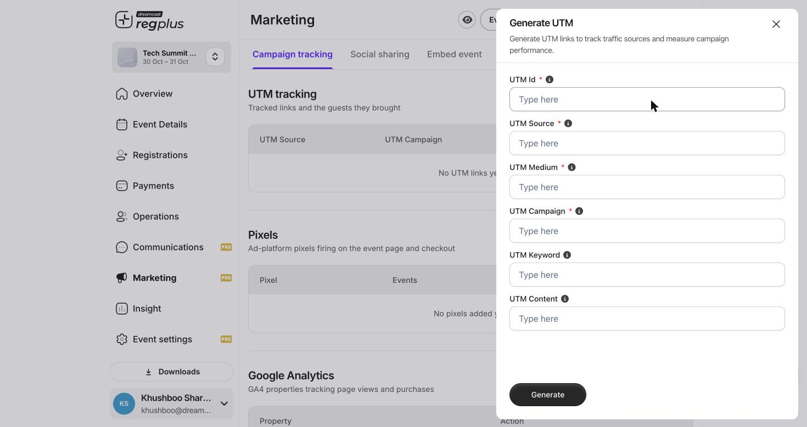
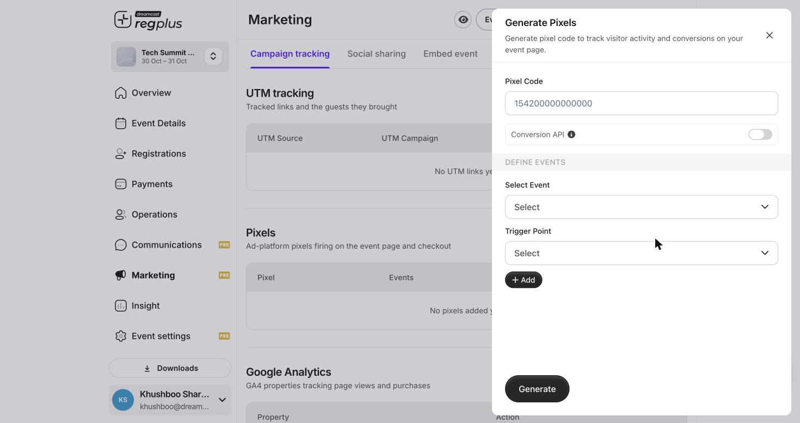
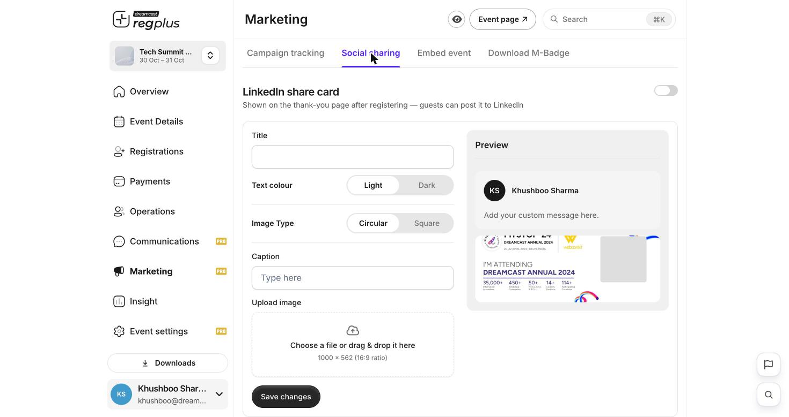
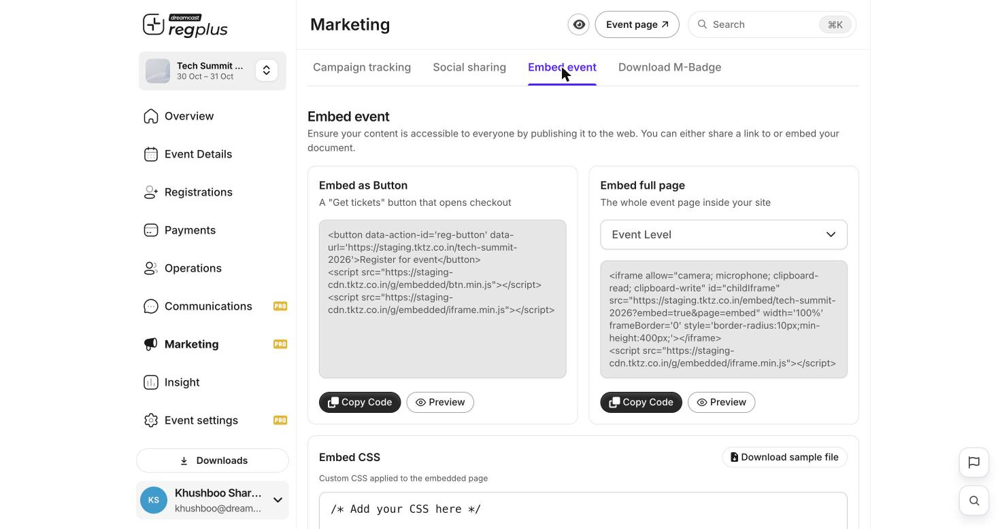
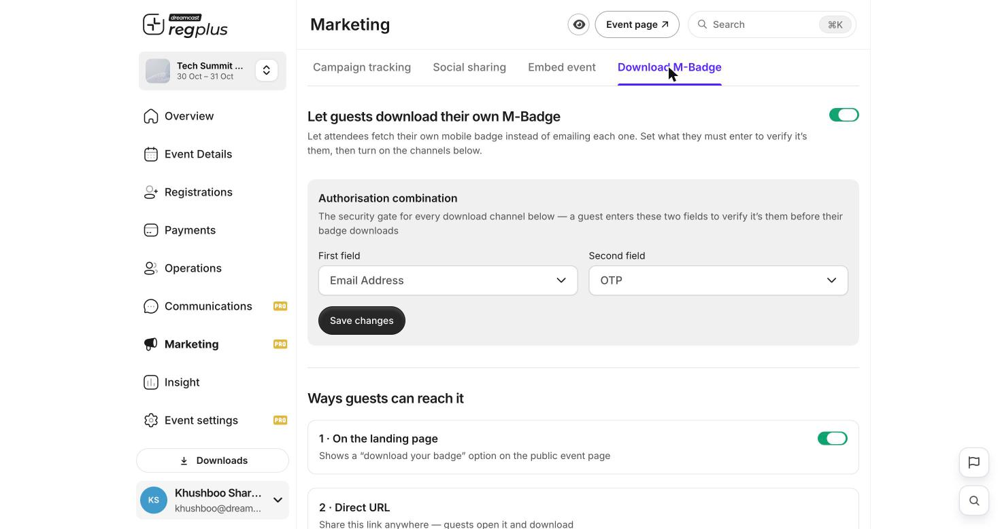

## In short

The **Marketing** module is where you drive registrations and prove what is working: tracked campaign links, ad pixels, Google Analytics, a ready-made LinkedIn share card, embeds for your own website, and self-service badge downloads. This guide covers all four tabs.

<Info>
**Where to find it:** Open **Marketing** from the left menu. This is a Pro feature. The four tabs across the top are **Campaign tracking**, **Social sharing**, **Embed event** and **Download M-Badge**.
</Info>

## Campaign tracking

This tab has three tools, stacked top to bottom: UTM links, ad pixels and Google Analytics.

<Frame caption="Campaign tracking: UTM links, pixels and GA4 in one place.">
  
</Frame>

### UTM tracking — see which campaigns bring guests

A UTM link is your event link with tags on the end, so you can tell which email, ad or post a registration came from. Click **Generate UTM** and fill in the tags.

<Frame caption="The Generate UTM form.">
  
</Frame>

| Field | What to enter |
| --- | --- |
| **UTM Id** | A name for this link so you can find it in the list. |
| **UTM Source** | Where the link lives — for example `newsletter`, `instagram`, `google`. |
| **UTM Medium** | The type of channel — for example `email`, `social`, `cpc`. |
| **UTM Campaign** | The campaign name — for example `early-bird`. |
| **UTM Keyword** | Optional — the paid keyword, if any. |
| **UTM Content** | Optional — which creative or placement, to tell two links apart. |

The UTM tracking table then shows each link and the **guests it brought**, so you can see which source is actually converting.

### Pixels — track conversions for your ads

Add an ad-platform pixel so your ad account can see page views and registrations and optimise your spend. Click **Add pixel**.

<Frame caption="The Generate Pixels form — pixel code, Conversion API, and the events to track.">
  
</Frame>

| Field | What it does |
| --- | --- |
| **Pixel Code** | Your ad-platform pixel ID. |
| **Conversion API** | Turn on to also send events server-side, not just from the browser — more reliable tracking when browsers block pixels. |
| **Select Event** | Which action to report. The standard set is available: `PageView`, `ViewContent`, `Search`, `AddToCart`, `AddToWishlist`, `Purchase`, `Lead`, `CompleteRegistration`, `Contact`, `Schedule`. |
| **Trigger Point** | Where on the journey that event fires (for example, on the event page or at checkout). |

Use **Add** to map more than one event (for example `PageView` on the event page and `Purchase` at checkout), then **Generate**.

<Tip>
For accurate paid-ad reporting, map **Purchase** (a completed paid registration) and turn on **Conversion API**. Browser-only pixels undercount when ad-blockers or privacy settings are in play; the server-side API fills the gap and reduces double-counting.
</Tip>

### Google Analytics

Under **Google Analytics**, click **Add new** to connect a GA4 property. Once linked, GA4 records page views and purchases from your event page alongside the rest of your site analytics.

## Social sharing

Turn on a **LinkedIn share card** so that, right after a guest registers, they can post an “I’m attending” card to LinkedIn — free promotion from your own attendees.

<Frame caption="The LinkedIn share card, with a live preview of the post.">
  
</Frame>

| Field | What it does |
| --- | --- |
| **LinkedIn share card** (toggle) | Switch the whole feature on or off. |
| **Title** | The headline on the card. |
| **Text colour** | **Light** or **Dark**, to suit your artwork. |
| **Image Type** | **Circular** or **Square** profile image. |
| **Caption** | The default message that goes with the post. |
| **Upload image** | The card artwork — 1000 × 562 px (16:9). |

The **Preview** on the right shows exactly how the post will look before you save.

## Embed event

Put your registration flow directly on your own website, so visitors never have to leave it.

<Frame caption="Three ways to embed: a button, the full page, and custom CSS.">
  
</Frame>

| Option | What it gives you |
| --- | --- |
| **Embed as Button** | A “Get tickets” button that opens checkout in an overlay — copy the snippet into any page. |
| **Embed full page** | The whole event page inside an iframe on your site. Choose the level (for example Event Level) from the dropdown. |
| **Embed CSS** | Custom CSS applied to the embedded page so it matches your brand — download the sample file to start from. |

Each block has **Copy Code** and **Preview** — copy the snippet and paste it into your site’s HTML.

## Download M-Badge

Let attendees fetch their own mobile badge instead of you emailing each one.

<Frame caption="Self-service badge download with a verification gate and delivery channels.">
  
</Frame>

1. Turn on **Let guests download their own M-Badge**.
2. Set the **Authorisation combination** — the two things a guest must enter to prove it is them before the badge downloads. For example **First field** = Email Address and **Second field** = OTP.
3. Turn on the **channels** guests can use to reach it — for example a “download your badge” option **on the landing page**, or a **direct URL** you can share anywhere.

<Warning>
Always keep an **Authorisation combination** set. Without the verification gate, anyone with the link could pull another guest’s badge.
</Warning>

## FAQs & troubleshooting

<AccordionGroup>
  <Accordion title="My ad platform is undercounting registrations.">
    Turn on **Conversion API** on the pixel and make sure the **Purchase** event is mapped to checkout. Browser-only pixels miss conversions when ad-blockers or privacy settings are active.
  </Accordion>
  <Accordion title="How do I know which campaign is working?">
    Create a separate **UTM** link for each campaign and channel. The UTM tracking table shows the guests each link brought, so you can compare them directly.
  </Accordion>
  <Accordion title="Can I put the registration form on my own website?">
    Yes. Use the **Embed event** tab — the button embed for a “Get tickets” overlay, or the full-page embed to show the whole event page inside your site.
  </Accordion>
  <Accordion title="A guest says the badge link asks for a code they don't have.">
    That is the **Authorisation combination**. Check which two fields you set (for example Email + OTP) and make sure the guest uses the same email they registered with.
  </Accordion>
</AccordionGroup>

## What's next?

<CardGroup cols={2}>
  <Card title="Read your Insight reports" icon="chart-line" href="/regplus/how-to-insight-reports">
    See traffic sources and conversions in the Marketing & Traffic report.
  </Card>
  <Card title="Set up emails & WhatsApp" icon="envelope" href="/regplus/how-to-emails-whatsapp">
    Pair tracked links with reminders and nudges.
  </Card>
</CardGroup>
