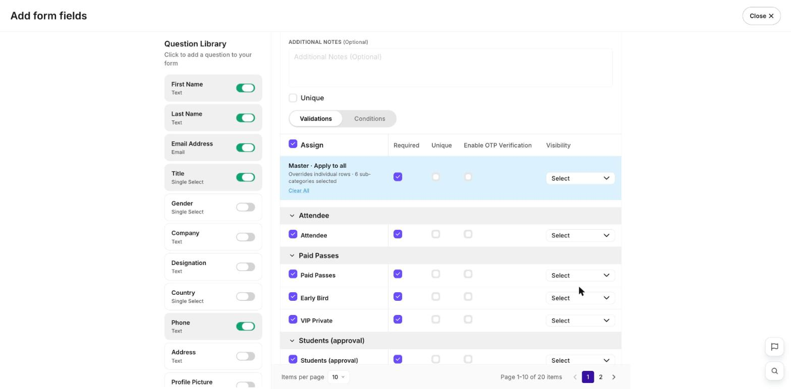

**In short:** Make a form question **unique** so the same answer — like an email address or employee ID — can't be used twice. This stops one person signing up more than once.

## Make a question unique

<Steps>
  <Step title="Open the form">
    Go to **Registrations → Form**.
  </Step>
  <Step title="Turn on Unique">
    Open the question you want to protect (for example _Email_ or _Employee ID_) from its **⋮** menu and choose **Edit**, tick **Unique** in the field's settings, then **Save Changes**.

    <Info icon="image">
      
    </Info>
  </Step>
</Steps>

Now, if someone tries to register with a value that's already been used, regplus won't accept it.

<Note>
  Pick a field that's truly one-per-person, like email or a staff ID. A field like _Company_ isn't unique — many guests share it.
</Note>

## What's next?

<CardGroup cols={2}>
  <Card title="Build your registration form" icon="list-check" href="/regplus/registration-form">
    Add and set up your questions.
  </Card>

  <Card title="Approvals & limits" icon="user-check" href="/regplus/approvals-limits">
    Control who gets a place.
  </Card>
</CardGroup>
