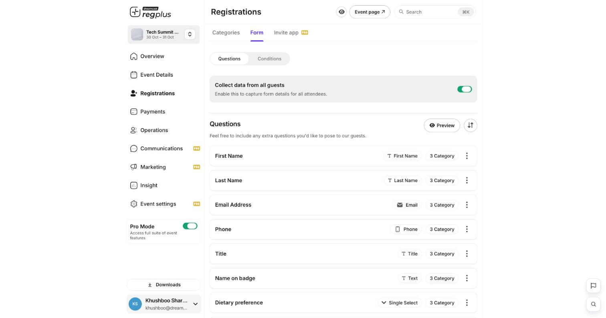
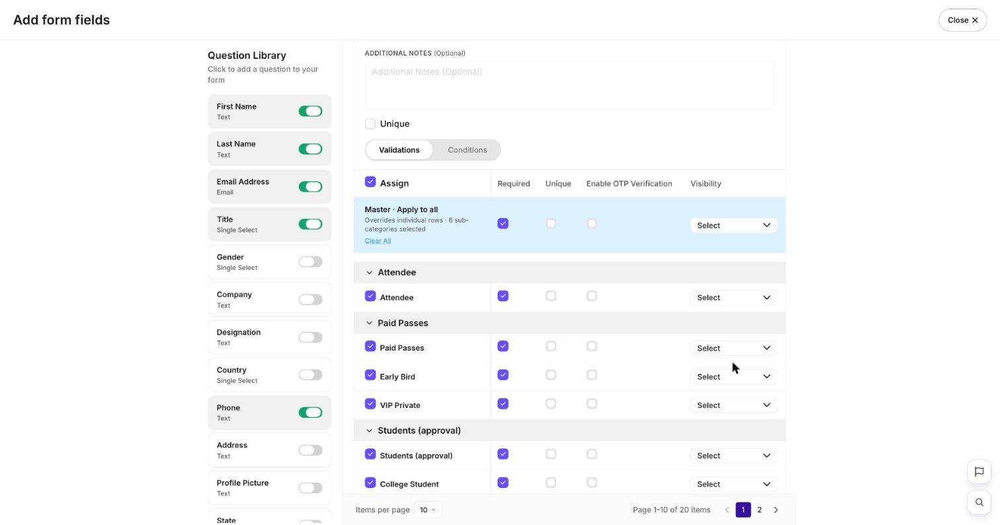
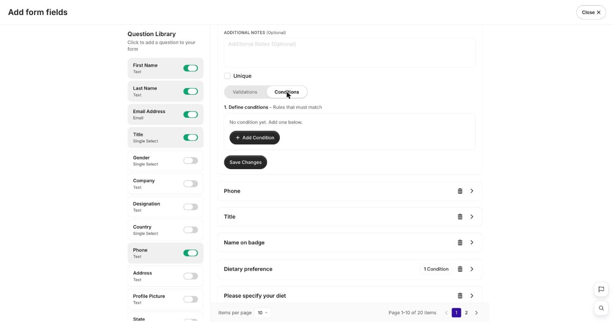

**In short:** Your registration form decides what you collect from each guest. Build it under **Registrations → Form** — add questions, control which are required or unique, and show questions only when they apply.

## The form at a glance

<Frame>
  
</Frame>

- **Collect data from all guests** — turn on to capture form details for **every** attendee in an order, not just the booker.
- Each question shows its **field type** (Text, Email, Phone, Single Select…) and how many **ticket types** it applies to.
- Use **Preview** to see the form as guests will, and the **⋮** menu on a question to **Edit** or **Delete** it.

## Step 1 — Add questions

Open a question's **⋮ → Edit** (or add one from the library) to open the field editor. The **Question Library** on the left lists every field type you can add:

<Frame>
  
</Frame>

Common field types include **First/Last Name**, **Email**, **Phone**, **Title**, **Single Select**, **Company**, **Designation**, **Country**, **Address** and **Profile Picture** — toggle one on to add it to your form.

## Step 2 — Set validations per ticket type

In the field editor's **Validations** tab you control the question for each ticket type at once. The **Master · Apply to all** row sets every ticket type together, or set each row individually:

| Column | What it does |
| --- | --- |
| **Required** | Guest must answer before they can register |
| **Unique** | The same answer (e.g. an email) can't be used twice — stops duplicate sign-ups |
| **Enable OTP Verification** | Verify the answer (e.g. phone/email) with a one-time code |
| **Visibility** | Whether and how the question shows for that ticket type |

## Step 3 — Show questions conditionally

Switch to the **Conditions** tab to show a question only when an earlier answer matches a rule — for example, ask _"Please specify your diet"_ only when **Dietary preference** is _Other_.

<Frame>
  
</Frame>

<Steps>
  <Step title="Open Conditions">
    In the field editor, open the **Conditions** tab and click **Add Condition**.
  </Step>
  <Step title="Define the rule">
    Choose the earlier question, the match (e.g. _is_), and the value that should reveal this question.
  </Step>
  <Step title="Save">
    Click **Save Changes**. Questions with a rule show a **condition** badge in the list.
  </Step>
</Steps>

## FAQ

<AccordionGroup>
  <Accordion title="Can different ticket types ask different questions?">
    Yes. Each question's **Validations** row is set per ticket type, and **Visibility** lets you hide a question for ticket types it doesn't apply to.
  </Accordion>

  <Accordion title="How do I stop one person registering twice?">
    Turn on **Unique** for a one-per-person field like email or a staff ID. See [Prevent duplicate sign-ups](/regplus/how-to-prevent-duplicate-signups).
  </Accordion>

  <Accordion title="Can I edit the form after publishing?">
    Yes — changes go live immediately. Take care removing or renaming a field guests have already filled, as it affects the data you've collected.
  </Accordion>
</AccordionGroup>

## What's next?

<CardGroup cols={2}>
  <Card title="Build your ticket types" icon="ticket" href="/regplus/how-to-ticket-types">
    What guests choose before the form.
  </Card>

  <Card title="Design and print badges" icon="id-badge" href="/regplus/how-to-badges">
    Put form answers on badges.
  </Card>
</CardGroup>
