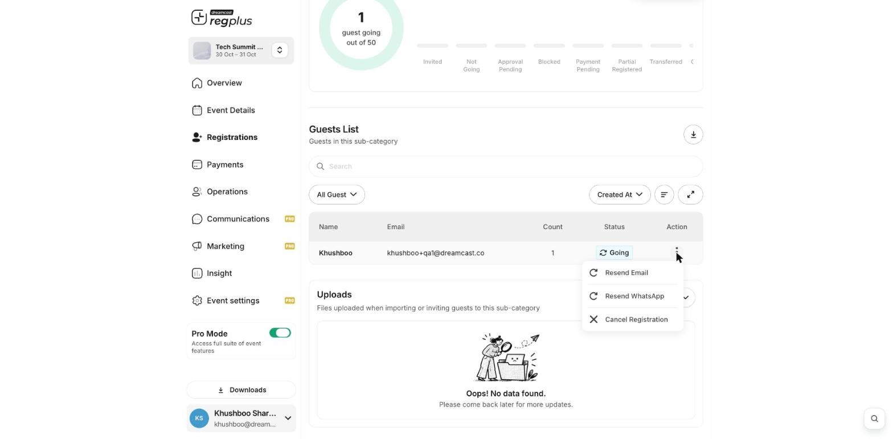

**In short:** If a guest says they never got their confirmation or ticket, you can send it again from their record — by email or WhatsApp — without re-registering them.

## Resend to a guest

<Steps>
  <Step title="Open the guest list">
    Go to **Registrations → Categories**, click **Manage** on the guest's ticket type, and open the **Guests** tab.
  </Step>
  <Step title="Resend">
    From the guest's **⋮** menu, choose **Resend Email** or **Resend WhatsApp**.

    <Frame>
      
    </Frame>
  </Step>
</Steps>

<Tip>
  Ask the guest to check their spam folder first. If their email or phone is wrong, fix it on their record (open the guest and **Edit Details**) before you resend. You can see email delivery under **Insight → Marketing & Traffic**.
</Tip>

## What's next?

<CardGroup cols={2}>
  <Card title="Manage registrants" icon="users" href="/regplus/manage-registrants">
    Find and edit a guest.
  </Card>

  <Card title="Set up WhatsApp and email" icon="plug" href="/regplus/integrations">
    Control how your messages are sent.
  </Card>
</CardGroup>
