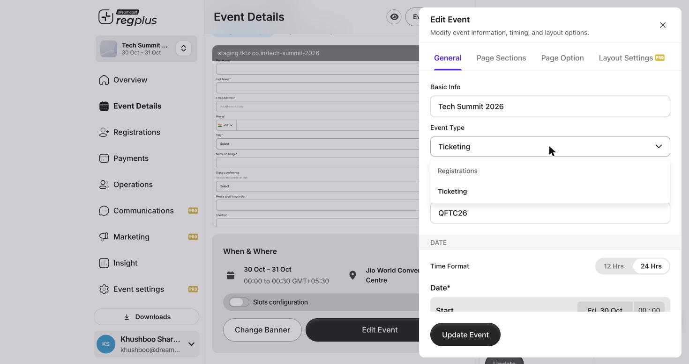

## In short

Not every event sells tickets. When you just need to know **who's coming** — an invite-only dinner, a community meetup, a webinar — run it as a **Registrations** event. Guests RSVP or sign up instead of buying a pass, and you track their responses in one place.

<Info>
**Where to set it:** Open **Event Details → Edit Event → General**, and choose the **Event Type**.
</Info>

## Ticketing vs Registrations

The **Event Type** is the single switch that decides how your event behaves.

<Frame caption="Event Type — Ticketing for passes, Registrations for RSVPs.">
  
</Frame>

| Event Type | Use it when… |
| --- | --- |
| **Ticketing** | You're selling passes (paid or free) — guests pick a ticket type and check out. |
| **Registrations** | You're collecting RSVPs or sign-ups — guests confirm attendance rather than buy a ticket, usually for free or invite-led events. |

<Warning>
Choose the type when you **create** the event. Switching an event that already has registrations or orders between the two modes is disruptive — set it up right from the start.
</Warning>

## Set up an RSVP event

1. **Choose Registrations** as the Event Type (above).
2. **Build your form** the same way as any event — keep it short for RSVPs (name, email, maybe one or two questions). See [Build the form](/regplus/how-to-registration-form).
3. **Invite your guests.** Send them the **Guest RSVP Invitation** email (from Communications), or add them through the [Invite app](/regplus/how-to-invite-app) or a ticket type's **Invite** action.
4. **Track responses.** As guests reply, their status updates in the **Guests** list — **Invited**, **Not Going**, and confirmed — so you always know your headcount. See [Manage your guest list](/regplus/how-to-manage-guests).

<Tip>
Because there's no payment step, RSVP events are the fastest for guests to complete — keep the form short and the invite clear, and your confirmations will climb.
</Tip>

## FAQs & troubleshooting

<AccordionGroup>
  <Accordion title="What's the difference between an RSVP and a free ticket?">
    A free **ticket** still runs through the ticketing flow (pick a pass, check out at zero cost). An **RSVP** is a simple yes/no sign-up with no pass or checkout — lighter for guests, and the right fit for invite-led events.
  </Accordion>
  <Accordion title="Can I see who said they're not coming?">
    Yes — the **Guests** list shows a **Not Going** status alongside Invited and confirmed, so you can read the full picture.
  </Accordion>
  <Accordion title="How do guests RSVP?">
    Send the **Guest RSVP Invitation** email. Guests open it and confirm — no account or payment needed.
  </Accordion>
  <Accordion title="I already built a ticketing event. Can I turn it into an RSVP one?">
    It's best not to switch once there's data, because the two modes work differently. Create a fresh event as **Registrations** instead.
  </Accordion>
</AccordionGroup>

## What's next?

<CardGroup cols={2}>
  <Card title="Set up the Invite app" icon="user-plus" href="/regplus/how-to-invite-app">
    Hand out RSVP invites through your team.
  </Card>
  <Card title="Manage your guest list" icon="users" href="/regplus/how-to-manage-guests">
    Track who's coming and who's not.
  </Card>
</CardGroup>
