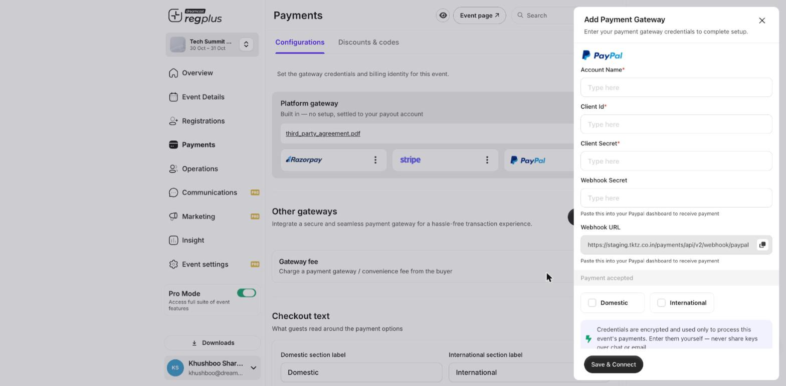

**In short:** Connect your own **PayPal** account so payments settle to you. Useful when your guests prefer paying with PayPal.

## What you'll need

- A **PayPal Business account**.
- Access to **Payments → Configurations** in your regplus event.
- The **PayPal Developer Dashboard** open in another tab.

## Step 1 — Open the PayPal connection form

<Steps>
  <Step title="Go to Payments">
    Open **Payments → Configurations** in your event.
  </Step>
  <Step title="Add PayPal">
    Under **Other gateways**, click **Add Other** and choose **PayPal**.

    <Frame>
      
    </Frame>
  </Step>
</Steps>

## Step 2 — Get your credentials and webhook from PayPal

<Steps>
  <Step title="Create an app">
    In the **PayPal Developer Dashboard**, go to **Apps & Credentials** and create (or open) an app. It gives you a **Client ID** and a **Secret**.
  </Step>
  <Step title="Add a webhook">
    In that app's settings, add a **webhook** using the **Webhook URL** from the regplus form, and subscribe to the payment events. Note any **webhook secret** if PayPal provides one.
  </Step>
</Steps>

<Note>
  PayPal has a **Sandbox** (test) and a **Live** environment, each with its own credentials. Trial in Sandbox, then switch to Live before taking real bookings.
</Note>

## Step 3 — Finish the connection in regplus

Fill each field, then click **Save & Connect**.

| regplus field | What to enter |
| --- | --- |
| **Account Name** | A name to recognise this connection (e.g. _PayPal — main_) |
| **Client Id** | Your PayPal app **Client ID** |
| **Client Secret** | Your PayPal app **Secret** |
| **Webhook Secret** | The webhook secret, if PayPal gave you one |
| **Webhook URL** | _(read-only — paste it into PayPal in Step 2)_ |
| **Payment accepted** | Tick **Domestic**, **International** or both |

<Warning>
  Credentials are encrypted and used only to process this event's payments. Enter them yourself and never share your secret.
</Warning>

## Test before you go live

Make a test booking and confirm it shows as paid in **Insight → Financial**. If it's charged but not confirmed, re-check the webhook URL in your PayPal app.

## What's next?

<CardGroup cols={2}>
  <Card title="Set up Razorpay" icon="credit-card" href="/regplus/how-to-setup-razorpay">
    Connect Razorpay for domestic payments.
  </Card>

  <Card title="Set up Stripe" icon="stripe-s" href="/regplus/how-to-setup-stripe">
    Connect Stripe for international cards.
  </Card>
</CardGroup>
