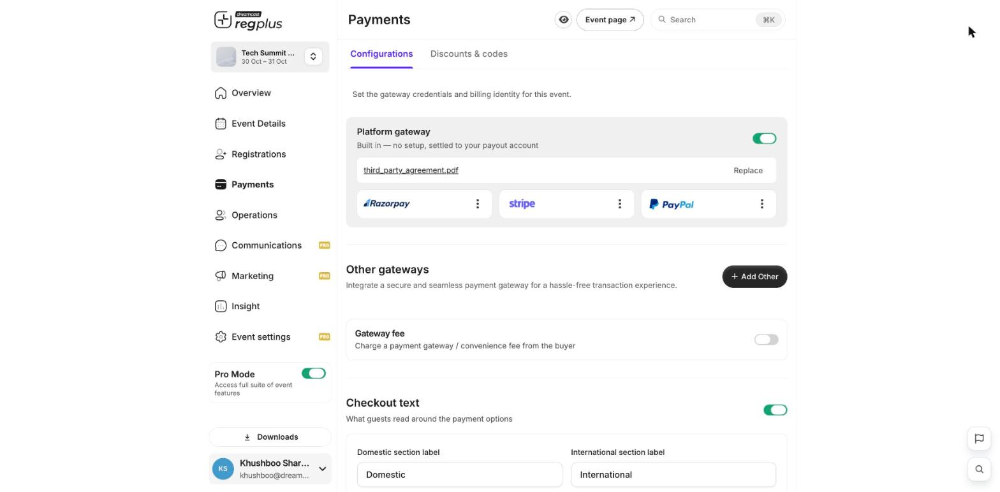
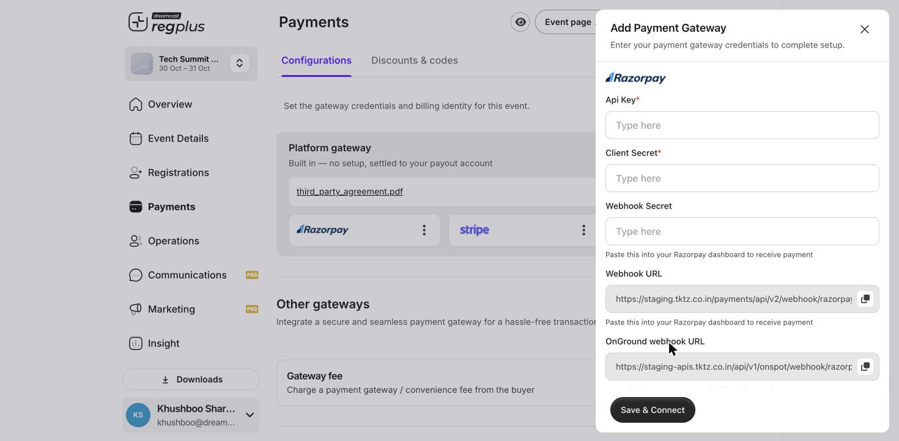

**In short:** You can collect payments through the built-in **Platform gateway** with no setup, or connect **your own Razorpay account** so money settles directly to you. This guide covers connecting your own Razorpay, field by field.

<Info>
  Happy to use the built-in gateway? You don't need this guide — the **Platform gateway** is on by default and settles to your payout account. Connect your own Razorpay only if you want payments to go straight into your Razorpay account.
</Info>

## What you'll need

- A **Razorpay account** with KYC completed and live payments activated (test mode works for trials).
- Access to **Payments → Configurations** in your regplus event.
- About 10 minutes, with your Razorpay dashboard open in another tab.

The setup has four steps: open the connection form in regplus, get your keys from Razorpay, add a webhook in Razorpay using the URLs regplus gives you, then paste everything back and save.

## Step 1 — Open the Razorpay connection form

<Steps>
  <Step title="Go to Payments">
    In your event, open **Payments → Configurations**.

    <Frame>
      
    </Frame>
  </Step>
  <Step title="Add Razorpay">
    Under **Other gateways**, click **Add Other** and choose **Razorpay**. The connection form opens.

    <Frame>
      
    </Frame>
  </Step>
</Steps>

Keep this form open — it shows two **Webhook URLs** you'll need in Step 3, and it's where you paste your keys in Step 4.

## Step 2 — Get your keys from Razorpay

In a separate tab, sign in to your **Razorpay Dashboard**.

<Steps>
  <Step title="Open API Keys">
    Go to **Account Settings → Website and app Settings → API keys**.
  </Step>
  <Step title="Generate a key">
    Choose the mode — **Test** for trials or **Live** for real payments — and generate a key. Razorpay gives you a **Key ID** and a **Key Secret**. The **Key ID** is shown on the left under the **Key ID** label.
  </Step>
  <Step title="Copy both values">
    Copy the **Key ID** and the **Key Secret** somewhere safe. The **Key Secret is generated only once and stays hidden after that for security** — if you lose it you must regenerate the pair.
  </Step>
</Steps>

<Note>
  Test and Live keys are separate. Use Test keys while trying things out, then switch to Live keys before you take real bookings.
</Note>

## Step 3 — Add a webhook in Razorpay

The webhook lets Razorpay tell regplus the instant a payment succeeds, so bookings confirm on their own.

<Steps>
  <Step title="Open Webhooks in Razorpay">
    In the Razorpay Dashboard, go to **Account Settings → Webhooks** and click **Add New Webhook**.
  </Step>
  <Step title="Paste the Webhook URL">
    Copy the **Webhook URL** from the regplus form (the copy icon beside it) and paste it into Razorpay. If you run on-ground check-in, add a second webhook with the **OnGround webhook URL** too.
  </Step>
  <Step title="Set a webhook secret">
    Create a **webhook secret** (any strong phrase) and enter it in Razorpay. Keep a copy — the same secret goes into regplus.
  </Step>
  <Step title="Select events and save">
    Select the payment events (such as **payment.captured**), then save the webhook.
  </Step>
</Steps>

## Step 4 — Finish the connection in regplus

Back in the regplus Razorpay form, fill each field as below, then click **Save & Connect**.

| regplus field | What to enter | Where it comes from |
| --- | --- | --- |
| **Api Key** | Your Razorpay **Key ID** | Razorpay → Account Settings → Website and app Settings → API keys |
| **Client Secret** | Your Razorpay **Key Secret** | Shown once when you generate the key |
| **Webhook Secret** | The **webhook secret** you chose | The secret you set in Step 3 |
| **Webhook URL** | _(read-only — copy it out)_ | Paste into Razorpay in Step 3 |
| **OnGround webhook URL** | _(read-only — copy it out)_ | Paste into Razorpay if you use on-ground check-in |
| **Payment accepted** | Tick **Domestic**, **International** or both | The cards you want Razorpay to handle |

<Warning>
  Your keys are encrypted and used only to process this event's payments. Enter them yourself and never share your Key Secret with anyone over chat or email.
</Warning>

## Test before you go live

Make a test booking on your event page and check the order shows as paid in **Insight → Financial**. If a payment is charged but the booking doesn't confirm, the webhook is almost always the cause.

## Troubleshooting & FAQ

<AccordionGroup>
  <Accordion title="A payment was charged but the booking didn't confirm">
    This means Razorpay couldn't reach the webhook. Re-open **Account Settings → Webhooks** in Razorpay and check the **Webhook URL** matches the one in regplus exactly, that the **webhook secret** is identical on both sides, and that **payment.captured** is one of the selected events.
  </Accordion>

  <Accordion title="Can I use Razorpay for some tickets and the platform gateway for others?">
    The gateway applies to the whole event's checkout. You choose one active gateway for the event rather than per ticket type.
  </Accordion>

  <Accordion title="How do refunds work with my own Razorpay?">
    Refund the guest in your Razorpay dashboard, then cancel their registration in regplus so your counts update. See [Issue a refund](/regplus/how-to-issue-refund).
  </Accordion>

  <Accordion title="Do I enter my bank details in regplus?">
    No. Money settles inside your own Razorpay account on Razorpay's settlement schedule. regplus only holds the API keys needed to create and confirm payments.
  </Accordion>

  <Accordion title="I switched from Test to Live keys — anything else to do?">
    Generate **Live** API keys in Razorpay, add a **Live-mode webhook** with the same URL and secret, then update the **Api Key** and **Client Secret** in regplus with the live values and save again.
  </Accordion>
</AccordionGroup>

## What's next?

<CardGroup cols={2}>
  <Card title="Set up Stripe" icon="stripe-s" href="/regplus/how-to-setup-stripe">
    Connect Stripe for international cards.
  </Card>

  <Card title="Check bounced orders" icon="arrow-rotate-left" href="/regplus/insight-bounced">
    Spot payments that didn't complete.
  </Card>
</CardGroup>
