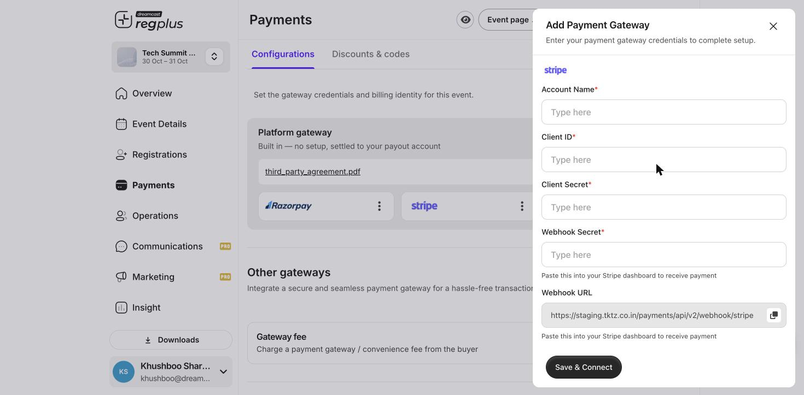

**In short:** Connect your own **Stripe** account so card payments settle directly to you. Stripe is a good choice when you sell to an international audience.

<Info>
  Prefer no setup? The built-in **Platform gateway** works out of the box. Connect Stripe only if you want payments in your own Stripe account.
</Info>

## What you'll need

- A **Stripe account** activated for payments.
- Access to **Payments → Configurations** in your regplus event.
- Your Stripe dashboard open in another tab.

## Step 1 — Open the Stripe connection form

<Steps>
  <Step title="Go to Payments">
    Open **Payments → Configurations** in your event.
  </Step>
  <Step title="Add Stripe">
    Under **Other gateways**, click **Add Other** and choose **Stripe**.

    <Frame>
      
    </Frame>
  </Step>
</Steps>

## Step 2 — Get your keys and webhook from Stripe

<Steps>
  <Step title="Open your API keys">
    In the **Stripe Dashboard**, go to **Developers → API Keys**. You'll use your **publishable key** and your **secret key**.
  </Step>
  <Step title="Add a webhook">
    Go to **Developers → Webhooks**, click **Add Destination**, paste the **Webhook URL** from the regplus form, and select the payment events. Stripe gives you a **signing secret** for the destination — copy it.
  </Step>
</Steps>

<Note>
  Stripe has **test** and **live** keys. Use test keys to trial the flow, then switch to live keys before taking real bookings.
</Note>

## Step 3 — Finish the connection in regplus

Fill each field, then click **Save & Connect**.

| regplus field | What to enter |
| --- | --- |
| **Account Name** | A name to recognise this connection (e.g. _Stripe — main_) |
| **Client ID** | Your Stripe **publishable key** |
| **Client Secret** | Your Stripe **secret key** |
| **Webhook Secret** | The webhook **signing secret** from Stripe |
| **Webhook URL** | _(read-only — paste it into Stripe in Step 2)_ |
| **Payment accepted** | Tick **Domestic**, **International** or both |

<Warning>
  Credentials are encrypted and used only to process this event's payments. Enter them yourself and never share your secret key.
</Warning>

## Test before you go live

Make a test booking and confirm it shows as paid in **Insight → Financial**. If it's charged but not confirmed, re-check the webhook destination URL and signing secret in Stripe.

## FAQ

<AccordionGroup>
  <Accordion title="Which should I use — Stripe or Razorpay?">
    Razorpay suits Indian domestic payments (UPI, net banking, local cards); Stripe suits international cards. Pick the one that matches where most of your guests pay from.
  </Accordion>

  <Accordion title="A payment was charged but the booking didn't confirm">
    The webhook didn't reach regplus. In Stripe, check the destination URL matches the regplus **Webhook URL** and that the **signing secret** is the same on both sides.
  </Accordion>
</AccordionGroup>

## What's next?

<CardGroup cols={2}>
  <Card title="Set up Razorpay" icon="credit-card" href="/regplus/how-to-setup-razorpay">
    Connect Razorpay for domestic payments.
  </Card>

  <Card title="Set up PayPal" icon="paypal" href="/regplus/how-to-setup-paypal">
    Connect PayPal for your event.
  </Card>
</CardGroup>
