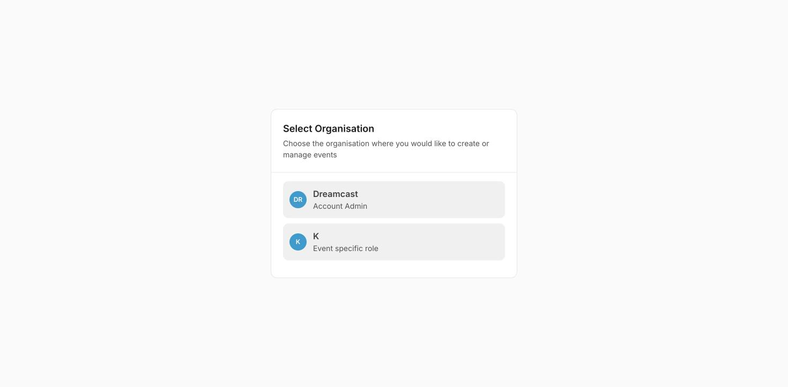

## In short

Before you can build an event you need a host account. This guide covers creating one, signing in, choosing which organisation to work in, and signing out.

## Create your account (sign up)

Go to the regplus host site and **sign up** with your work email. You'll set a password and verify your email (or confirm with a one-time code), and you're ready to create your first organisation and event.

<Tip>
Use a shared **work** email rather than a personal one where you can — it makes handing the account over or adding it to a team far easier later.
</Tip>

## Sign in

Returning hosts **sign in** with the email and password (or one-time code) set at sign-up.

### Choose your organisation

If your login has access to more than one organisation — or you hold an event-specific role — you'll be asked which one to work in right after signing in.

<Frame caption="Choose which organisation (and role) to work in after signing in.">
  
</Frame>

| What you see | What it means |
| --- | --- |
| **Account Admin** | Full access to that organisation — all its events, branding and team. |
| **Event specific role** | Access scoped to a single event (for example a sponsor or partner who manages just their part). |

Pick the one you want, and you land on its dashboard.

## Switch organisation without signing out

You don't need to sign out to move between organisations. Click your name at the **bottom-left**, and use **Switch Profile** to jump to another organisation under the same login. See [Account & organisation](/regplus/how-to-account-org).

## Sign out

To sign out, click your name at the **bottom-left** to open the account menu, then **Logout**. This ends your session on that device — always do it on a shared or public computer.

## FAQs & troubleshooting

<AccordionGroup>
  <Accordion title="I signed in but landed on a 'Select Organisation' screen.">
    That's normal when your login has more than one organisation or an event-specific role. Pick the one you want to work in and continue.
  </Accordion>
  <Accordion title="A colleague needs access — should I share my login?">
    No. Invite them instead — as a **team member** at the organisation or event level — and assign a role. They get their own login, scoped to what they need. See [Event settings & team](/regplus/how-to-event-settings).
  </Accordion>
  <Accordion title="I only see one event, not the whole organisation.">
    You're probably signed in under an **event-specific role**. Use **Switch Profile** to change to an organisation where you're an Account Admin, if you have one.
  </Accordion>
  <Accordion title="How do I sign out on a shared computer?">
    Open the account menu (your name, bottom-left) and choose **Logout**.
  </Accordion>
</AccordionGroup>

## What's next?

<CardGroup cols={2}>
  <Card title="Account & organisation" icon="id-card" href="/regplus/how-to-account-org">
    Set up your profile, organisation and branding.
  </Card>
  <Card title="Find your way around the dashboard" icon="gauge" href="/regplus/how-to-dashboard">
    Get oriented once you're in.
  </Card>
</CardGroup>
