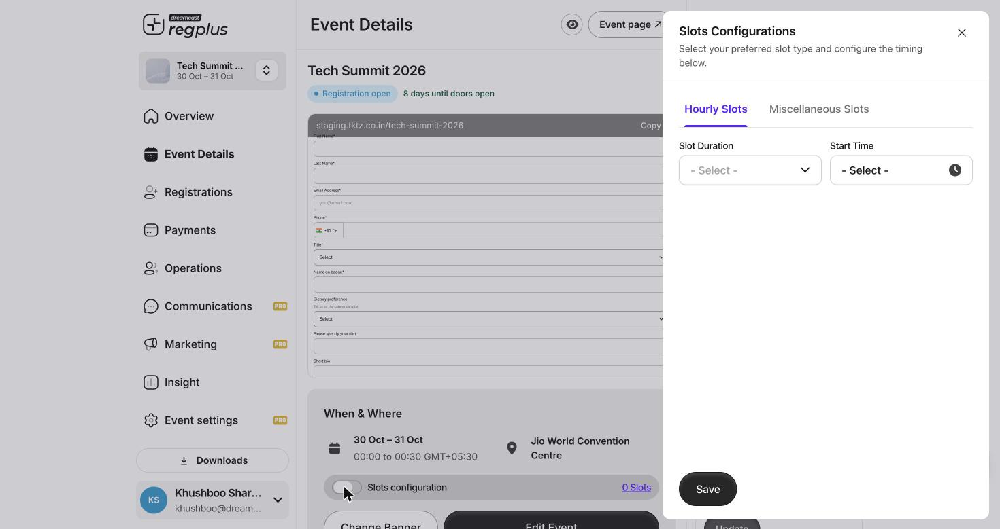
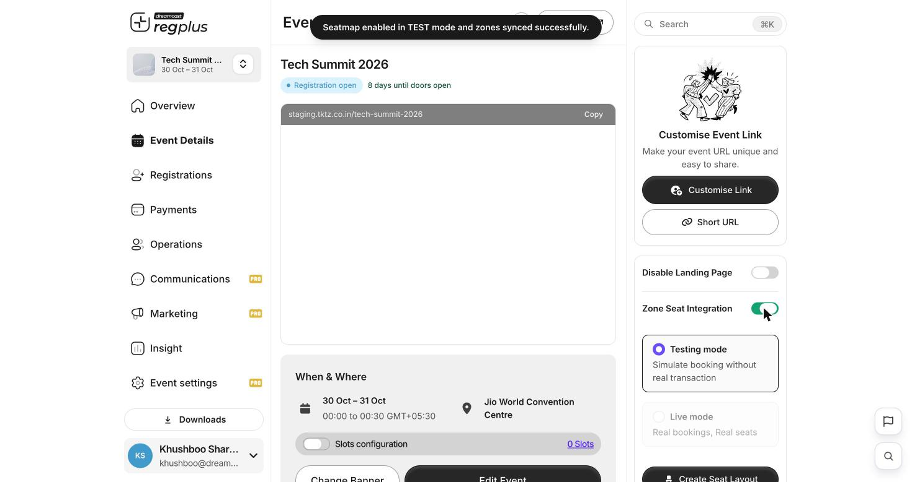

## In short

Two features let you control capacity by **time** and by **space**: **Slots** break the event into bookable time blocks (sessions, staggered entry, appointments), and **Zone Seat Integration** turns on a **seat map** so guests choose a specific seat. Both live on the **Event Details** screen.

<Info>
**Where to find them:** Open **Event Details**. **Slots configuration** sits in the *When & Where* block; **Zone Seat Integration** is in the right-hand panel.
</Info>

## Time slots

Slots are useful when you don't want everyone arriving at once — timed entry, workshop sessions, or appointment-style bookings. Turn on **Slots configuration** in the *When & Where* block to open the panel.

<Frame caption="Slots Configuration — hourly or custom time blocks.">
  
</Frame>

| Slot type | What it does |
| --- | --- |
| **Hourly Slots** | Generate evenly-spaced slots — set a **Slot Duration** and a **Start Time**, and regplus creates the blocks for you. |
| **Miscellaneous Slots** | Define your own custom slots when they aren't a neat hourly pattern. |

Save the configuration, and the *When & Where* block shows how many slots exist (for example *0 Slots* becomes your real count).

<Note>
Once slots exist, each ticket type decides how it uses them on its **Ticket type** tab (Event Pass / Single Day / Multi Day). See [Advanced ticket controls](/regplus/how-to-ticket-advanced).
</Note>

## Reserved seating

For seated venues, **Zone Seat Integration** turns on a seat map so guests pick an actual seat when they register.

<Frame caption="Zone Seat Integration — test or live mode, then build the layout.">
  
</Frame>

When you switch it on, the seat map is enabled and your zones are synced. You then choose a mode and build the layout:

| Option | What it does |
| --- | --- |
| **Testing mode** | Simulate bookings **without** a real transaction — safe for trying the seat map before you go live. |
| **Live mode** | Real bookings against real seats — use this once the layout is final. |
| **Create Seat Layout** | Build your seating chart — the seats and zones guests will choose from. |

<Warning>
Start in **Testing mode** and only switch to **Live mode** once your seat layout is final. Live bookings hold real seats, so changing the layout afterwards is disruptive.
</Warning>

## FAQs & troubleshooting

<AccordionGroup>
  <Accordion title="I want timed entry so the venue doesn't crowd at the start.">
    Turn on **Slots configuration** and use **Hourly Slots** to create entry blocks. Guests pick a slot when they register.
  </Accordion>
  <Accordion title="My slots aren't a neat hourly pattern.">
    Use **Miscellaneous Slots** to define each custom block yourself.
  </Accordion>
  <Accordion title="How do I test seating without taking real bookings?">
    Enable **Zone Seat Integration** and keep it in **Testing mode** — bookings are simulated with no real transaction. Switch to **Live mode** only when ready.
  </Accordion>
  <Accordion title="Where do guests pick their seat?">
    Once the seat layout is live, the seat map appears in the registration flow so guests choose their seat before checkout.
  </Accordion>
</AccordionGroup>

## What's next?

<CardGroup cols={2}>
  <Card title="Advanced ticket & accreditation" icon="ticket-simple" href="/regplus/how-to-ticket-advanced">
    Map each ticket to your slots and set day admission.
  </Card>
  <Card title="Set up your event page" icon="window" href="/regplus/how-to-event-page">
    Where dates, venue and layout come together.
  </Card>
</CardGroup>
