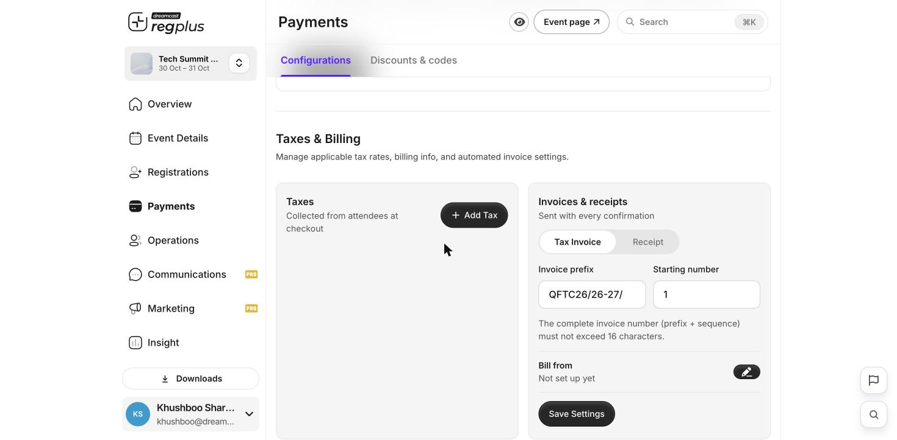
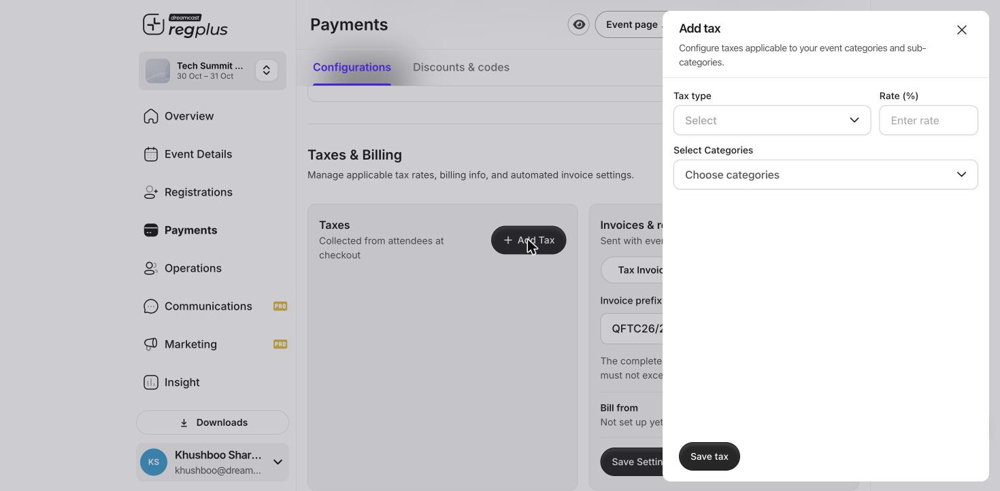
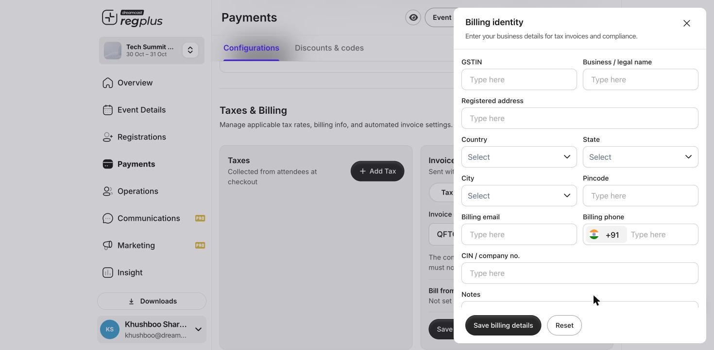

**In short:** regplus can send a **tax invoice** or a **receipt** with every confirmed booking. Set your billing identity once, add any taxes, and choose which document attendees receive. You can also let attendees request a tax invoice themselves at checkout.

<Info>
  **Where to find it:** Open **Payments → Configurations** and scroll to **Taxes & Billing**.
</Info>

## Let attendees request a tax invoice

If you want buyers to be able to ask for a tax invoice during checkout, turn on the **tax invoice option for attendees**. When it's on, a request-tax-invoice field appears at checkout; when it's off, attendees simply get the standard confirmation. Turn it on when you sell to businesses who need an invoice for their records.

## Set up your invoice or receipt

<Frame caption="Taxes, invoice numbering and your billing identity.">
  
</Frame>

In **Invoices & receipts**, pick the document attendees get with every confirmation:

- **Tax Invoice** — for events where you charge tax and buyers need it for compliance.
- **Receipt** — a simple proof of payment when no tax breakdown is needed.

Then set:

| Field | What to enter |
| --- | --- |
| **Invoice prefix** | The text in front of each number (e.g. your event code). |
| **Starting number** | The number the first invoice starts from. |

The complete number (**prefix + sequence**) must stay within **16 characters**.

## Add a tax

If your invoice needs to show tax, click **Add Tax** in the **Taxes** card.

<Frame caption="Add a tax rate and choose which ticket types it applies to.">
  
</Frame>

Choose the **Tax type** (GST, VAT or another), enter the **Rate (%)**, pick the **ticket types** it applies to, and click **Save tax**. The tax then appears on the invoices for those ticket types.

## Enter your billing identity (Bill from)

Under **Bill from**, click the pencil to open **Billing identity** and enter the business details that appear on every invoice.

<Frame caption="Your business details for tax invoices and compliance.">
  
</Frame>

| Field | What to enter |
| --- | --- |
| **GSTIN** | Your GST number. |
| **Business / legal name** | The name that appears on the invoice. |
| **Registered address**, **Country**, **State**, **City**, **Pincode** | Your registered business address. |
| **Billing email** and **Billing phone** | Contact details shown on the invoice. |
| **CIN / company no.** and **Notes** | Optional company number and any extra line you want on the invoice. |

<Tip>
  Enter your **GSTIN** first. Once you do, regplus validates it against the GST portal and **auto-fills your company name and address** from the registered details — so you don't have to type them in.
</Tip>

Click **Save billing details**, then **Save Settings** to apply everything.

## Tax invoice vs receipt — what's the difference?

| | **Tax invoice** | **Receipt** |
| --- | --- | --- |
| **What it is** | A record of the booking showing the registration fee and the taxes charged (such as GST or VAT). | Proof that a payment was made. |
| **What it's for** | Serves as proof the transaction took place and gives the tax detail buyers need for compliance. | Confirms the amount paid — it doesn't focus on tax. |
| **What it shows** | Event and fee details, tax breakdown and your billing identity. | Attendee name, amount paid, date and payment method. |

Choose a **tax invoice** when attendees need the tax detail for their records, and a **receipt** when a simple proof of payment is enough.

## FAQs

<AccordionGroup>
  <Accordion title="Can attendees get an invoice after they've booked?">
    Yes — the invoice or receipt goes out with the booking confirmation. If you turned on the request option, buyers can also ask for a tax invoice at checkout.
  </Accordion>

  <Accordion title="My GSTIN isn't filling in the company details">
    Check the GSTIN is typed correctly and active on the GST portal. regplus validates it live, so an inactive or mistyped number won't fetch the details.
  </Accordion>

  <Accordion title="The invoice number was rejected">
    The **prefix + starting number** together must be **16 characters or fewer**. Shorten your prefix if the full number is too long.
  </Accordion>
</AccordionGroup>

## What's next?

<CardGroup cols={2}>
  <Card title="Configure payments & taxes" icon="sliders" href="/regplus/how-to-configure-payments">
    Gateways, fees, taxes and checkout text in one place.
  </Card>

  <Card title="Read your financial report" icon="indian-rupee-sign" href="/regplus/insight-financial">
    Track orders and revenue.
  </Card>
</CardGroup>
