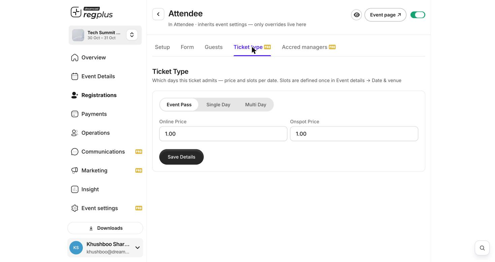
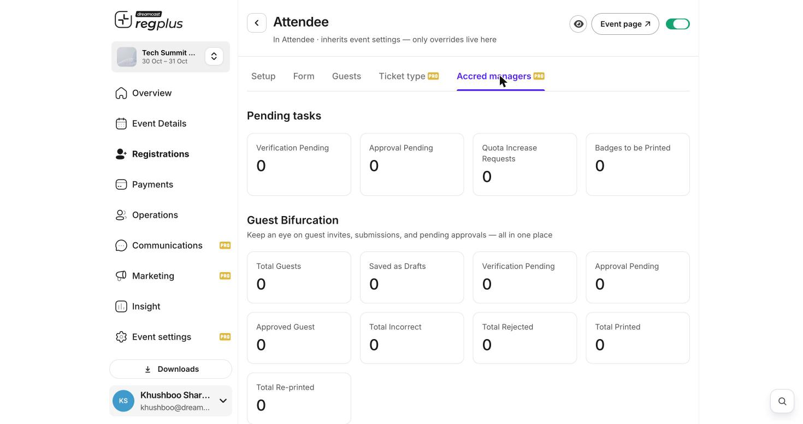

## In short

Every ticket type has two advanced tabs beyond the basics: **Ticket type** (which days it admits and its online vs on-spot price) and **Accred managers** (a dashboard for verifying and approving guests before they are confirmed). Both are Pro.

<Info>
**Where to find them:** Open **Registrations**, click **Manage** on a ticket type, and use the **Ticket type** and **Accred managers** tabs.
</Info>

## Ticket type — days and dual pricing

This tab controls which days the ticket admits and sets two prices — one for online buyers and one for people who pay at the venue.

<Frame caption="The Ticket type tab — admission type and online vs on-spot price.">
  
</Frame>

| Setting | What it does |
| --- | --- |
| **Event Pass** | The ticket admits the guest to **all days** of the event. |
| **Single Day** | The ticket is valid for **one** day only. |
| **Multi Day** | The ticket is valid for a **chosen set** of days. |
| **Online Price** | The price a guest pays when registering online. |
| **Onspot Price** | The price charged at the venue for a walk-in — often set higher than online to reward early booking. |

<Note>
The days a ticket can admit come from the **slots** you set once in **Event Details → Date & venue**. Set those up first, then choose how this ticket maps to them here.
</Note>

Click **Save Details** to apply.

## Accred managers — verify and approve guests

For events where registrations must be checked before they are confirmed (accreditation), the **Accred managers** tab is your control panel for that ticket type.

<Frame caption="The Accred managers dashboard — pending tasks and a full status breakdown.">
  
</Frame>

**Pending tasks** are the things waiting on you:

| Count | What it means |
| --- | --- |
| **Verification Pending** | Registrations whose details still need checking. |
| **Approval Pending** | Registrations waiting for your yes/no. |
| **Quota Increase Requests** | Requests to raise an invite admin's quota. |
| **Badges to be Printed** | Approved guests whose badge has not been printed yet. |

**Guest Bifurcation** is the full status breakdown for the ticket type — Total Guests, Saved as Drafts, Verification Pending, Approval Pending, Approved Guest, Total Incorrect, Total Rejected, Total Printed and Total Re-printed — so you can see the whole accreditation pipeline in one place.

<Tip>
Use this tab when your event needs vetting — press, VIPs, or restricted zones. Guests register, you verify and approve them here, and only then are they confirmed and their badge printed.
</Tip>

## FAQs & troubleshooting

<AccordionGroup>
  <Accordion title="Why would I charge a different price on-spot?">
    **Onspot Price** lets you reward early online booking with a lower price and charge walk-ups more at the door — a common way to push pre-registration.
  </Accordion>
  <Accordion title="A ticket should only be valid on day one. How?">
    On the **Ticket type** tab, choose **Single Day** (or **Multi Day** for a chosen set). Make sure your event's days are set in **Event Details → Date & venue** first.
  </Accordion>
  <Accordion title="Guests are confirmed before I can check them.">
    Those registrations aren't going through approval. Use an approval-based flow so they land in **Approval Pending** on the Accred managers tab for you to review.
  </Accordion>
  <Accordion title="What is 'Badges to be Printed'?">
    Approved guests whose badge hasn't been printed yet. Clear them by printing from your badge/on-ground tools.
  </Accordion>
</AccordionGroup>

## What's next?

<CardGroup cols={2}>
  <Card title="Build ticket types" icon="ticket" href="/regplus/how-to-ticket-types">
    The basics of categories, pricing and limits.
  </Card>
  <Card title="Design badges" icon="id-badge" href="/regplus/how-to-badges">
    Set up the badges printed for approved guests.
  </Card>
</CardGroup>
