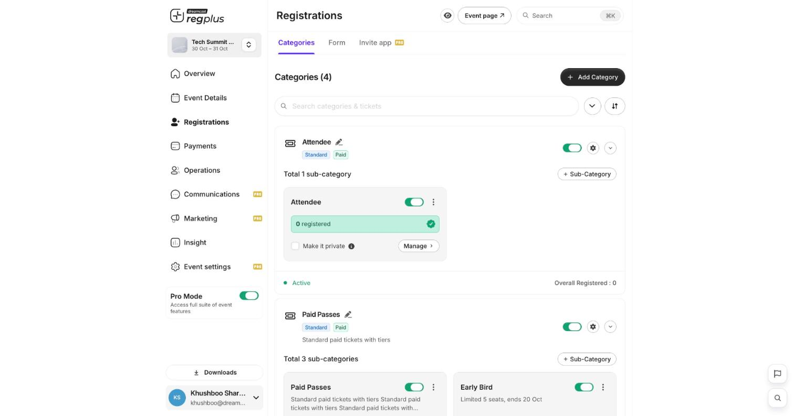
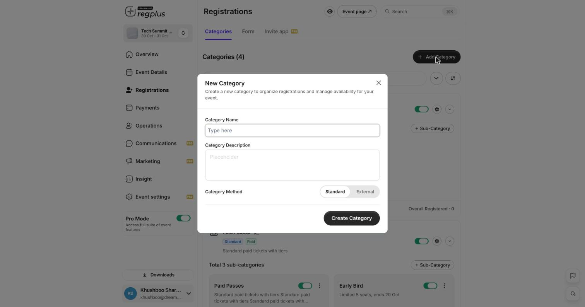
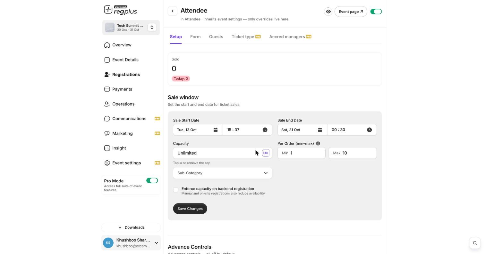

**In short:** In regplus a **category** groups what people sign up for, and inside it you add **ticket types** (sub-categories) — each with its own price, sale window and limits. You manage all of this under **Registrations → Categories**.

## The category matrix

<Frame>
  
</Frame>

- A **category** (e.g. _Attendee_, _Paid Passes_) is the top-level group, tagged **Standard** or **Paid**.
- Each category holds one or more **ticket types** (sub-categories), each with its own **Manage** controls and registered count.
- Use the **toggle** to turn a category or ticket type on/off, the **gear** for its settings, and **+ Sub-Category** to add another ticket type.

## Step 1 — Add a category

<Steps>
  <Step title="New category">
    Click **Add Category**.

    <Frame>
      
    </Frame>
  </Step>
  <Step title="Name it and pick a method">
    Give it a **name** and optional **description**, then choose the **Category Method**:

    - **Standard** — people book this on regplus.
    - **External** — sends people to another website to book (see [Send guests to an external page](/regplus/how-to-external-link)).
  </Step>
  <Step title="Create">
    Click **Create Category**. Then add ticket types inside it with **+ Sub-Category**.
  </Step>
</Steps>

## Step 2 — Set up a ticket type

Click **Manage** on a ticket type to open its **Setup** tab.

<Frame>
  
</Frame>

| Setting | What it does |
| --- | --- |
| **Sale window** | The **start and end date/time** this ticket is on sale. Use it for early-bird tiers that close before the regular ones. |
| **Capacity** | How many can be sold. Tap the **∞** to remove the cap (unlimited). |
| **Per Order (min–max)** | The fewest and most of this ticket one order can include. |
| **Enforce capacity on backend registration** | When on, **manual and on-site registrations also reduce availability** — keep it on so your cap is a true limit. |

Click **Save Changes**. The **Manage** view also has **Form**, **Guests**, **Ticket type** and **Accred managers** tabs for that ticket type.

## Step 3 — Price it, or make it private

- **Pricing** — set a ticket free, or switch on **Paid** and enter a price (paid tickets need a payment gateway — see [Configure payments & taxes](/regplus/how-to-configure-payments)).
- **Make it private** — tick this on a ticket type to hide it from your public page; only people with its private link can book it (see [Make an event invite-only](/regplus/how-to-invite-only-event)).

## FAQ

<AccordionGroup>
  <Accordion title="What's the difference between a category and a ticket type?">
    A **category** is the group (like _Delegate_); a **ticket type** (sub-category) is the specific option inside it (like _Early Bird_ or _Regular_) with its own price and sale window.
  </Accordion>

  <Accordion title="How do I run early-bird pricing?">
    Add two ticket types: an **early-bird** with a sale window that ends on a date, and a **regular** one whose window opens after. Buyers automatically see whichever is on sale.
  </Accordion>

  <Accordion title="My cap isn't holding when I add guests manually">
    Turn on **Enforce capacity on backend registration** in the ticket type's Setup. Otherwise manual and on-site registrations don't count against the cap.
  </Accordion>
</AccordionGroup>

## What's next?

<CardGroup cols={2}>
  <Card title="Build your registration form" icon="list-check" href="/regplus/how-to-registration-form">
    Decide what you ask each guest.
  </Card>

  <Card title="Create discount codes" icon="tag" href="/regplus/how-to-create-discounts">
    Offer money off selected ticket types.
  </Card>
</CardGroup>
