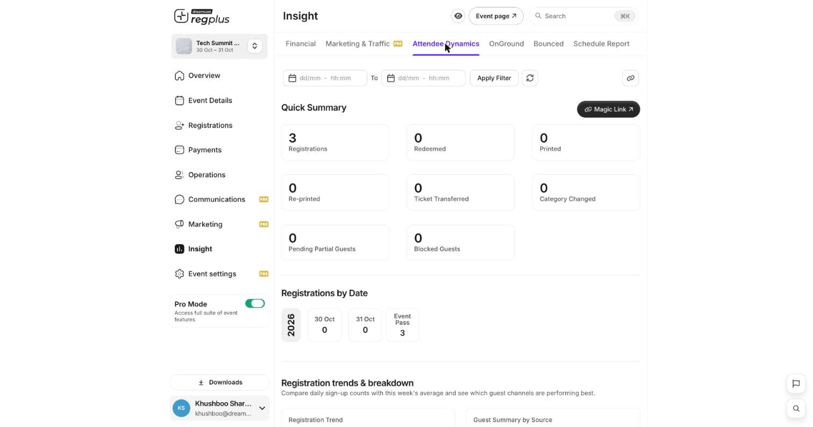

The **Attendee Dynamics** report under **Insight** is the people view — who registered and what happened to their tickets. Open **Insight → Attendee Dynamics** to see it.

<Frame caption="Attendee Dynamics — a summary of registrations and ticket activity, plus trends.">
  
</Frame>

## Quick Summary

The cards count the key attendee actions:

| Stat | What it means |
| --- | --- |
| **Registrations** | Total people registered. |
| **Redeemed** | How many have been checked in / redeemed. |
| **Printed / Re-printed** | Badges printed, and printed again. |
| **Ticket Transferred** | Tickets moved to another person. |
| **Category Changed** | Guests moved between ticket types. |
| **Pending Partial Guests** | Started but didn't finish registering. |
| **Blocked Guests** | Guests you've blocked. |

## Registrations by date & trends

Below the summary, **Registrations by Date** and **Registration trends & breakdown** show daily sign-up counts and a **Guest Summary by Source**, so you can see which channels perform best over time and when your sign-ups peak.

## Filter by date

Use the date range at the top and click **Apply Filter** to focus on a period.

<Tip>
  Watch **Pending Partial Guests** — these are people who nearly registered. Turn on the _Resume Cart_ reminder to win some of them back.
</Tip>

## FAQs

<AccordionGroup>
  <Accordion title="Registrations and Redeemed are far apart on event day.">
    That's your no-show gap — registered but not checked in. A reminder the day before, and smooth on-ground check-in, both narrow it.
  </Accordion>

  <Accordion title="What counts as a transfer or category change?">
    A **transfer** moves a ticket to a new person; a **category change** moves a guest to a different ticket type. Both are tracked here.
  </Accordion>
</AccordionGroup>

## What's next?

<CardGroup cols={2}>
  <Card title="Read your Insight reports (detailed)" icon="chart-line" href="/regplus/how-to-insight-reports">
    The full walkthrough of every report.
  </Card>

  <Card title="Financial report" icon="indian-rupee-sign" href="/regplus/insight-financial">
    See the money side.
  </Card>
</CardGroup>
