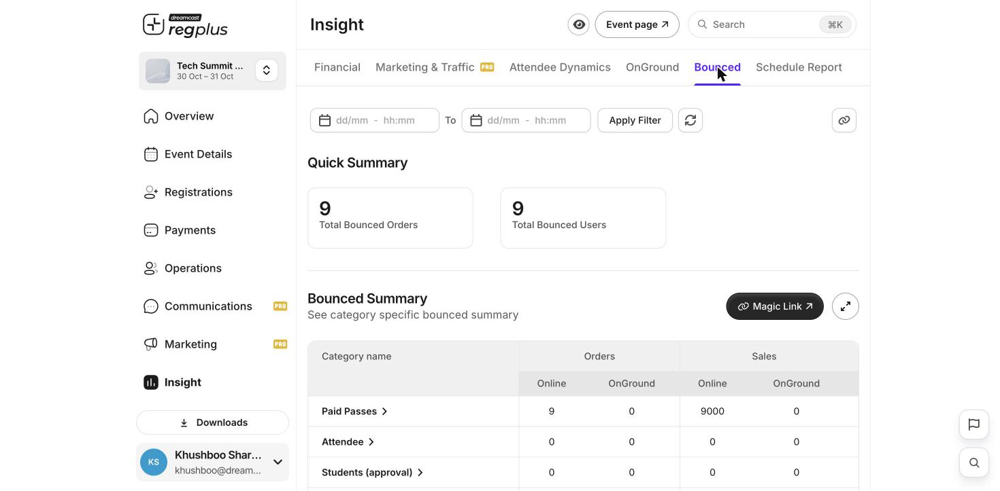

The **Bounced** report under **Insight** shows orders that didn't go through cleanly — for example, payments that were charged but not completed. Open **Insight → Bounced** to see it.

<Frame caption="The Bounced report — totals and a summary by ticket type.">
  
</Frame>

## Quick Summary

| Stat | What it means |
| --- | --- |
| **Total Bounced Orders** | How many orders bounced. |
| **Total Bounced Users** | How many people those orders belong to. |

## Bounced Summary

The table breaks the bounced orders down by ticket type, with orders and sales split across online and on-ground channels. Use the **Currency** selector to switch between currencies.

## Filter by date

Use the date range at the top and click **Apply Filter** to focus on a period.

<Tip>
  A high number of bounced orders usually points to payment trouble at checkout. Cross-check with **Pending Payments** in the [Financial report](/regplus/insight-financial), and review your gateway setup if the number keeps climbing.
</Tip>

## FAQs

<AccordionGroup>
  <Accordion title="What makes an order bounce?">
    Typically a payment that was started but not completed, or was reversed. Guests can finish from their email link, or you can confirm them manually.
  </Accordion>

  <Accordion title="Bounced orders keep climbing.">
    Check your payment gateway configuration and whether a particular ticket type or payment method is failing — the summary breaks it down so you can spot the pattern.
  </Accordion>
</AccordionGroup>

## What's next?

<CardGroup cols={2}>
  <Card title="Financial report" icon="indian-rupee-sign" href="/regplus/insight-financial">
    Compare with pending payments and revenue.
  </Card>

  <Card title="Configure payments & taxes" icon="sliders" href="/regplus/how-to-configure-payments">
    Review your gateway setup.
  </Card>
</CardGroup>
