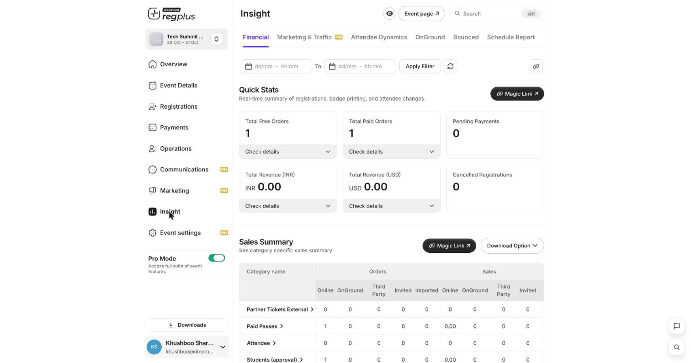

The **Financial** report under **Insight** gives you a real-time picture of how your event is selling. Open **Insight → Financial** to see it.

<Frame caption="The Financial report — quick stats and the sales summary.">
  
</Frame>

## Quick Stats

The cards at the top give you the headline numbers at a glance:

| Stat | What it means |
| --- | --- |
| **Total Free Orders** | Orders on free ticket types. |
| **Total Paid Orders** | Orders on paid ticket types. |
| **Pending Payments** | Orders where payment hasn't gone through yet. |
| **Total Revenue (INR / USD)** | Money collected, split by currency. |
| **Cancelled Registrations** | Registrations that were cancelled. |

Click **Check details** on any card to drill into the orders behind the number.

## Sales Summary

Below the stats, the **Sales Summary** table breaks your orders and sales down by ticket type and by **channel** — Online, OnGround, Third Party, Invited and Imported — so you can tell exactly where your registrations come from.

| Channel | What it is |
| --- | --- |
| **Online** | Self-service registrations on your event page. |
| **OnGround** | Walk-ins registered at the venue. |
| **Third Party** | External or partner sources. |
| **Invited** | Came through invites. |
| **Imported** | Uploaded by you. |

## Filter and share

Use the **date range** at the top and click **Apply Filter** for a specific period, and the refresh icon for the latest figures.

<Tip>
  Use **Download Option** to export the figures, and **Magic Link** to share a live view with someone who doesn't have backend access.
</Tip>

## FAQs

<AccordionGroup>
  <Accordion title="Revenue looks lower than expected.">
    Check for **Pending Payments** — those orders aren't counted as revenue until they complete. A high pending count can also point to checkout problems (see the Bounced report).
  </Accordion>

  <Accordion title="How do I see which channel sells best?">
    Read the **Sales Summary** — each ticket type's orders and sales are split by channel, so Online vs OnGround vs Invited is clear.
  </Accordion>
</AccordionGroup>

## What's next?

<CardGroup cols={2}>
  <Card title="Check bounced orders" icon="arrow-rotate-left" href="/regplus/insight-bounced">
    Spot payments that didn't complete.
  </Card>

  <Card title="Schedule reports by email" icon="clock" href="/regplus/insight-schedule-report">
    Have this report delivered automatically.
  </Card>
</CardGroup>
